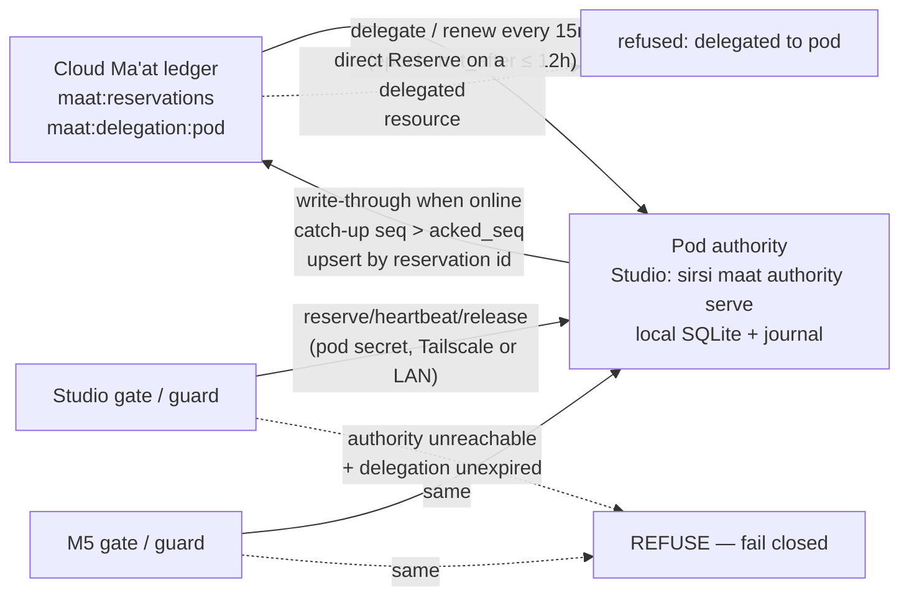

# ADR-120: Pod-Local Ma'at Booking Authority (ADR-062 Exception for One Resource)

## Status
**Proposed.** Owner decision 2026-10-22, given verbatim in Mercury's session ("go with
option 2"), authorizes this design to go ahead. This document is the ADR text promised
back to the owner for review; he has not yet signed off on the text itself.
Design owner: Ra.

Related:
- ADR-062: the router as a service, with a single canonical ledger. This ADR amends it.
- ADR-069: the durable ordered outbox.
- ADR-067: credentialed machine identity.
- ADR-040: do no harm to the running host.
- A35: scope the check to the claim.
- A37: a record exists only on origin.

Revision 2 (Ra lead session, 2026-10-22) builds on the first draft at 0c41d330.
That draft settled the requirements; revision 2 settles the mechanism:
- **Authority.** The pod authority holds its resources for as long as its
  delegation is live, not only while the cloud is unreachable. A rule based on
  reachability makes two authorities whenever one Mac can see the cloud and
  another cannot, which is the failure the owner ruled out.
- **Decided, not left open.** Authority placement, renewal, the fence and the
  idempotency key are now decided.

## Context

ADR-062 put the router, and the Ma'at reservation ledger that rides on it
(`internal/maat/schedule`, one state key `maat:reservations`), behind a single
cloud store. Every Ma'at call (`reserve`, `heartbeat`, `release`, `who-is-on`)
is a read-modify-write on that key, so with no internet:
- no guarded run can start;
- the front-door gate `sirsi-maat-run` refuses, as observed on the M1 on
  2026-10-22 when one service call timed out.

The owner's requirement: guarded Mercury and Apollo runs must work offsite with
only Tailscale or a LAN between the Macs. The requirements he was told, and
approved:
- one authority per pod, never two ledgers that reconcile after the fact;
- a finite, fenced delegation;
- reconciliation exactly once when the cloud returns;
- fail closed when neither the cloud nor the pod authority is reachable.

## Decision

Amend ADR-062 for exactly one resource class: **Ma'at reservations on resources
that a delegation names.** Router items, tasks, threads and every other state
key stay on the single canonical service.

### 1. The delegation record (canonical, cloud)

The state key `maat:delegation:<pod>` holds one JSON document:

| Field | Meaning |
|---|---|
| `pod` | Pod id, e.g. `studio-m5` |
| `authority_machine` | Machine-registry id that hosts the authority, e.g. `M5-Studio` |
| `authority_addrs` | The addresses the authority serves on (Tailscale first, then LAN) |
| `resources` | Exact resource ids delegated, e.g. `studio`, `m5`, `rail-a` |
| `epoch` | Monotonic integer; the fence (§3) |
| `issued_at`, `not_after` | `not_after` is at most `issued_at + 12h`; finite (§4) |
| `acked_seq` | Highest pod journal sequence the cloud has reconciled (§5) |
| `pod_secret_hash` | Hash of the pod's shared secret (§6) |

- **Created by** `sirsi maat delegate --pod … --authority … --resources …`.
  Ra or the owner runs it while online.
- **Revoked by** `sirsi maat delegate --revoke`.
- **Overlap check:** a resource can belong to at most one live delegation. A
  create that overlaps another live delegation is refused.

### 2. One authority for delegated resources, always

While a delegation is live, its resources are booked **only** by the pod
authority, whether or not the cloud is reachable.

- **The cloud ledger refuses direct bookings.** `Reserve` on a delegated
  resource returns "delegated to pod `<pod>` (epoch N) at `<addr>`" and grants
  nothing.
- **While online, the authority writes through.** Each grant it makes is copied
  to the canonical ledger immediately, so the cloud record stays current.
- **Pod authority = `sirsi maat authority serve`** on `authority_machine`.
  - It runs the existing `schedule.Ledger` over a local SQLite `StateStore`, so
    the grant rules are unchanged: floor share, cedes, lease TTL and expiry.
  - It serves on the Tailscale and LAN addresses only.
- **One authority, no failover.**
  - If that Mac is off, the pod fails closed.
  - Moving authority means a new delegation, which needs the cloud.
  - The authority never manufactures authority on a second Mac. This is the
    owner's "no stale cached lease" rule, applied to the authority itself.

### 3. The fence

- **The epoch.** Every new delegation, or change of `authority_machine`, bumps
  `epoch`.
- **Stamped grants.** Every grant the pod authority makes carries
  `authority: "pod:<pod>"`, `epoch` and `seq`.
- **The authority checks itself.** When it can reach the cloud (each renewal,
  §4), it compares its epoch with the record. If they differ, or the record is
  revoked, it stops granting at once and returns "fenced: epoch N superseded".
- **The cloud enforces the fence.** It records grants from an old epoch as
  history (they really happened), but never accepts one as current authority
  for a resource.

### 4. Finite delegation and renewal

- **Renewal.** While the cloud is reachable, the authority renews every 15 min,
  moving `not_after` to now + 12 h.
- **Expiry.** With no renewal, the delegation expires at most 12 h after the
  cloud was last seen. At `not_after` the authority stops granting, so the pod
  fails closed.
- **Handback.** The cloud treats the resources as its own again only after
  `not_after` + 5 min, a margin for clock skew. So there is never a moment when
  both could grant.
- **Running jobs.** Live reservations keep their own heartbeat leases (120–240 s
  today) and are never cut off mid-run by renewal timing.

### 5. Reconciliation exactly once

- **The pod journal.** The authority appends every grant and every state change
  (heartbeat excluded; release, expire, done and invalidate included) to a local
  journal with a monotonic `seq`. The journal is fsynced before the caller gets
  its answer.
- **Catch-up.** When the cloud is reachable, the authority replays
  `seq > acked_seq` in order.
  - Each entry is an **upsert by reservation ID** into `maat:reservations`, so a
    replay after a crash rewrites the same row; it never adds a second.
  - Then `acked_seq` is advanced.
  - A crash between the two writes only causes a harmless second upsert of the
    same row.
- **Queued intent stays queued.** A caller that could not reach the authority
  holds no grant; its request is not in the journal and is never "reconciled
  into" a grant.

### 6. Client resolution, auth and fail closed

- **Cache.** The gate (`sirsi-maat-run`, Mercury's guard, Apollo's runner)
  caches the delegation record locally (0600) whenever the cloud is reachable.
- **Delegated resource:** ask the authority at `authority_addrs`.
  - If it is unreachable, **refuse.** Never fall back to the cloud or to a local
    grant while the cached delegation is unexpired.
  - If the cache says the delegation has expired, use the cloud. If the cloud is
    unreachable too, **refuse.**
- **Any other resource:** the cloud, as today. If unreachable, refuse (unchanged).
- **Auth.**
  - **Pod secret.** Pod members authenticate to the authority with a pod secret
    issued with the delegation and installed 0600 on each member while online.
    It rotates every epoch, so revoking or moving the authority invalidates the
    old secret.
  - **The cloud token never leaves a Mac.** The ADR-062 host token stays with
    that Mac's relay. The authority never holds or forwards cloud tokens; its
    write-through and catch-up use its own host's relay.
- **The gate's other cloud calls.** Thread register and heartbeat must not
  block a run that has a valid pod grant: they queue through the ADR-069 outbox.
  Ma'at admission is the only call that must succeed.

### 7. Deployment (owner directive 2026-10-22, services run on their own)

- **A signed launchd service.** The pod authority ships as a signed launchd
  service on the pod Macs, installed through the normal signed package path.
- **Never hosted by a lane.** It is never a process that an AI lane (a Claude
  or Codex session, an IDE) starts or keeps alive.
- **Started by the user.** It starts when the user starts it: at login, from
  the app, or by launching the binary.
- **Boot start is opt-in.** Starting at boot or login is something the user
  enables (Login Items or an explicit launchd job), not a silent default.
- **Kept alive by launchd.** Once running, launchd keeps it alive and restarts it.
- **Lanes support it, never host it.** Ra, Mercury and Apollo develop, deploy
  and diagnose it.

### Non-goals

- **No second general-purpose ledger.** Router items, tasks and threads stay
  canonical.
- **No change to the supervised front door.** The pod authority decides which
  grant exists, not whether a command may run unsupervised.
- **No automatic failover or leader election.** A second authority would need a
  consensus protocol. That is out of scope until a measured need exists.

## Data flow

## Implementation order

1. **Delegation schema and fence on the cloud side.** The `maat:delegation`
   record, `maat delegate` / `--revoke`, the cloud refusing delegated resources,
   and upsert-by-ID. Unit tests: overlap refusal, epoch fence, upsert idempotency.
2. **`maat authority serve`.** The existing `schedule.Ledger` over SQLite, the
   journal, catch-up, renewal and self-fencing. Tests:
   - crash between upsert and ack: no duplicate row;
   - expiry stops granting;
   - superseded epoch stops granting.
3. **Client resolution in the gate, guard and runner.** Delegation cache,
   refuse-on-unreachable, and outbox-queued thread calls.
4. **Acceptance test** (below), run by Mercury with the owner cutting internet.

Steps 1 and 2 are Ra's. Step 3 is shared: Ra does the gate, Mercury the guard,
Apollo its runner. SSA keeps service and deploy custody.

## Key decisions

| Question | Options | Decision |
|---|---|---|
| When is the pod authority in charge? | (a) only while the cloud is unreachable; (b) whenever its delegation is live | **(b).** (a) splits authority whenever reachability differs between Macs. |
| Failover if the authority's Mac dies? | (a) elect a new leader in the pod; (b) fail closed until a new delegation | **(b).** (a) needs consensus. Fail closed is the owner's rule. |
| Delegation length | short (1 h) / long (12 h) / unbounded | **12 h, renewed every 15 min.** Finite, and covers an evening offsite. |
| Idempotency key | content hash / reservation ID + journal seq | **Reservation ID (upsert) + seq watermark.** IDs already exist and are unique. |
| Authority store | reuse `schedule.Ledger` over a new `StateStore` / a new ledger | **Reuse.** Same grant rules; only the store differs. |
| Pod auth | cloud host tokens / pod secret per epoch | **Pod secret per epoch.** Cloud tokens never leave their Mac. |

## Verification (Mercury's pre-registered acceptance test, 2026-10-22)

**Setup:** the M1 is offline, and the owner cuts the pod's internet. No agent
changes any radio.

**Pass conditions:**
- A Run started from the Studio's page and from the M5's page each reaches done
  at about 42 GB/s.
- Each has a guard verdict and a **new** reservation granted by the pod
  authority.
- After internet returns, the canonical ledger shows those reservations
  reconciled **exactly once**: one row per reservation ID, and `acked_seq` equal
  to the journal head.

**Negative control:** with the pod authority also down, the run is refused.

**Added by revision 2:** with the delegation revoked from the cloud while the
pod is online, the next pod grant is refused with "fenced".

## Owners

- **Ra:** this ADR, the delegation and fence (steps 1–2), and the gate side of step 3.
- **Sirsi Software Admin:** Ma'at service and deployment custody
  (`maat-local-first-admission-20261022`).
- **Mercury:** maat-run-guard and the run conductor (step 3), and the acceptance test.
- **Apollo:** the same client resolution for its pod runs.

## Dates

- **2026-10-22:** this revision to the owner.
- **2026-10-23:** steps 1–2 schema and interfaces with unit tests, on a branch.
- **2026-10-24:** first working slice: delegation, authority and fence, gate
  client on one pod, tests green. Ready for Mercury's acceptance run when the
  owner can cut internet.
