# Sleeve MPI architecture and qualification brief

**Owner direction preserved 2026-09-10 • Research • Diligence only**

Sirsi Software Admin prepared this brief for the owner and the hardware, runtime and Pantheon implementers. It maps the owner's September 3 direction into interfaces and qualification gates. It is a design specification; no transport, hardware, bandwidth or enterprise qualification is asserted.

Authority is the owner brief in router item `20260903-010339-codex-deck-codex-nexus-owner-architecture-brief-sleeve-mpi-fabric-and-exo-distincti`, reassigned as `20260910-051359-ra-sirsi-software-admin-reassigned-from-codex-nexus-owner-architecture-brief-sleeve-`. Portfolio identity follows `SIRSI_MANIFESTO.md`. Sleeve belongs to Sirsi IO Connect. Mac is the premium first target, not a limit on Sirsi's market.

## Architecture decision

Every qualified Mac runs its workload runtime and an MPI participant. Pantheon governs identity, admission, lifecycle, policy, recovery and evidence above the payload path. SNE qualifies inference execution. The communications implementation beneath MPI selects an explicitly qualified transport. An RDMA-capable endpoint may accelerate movement only when the complete endpoint, operating system, driver and fabric tuple proves it.

Thunderbolt 5 is the proposed Mac attachment and PCIe tunneling path. It does not establish that an arbitrary Mac, adapter or optical assembly supports RDMA. MPI describes the programming and communication interface; it does not determine physical topology or provide governance.

## Physical and control topology

Solid arrows carry workload messages. Dashed arrows are Pantheon control and evidence. Every endpoint marked proposed must be qualified before implementation claims.

```mermaid
flowchart LR
  P[Pantheon policy and lifecycle]
  subgraph A[Qualified Mac A]
    WA[SNE or workload runtime] --> MA[MPI participant A]
    MA --> CA[Communications implementation A]
    CA --> EA[Transport endpoint A proposed]
  end
  subgraph S[Proposed Sleeve fabric]
    TA[TB5 attachment A] --> FA[Sleeve endpoint A]
    FA --> F[Qualified fabric]
    F --> O[Electrical link or qualified optical extension]
    O --> FB[Sleeve endpoint B]
    FB --> TB[TB5 attachment B]
  end
  subgraph B[Qualified Mac B]
    EB[Transport endpoint B proposed] --> CB[Communications implementation B]
    CB --> MB[MPI participant B]
    MB --> WB[SNE or workload runtime]
  end
  EA <--> TA
  TB <--> EB
  P -. admission and recovery .-> A
  P -. identity and health .-> S
  P -. admission and recovery .-> B
```

Arrows show one logical direction; the qualified implementation must prove both directions and collective traffic. The diagram specifies boundaries, not an electrical schematic, chosen switch, lane allocation or replicable protocol recipe.

## Declared assumptions

The initial qualification fixture has two explicitly identified Macs and two Sleeve endpoints. No particular chip, port count, line rate, optical reach, switch or MPI distribution is selected by this brief. Record exact hardware and software identities before testing. Additional nodes, multiple ports and optical extension are independent qualification steps; neither link-rate sums nor single-node memory bandwidth predict application throughput.

MPI ranks run on the Macs. Sleeve forwards inter-node communications; it is not assumed to execute MPI ranks. The control channel is logically distinct from the data channel and must remain observable under data-path failure. An optical extension is optional and unqualified until its full path passes; an electrical baseline must remain available for attribution.

## Interface contracts

| Boundary | Required contract | Accountable implementation owner |
| --- | --- | --- |
| Pantheon to node | Signed tuple identity, admission/refusal, start/cancel/deadline, health, terminal result, rollback | Pantheon |
| Workload to MPI | Rank/world membership, tensor/message shape and dtype, ordering, collective semantics, error and cancellation mapping | SNE with distributed-runtime implementer |
| MPI to communications | Supported MPI implementation/version, selected provider, explicit fallback/refusal, completion and memory lifetime | Distributed-runtime implementer |
| Communications to endpoint | Registration, buffer ownership, completion visibility, bounds, endpoint identity and failure semantics | Hardware and transport implementers |
| TB5 to Sleeve | Enumerated device/port, negotiated mode, topology, power/hotplug and error telemetry | Hardware Admin |
| Fabric to optical extension | Exact transceiver/cable/reach identities, compatibility, payload errors and recovery | Hardware Admin |
| Evidence to Hypergraph | Local authoritative receipts and privacy-safe projections; no raw prompts, weights or credentials in shared telemetry | Pantheon and Hypergraph |

Implementation ownership follows each repo's current registered lane. These are responsibility boundaries, not permission to alter another repo.

## Qualification matrix before public claims

| Proposed claim | Required proof and refusal criterion |
| --- | --- |
| MPI execution | Two-node rank launch, point-to-point and collective correctness, exact implementation/version and workload results; refuse mismatched membership or unsupported operation |
| RDMA capability | Supported OS/driver/device/provider tuple, buffer registration and completion correctness, actual selected path observation; refuse silent socket or CPU fallback |
| TB5 attachment | Actual enumeration and negotiated mode for every port/cable/endpoint under concurrent use; no inference from connector shape or vendor maximum |
| Optical extension | Exact electrical baseline comparison, optical component identities and reach, payload integrity, error rate, hotplug and recovery; no copper result reused as optical proof |
| Multi-node execution | Rank-to-node identity, partition/shard contract, exact result parity, failed-rank and network-partition behavior; no single-node result relabeled distributed |
| Bandwidth | Payload bytes per elapsed time at application boundary, bidirectional/collective cases, message sizes, repetitions and variance; distinguish line rate from goodput |
| Latency | Warm/cold and message-size distributions, p50/p95/p99, end-to-end workload latency and synchronization accounting |
| Recovery | Link loss, rank crash, cancellation, timeout, restart, sleep/wake and controller loss; bounded resource reclamation and explicit unknown outcomes |
| Enterprise readiness | Identity and authorization, tenant/data isolation, signed update/rollback, clean install/uninstall, audit/support workflow, sustained pressure/thermal tests, documented service limits |

Every packet must name source commits, binary/library hashes, hardware/OS, topology, workload/model identity, semantics, repetitions, rejected samples and limitations. Thresholds must be preregistered for the named workflow before performance testing, not chosen from the result. Until thresholds and measurements exist, readiness is unknown. Host memory and OS-wide pressure must be included; process survival alone is insufficient.

## Test sequence

1. Inventory the two-node fixture and supported transport choices; record explicit unsupported configurations.
2. Prove the electrical message path with fixed patterns and rank/endpoint identities before model loading.
3. Verify MPI ordering, collectives, cancellation and failure propagation on the selected communications provider.
4. Add SNE workload parity and resource admission under an approved exact tuple.
5. Measure payload goodput, latency, end-to-end performance, memory and thermal behavior against the same electrical control.
6. Qualify additional ports, nodes and optical extensions individually, then repeat combined contention and recovery tests.
7. Review evidence independently before changing any claim from designed to qualified. Product release additionally requires support, installation, security, experience and commercial closure.

## Public and diligence boundaries

Public-safe owner wording: “Sirsi Sleeve is a governed, high-bandwidth expansion architecture designed to connect qualified Apple Silicon nodes into a scalable local AI estate.” The word designed is essential until qualification exists.

Detailed transport choices, endpoint designs, MPI integration and optical topology remain diligence-only IP. Qualified diligence language may describe MPI-based distributed execution over an RDMA-capable path; never reverse this into “RDMA over MPI.”

The intended EXO distinction is deliberate topology, qualification, physical productization and Pantheon governance. MPI and a mesh can coexist. No exclusivity, competitor-absence, RDMA/TB5 uniqueness or performance advantage is established here. A current primary-source competitive audit is required before comparative publication.

TechRepublic's August 31 report is attributed category context only, not a Sirsi relationship or technical proof: https://www.techrepublic.com/article/news-openai-mac-mini-mac-studio-ai-agents/ . Source disposition is preserved in the router reply to `20260910-051400-ra-sirsi-software-admin-reassigned-from-codex-nexus-external-validation-source`.

## Commercialization and publication

Classification: research. The user is an operator of an owned multi-node estate; the pain is uncertain connectivity, uncontrolled resource use and unsupported distributed-performance claims. The proposed workflow is identify, admit, execute, observe and recover a qualified workload. Willingness to pay for hardware and operational support remains unvalidated. The trust boundary keeps workload contents local to authorized nodes; operational evidence exposes only permitted metadata. Hardware Admin owns physical qualification, SNE owns runtime correctness, and Pantheon owns operational lifecycle. Success for this brief is an explicit design and test contract, not a shipping product.

Canonical candidate: `sirsi-pantheon/docs/design/SLEEVE_MPI_OWNER_DIRECTION_20260910.md` on branch `ssa/sleeve-owner-brief-20260910`. Desktop mirror: `~/Desktop/Sirsi - Owner Reading Room/Sleeve MPI architecture and qualification brief.md`. Native Workspace copy: pending document-generation runtime availability. The documents skill requires a locally rendered and verified DOCX import; this session has neither its workspace dependency loader nor `container_tools/mark_artifact_operation_started.mjs`. Drive connectivity works, but a direct blank-Doc write would bypass that required workflow. Publication remains incomplete until a verified import and links are recorded. This blocker is mirrored on Desktop and in the router ledger.
