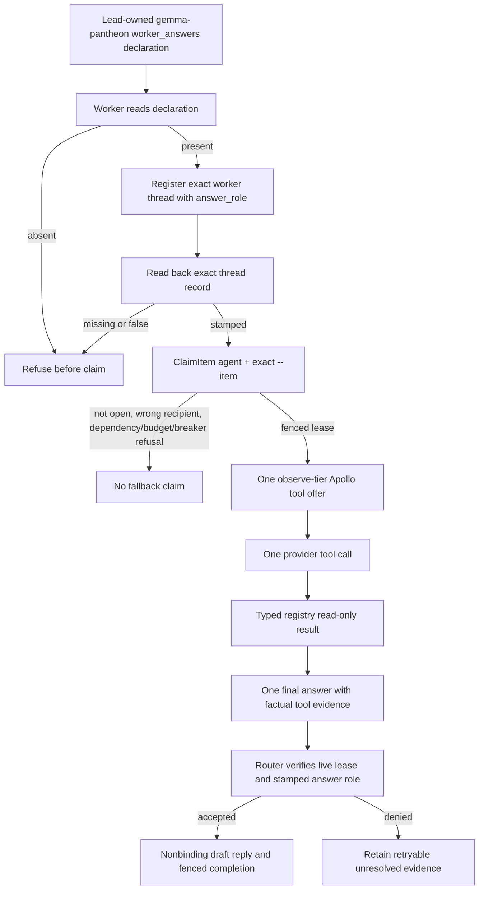

# APOLLO-P01 — Exact-item bounded Apollo worker

Owner: Pantheon. Recipe: `stacklab.recipe.apollo-2.1-bounded-tool-turn`.
Source boundary: `internal/routerstore/lease.go`, `cmd/sirsi/gemma_worker.go`.

The declaration is not self-service: the worker does not alter the registry.
`ClaimItem` is selection-only; it retains the ordinary dispatch eligibility and
lease rules. The client requires a router service that implements `ClaimItem`;
older `ClaimNext` consumers continue to use their existing API.
