# Pantheon PT — Ra/Horus Fabric operations gaps (PT-P57–PT-P67)

Owner: Pantheon PT documentation; Ra owns router authority and its durable
state. These eleven process records turn the finite Astra 11 review gaps into
an inspectable source map. They supplement the existing PT process set and do
not create a store, service, authority, release path, or completion claim.

## Reading and evidence boundary

The diagrams describe repository source and contracts. The pinned
`ra-horus-fabric-recipe-v1.json` is a versioned source inventory, not proof that
its component is installed, running, adopted by every consumer, or qualified in
production. In particular, reading the recipe from the named e26 source snapshot is provenance,
not a runtime receipt. Existing `RA-P01`–`RA-P03` are reusable partial views;
`RA-P04` is not truth for current migration, install, rollback, or service
traffic behavior. `RA-P05` is an SSA review/bind boundary, not Ra service or
runtime evidence.

“Source-described” means the cited implementation declares the behavior.
“Fixture-described” means the named test source exists. Neither means tests ran
in this documentation task. A stale or forced-restart check is not credited as
current runtime behavior. Open / partial evidence stays open / partial. Do not
infer behavior where a recovery action, owner, or receipt is not cited.

The recipe is the cross-component source/test inventory. The Ra canon's
`COMPONENT_CATALOG.md`, `TRACEABILITY_MATRIX.md`, `FABRIC_TASKS_AND_ROLES_V1.md`,
`NATIVE_FABRIC_SELF_DISPATCH_V1.md`, and `FABRIC_SURFACE_PRODUCER_V1.md` define
more detailed authority, privacy, and qualification limits. The PT process
index and component catalog remain unchanged by this file.

---

<a id="pt-p57"></a>
## PT-P57 — Item and task lifecycle, eligibility, and wake settlement

**Owner:** Ra, routerstore. **Requirement/story:** an item or task must retain
its own durable lifecycle, fenced owner, eligibility, dependency facts, and
terminal evidence. A task resume is a separately authorized recovery claim.
The matching direct wake is acknowledged only by its exact successful claim;
proven `DONE` source residue is excluded from execution without rewriting
history. **State:** source-described; deployment and full service qualification
remain separate. Existing RA-P01 partially covers the wake loop.

### Logical and data view

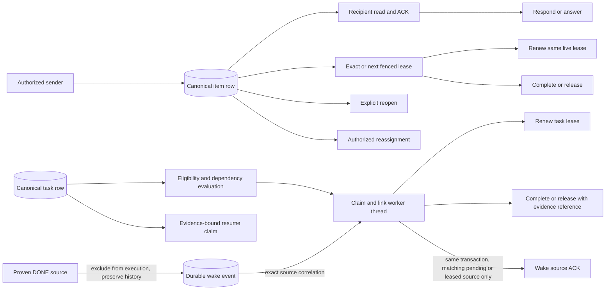

### State and recovery view

Read and ACK are orthogonal metadata on an open item, not additional SQLite
`status` values or claim preconditions. This is a workflow view, with direct
claim paths preserved.

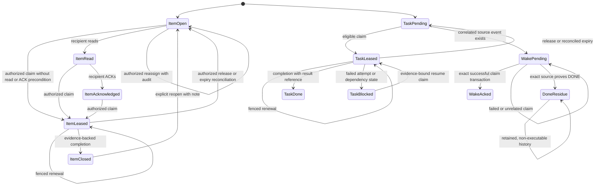

**Recovery:** ordinary lease expiry is reconciled by the durable store; it is
not proof that work completed. `task resume-claim` is a separate history-
preserving path with its own authorization and audit. Failed or foreign claims
do not ACK the source wake. Completed-source exclusion preserves old pending
or leased history and does not fabricate an ACK. No inference is made that
every old event has been repaired or that the service has deployed these paths.

### Actor sequence

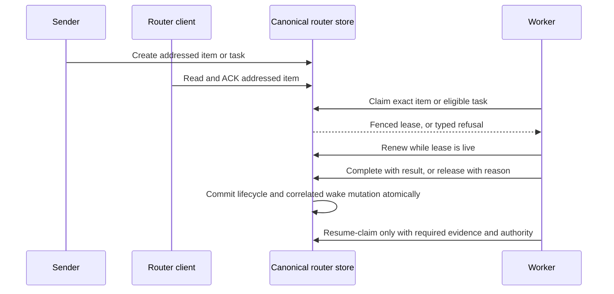

Plain English: message receipt, work ownership, and task completion are
different transitions. A heartbeat or delivery signal is not an ACK. Only the
canonical write that proves the exact transition can settle its corresponding
work source.

**Source / tests:** `internal/routerstore/items.go`, `lease.go`, `tasks.go`,
`tasklease.go`, `taskeligibility.go`, `taskresume.go`, `wakeevents.go`,
`reconcile.go`; `tasklease_direct_wake_test.go`,
`wake_completed_source_test.go`, `taskresume_test.go`,
`taskeligibility_test.go`, `lease_retry_test.go`. Contract: recipe components
`router-service` and `gemma-maintenance-claim-barrier`, plus
`DIRECT_TASK_CLAIM_WAKE_ACK.md` and `COMPLETED_TASK_WAKE_EXCLUSION.md`.
Direct wake ACK and DONE exclusion have explicit qualification/deployment debt;
do not promote these source/test references to a live service claim.

---

<a id="pt-p58"></a>
## PT-P58 — Thread registration, adoption, attended sessions, and closure

**Owner:** Ra for thread authority; Horus for the local workstation observer.
**Requirement/story:** register one runtime identity safely under contention,
refresh its heartbeat, census/adopt only with established identity, preserve
attended-session holds, explicitly resume suspended threads, reconcile exits,
and close/prune only under the matching lifecycle rules. **State:** source and
fixture coverage exists; loaded consumer and fleet adoption are independent.

### Logical and data view

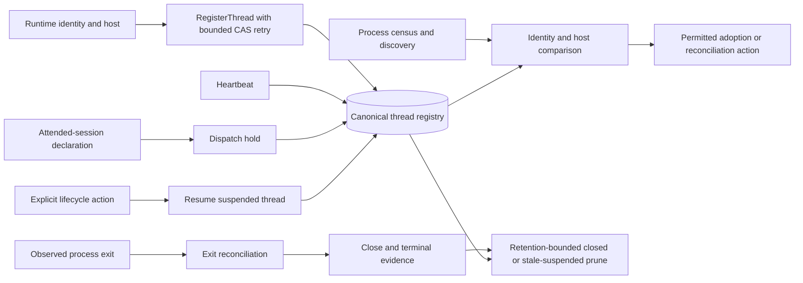

### State and recovery view

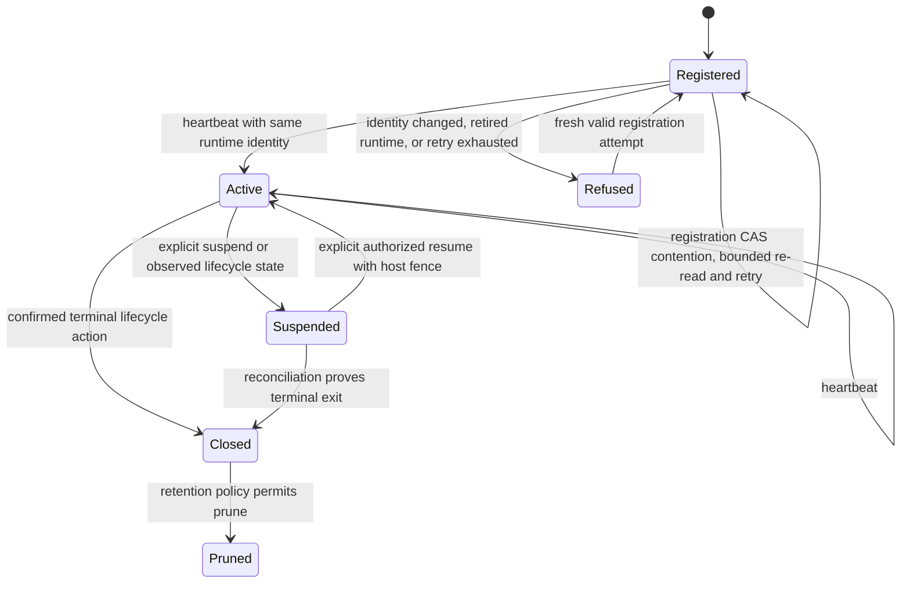

**Recovery:** registration contention uses bounded re-read/re-derive retries;
it must not resurrect a retired runtime or overwrite concurrent registry
changes. A suspended thread is not resumed by a late heartbeat. Cross-host
resume is refused. Census observations and process visibility are not
credentials to adopt another host's thread. Prune is retention-bounded; no
general “stale means close” policy is inferred.

### Actor sequence

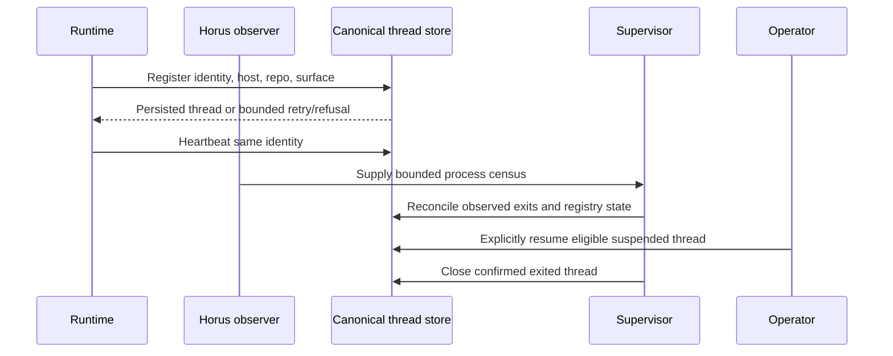

Plain English: the registry records a thread identity and lifecycle; a PID,
heartbeat, attended flag, or local process observation has only the authority
its source defines. Suspend/resume and terminal closure are explicit, fenced
transitions.

**Source / tests:** `internal/router/threads.go`, `register.go`,
`registerretry_test.go`, `attended.go`, `census.go`, `discover.go`,
`supervisor.go`, `sessionreaper.go`, `prune.go`; `internal/router/threads_test.go`,
`attended_test.go`, `census_test.go`, `discover_test.go`,
`supervisor_test.go`, `sessionreaper_test.go`, `prune_test.go`,
`registercompatible_test.go`. Ra canon: `COMPONENT_CATALOG.md` registration
row and `TRACEABILITY_MATRIX.md` registration/observer rows. Existing fixture
names are not a fresh qualification receipt.

---

<a id="pt-p59"></a>
## PT-P59 — Service resolution and authenticated enrollment/session lifecycle

**Owner:** Ra router service. **Requirement/story:** every write resolves to
the canonical service and is bound to authenticated host, session, runtime,
nonce, audience, and expiry. Enrollment, mint, revoke, and cleanup must retain
their narrow authority. An unavailable producer or refused identity cannot
become an empty or successful result. **State:** contract/source described;
current deployment and consumer readback are open where the canon says so.

### Logical and data view

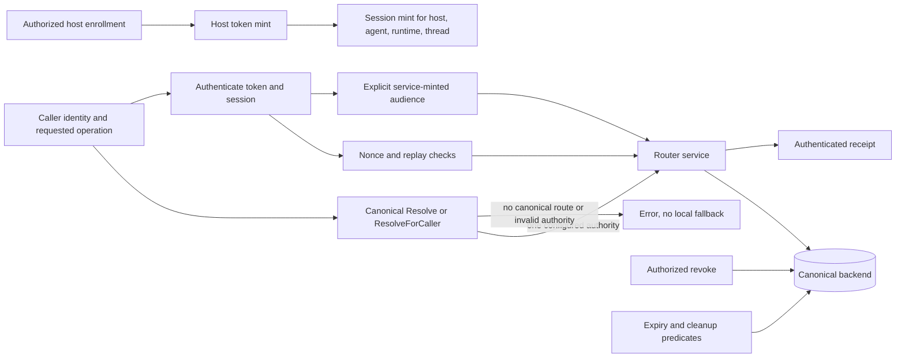

### State and recovery view

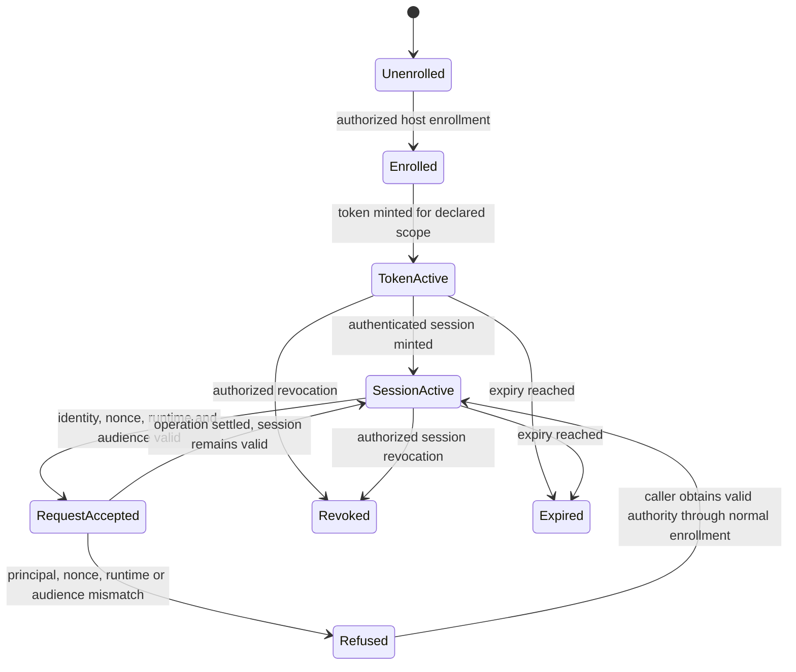

**Recovery:** resolver refusal stays refusal; it does not select a second
database. Expired, revoked, mismatched, or replayed authority must be rejected
by the relevant service boundary. Minting/revocation remains an authorized
service operation. Cleanup is only the concrete cleanup implemented by the
cited service/store path; this diagram does not invent a background expiry
worker, automatic renewal, or a successful service deployment.

### Actor sequence

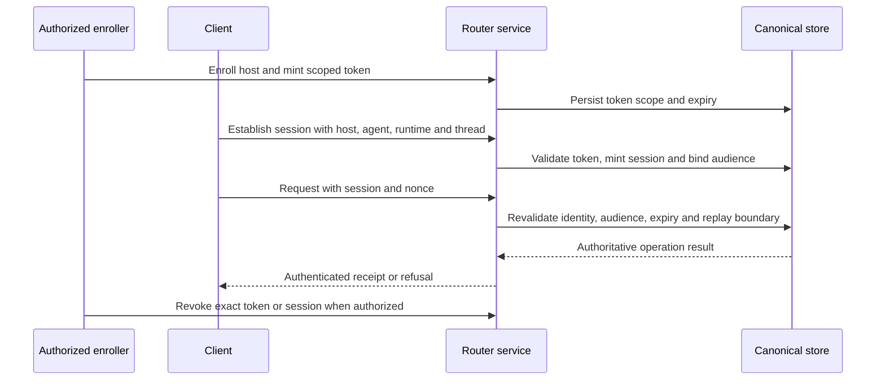

Plain English: the server owns identity validation and the durable result. A
projection cannot authorize a caller, and a locally configured URL or stored
credential alone does not prove service acceptance.

**Source / tests:** `internal/routerstore/resolve.go`, `remote.go`,
`hosttokens.go`, `sessions.go`, `serve.go`, `remote_pin.go`; resolver tests,
`hosttokens_test.go`, `sessioncache_test.go`, `serve_ruleofra_test.go`,
`spool_handshake_test.go`, and `ssa_scope_regression_test.go`. Contract:
recipe components `router-service` and `router-a2a-mcp-shared-core`, plus
`CLOUD_EXECUTOR_IDENTITY.md`. The recipe calls for authenticated audience and
installed-caller qualification; source presence is not service readback.

---

<a id="pt-p60"></a>
## PT-P60 — Relay spool, discovery, in-flight delivery, and repair

**Owner:** Ra for router delivery; the host relay producer owns its private
outbox. **Requirement/story:** publish and discover durable envelopes with
bounded retries, source correlation, lane isolation, retained lock semantics,
honest health, and narrowly scoped repair. Native handoff carries a fixed
sender identity to the canonical service. **State:** several source and fixture
surfaces exist; actual selected producer/consumer adoption remains a separate
release gate.

### Logical and data view

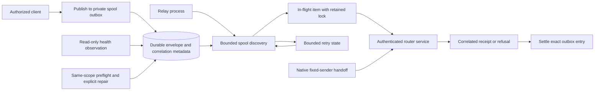

### State and recovery view

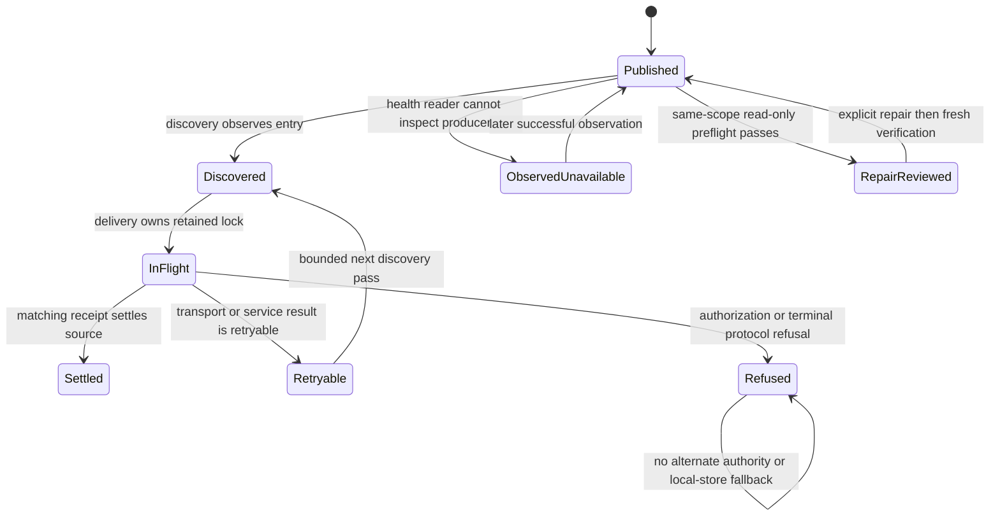

**Recovery:** the relay keeps forwarding lanes independent and bounds
discovery/retry behavior in the spool implementation. Outbox repair requires
the exact existing scope, same-user eligibility, and a fresh verification; a
partial or stale health snapshot is not current truth. Producer permission or
identity is not inferred from group membership. Failed observation must not
stop transport or fabricate empty health. No automatic service restart or
unbounded retry is asserted.

### Actor sequence

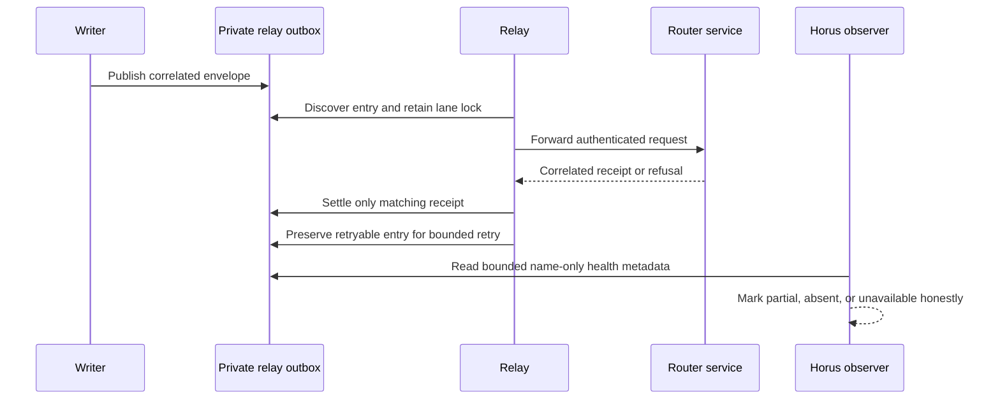

Plain English: the spool is transport custody, not a second router database.
Only a response correlated to the source entry can settle it. Health display
and repair are separate from delivery authority.

**Source / tests:** `internal/routerstore/spool.go`, `spoolobservation.go`,
`spoolobservation_unix.go`, `spoolhealth.go`, `spoolrepair_unix.go`,
`internal/router/nodestatus.go`, `cmd/sirsi/routerrelaycmd.go`, native
`SirsiEngine.swift` handoff and relay observation; `spool_test.go`,
`spool_live_retry_test.go`, `spool_outbox_test.go`, `spoolhealth_test.go`,
`spoolrepair_test.go`, `spoolobservation_unix_test.go`,
`RelayObservationTests.swift`. Contract: recipe components
`relay-owned-outbox-observation`, `router-service`, and `native-handoff`.
Retained service permissions and signed producer adoption remain independent
requirements.

---

<a id="pt-p61"></a>
## PT-P61 — Current wake, consumer quota, observer generation, and adoption

**Owner:** Ra wake runtime; Horus observes local executors. **Requirement/story:**
only current canonical work is eligible for dispatch. Consumer capacity,
provider quota holds, observer identity, loaded executable generation,
post-join refresh, and bounded cleanup must remain separate evidence. A
heartbeat, process existence, or installed file does not prove work or loaded
adoption. **State:** source/fixture evidence is component-specific; successor
release and live suppression/adoption receipts remain open where canon says so.

### Logical and data view

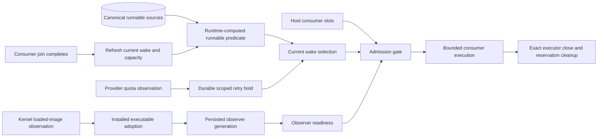

### State and recovery view

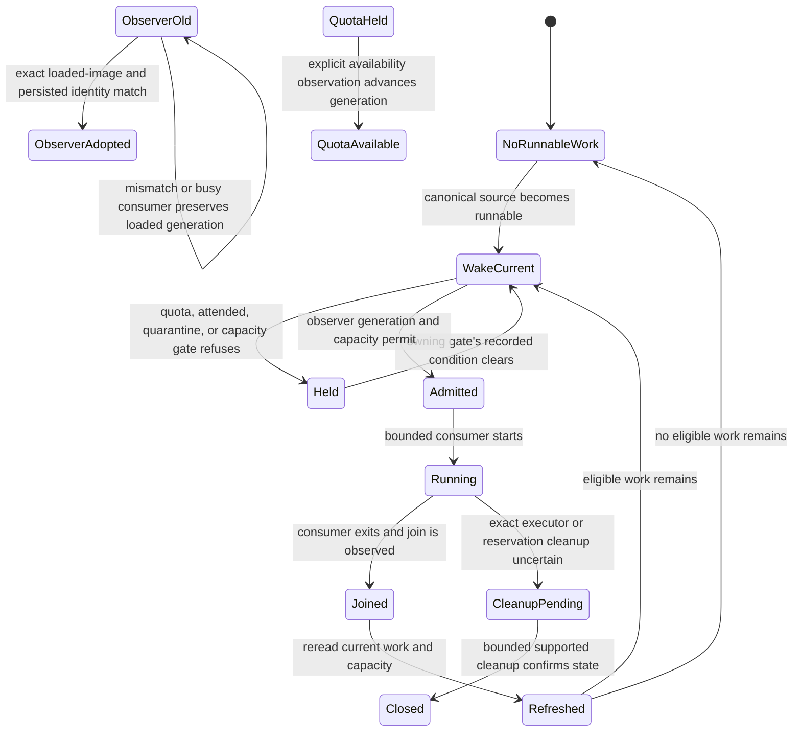

**Recovery:** a quota hold is backpressure, not a breaker failure or runnable
signal. It clears only through the implemented availability/generation path.
Adoption compares the kernel-loaded image and persisted identity; a busy
consumer is not force-restarted to claim freshness. Cleanup is bounded to the
exact executor and its reservation. After a joined consumer, the loop rereads
the current source before dispatching again. These paths do not certify a
particular installed host or release.

### Actor sequence

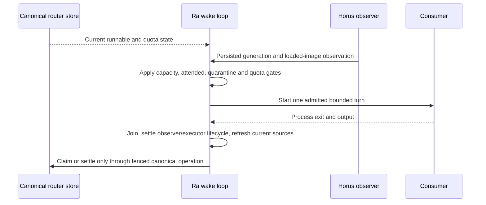

Plain English: wake is an observer of durable work, not the delivery record.
Provider availability, host capacity, current executable identity, and actual
lease mutations each answer different questions.

**Source / tests:** `internal/router/wake.go`, `wakeevents.go`, `providerquota.go`,
`consumerslots.go`, `wakeimage*.go`, `wakeconsumer_reload.go`, `threads.go`,
`internal/routerstore/runnable.go`, `tasklease.go`; `providerquota_test.go`,
`wakeidentity_test.go`, `wakeimage_test.go`, `wakeconsumer_reload_test.go`,
`consumerslots_test.go`, `adoptworker_test.go`, `tasklease_direct_wake_test.go`.
Contract: recipe `router-service`, `host-scoped-node-status-observation`, and
`gemma-maintenance-claim-barrier`; PT canon catalog rows for quota hold,
observer generation, installed executable adoption, and bounded cleanup.
Source and fixtures do not substitute for signed successor adoption or real
queue receipts.

---

<a id="pt-p62"></a>
## PT-P62 — Horus duty dispatch, census, quarantine, and breakers

**Owner:** Horus local supervisor for duties and observation; Ra/routerstore
for durable dispatch, breaker, and escalation authority. **Requirement/story:**
dispatch only through the declared duty and gate paths, census observed
processes, preserve quarantine/stand-down, and expose breaker/escalation
resolution as explicit state transitions. **State:** source-defined duties and
store behavior; a supervisor pass is not proof of ongoing healthy operation.

### Logical and data view

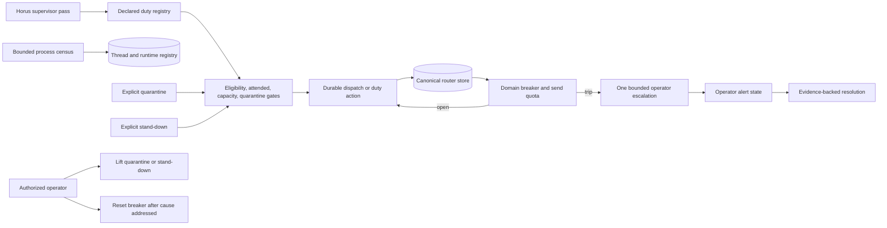

### State and recovery view

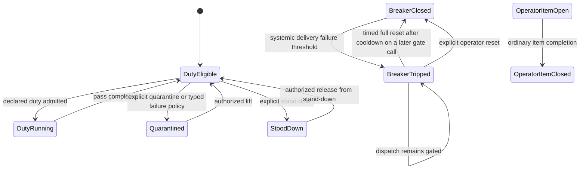

**Recovery:** the breaker source has a five-minute cooldown. After that pause,
a later gate call performs a timed full reset and admits calls; this is not a
single-probe half-open state. An explicit operator reset also exists. Quota
backpressure does not trip a breaker. Quarantine and fabric stand-down are
separate explicit holds and are not lifted by that cooldown. A breaker trip
creates one keyed operator item. Closing that item follows ordinary item
lifecycle and does not itself prove the underlying cause is fixed or reset the
breaker. A census action is an observation reconciled against identity and
host fences, not permission to kill or adopt an arbitrary process. The diagram
does not invent automatic repair of unknown failure classes.

### Actor sequence

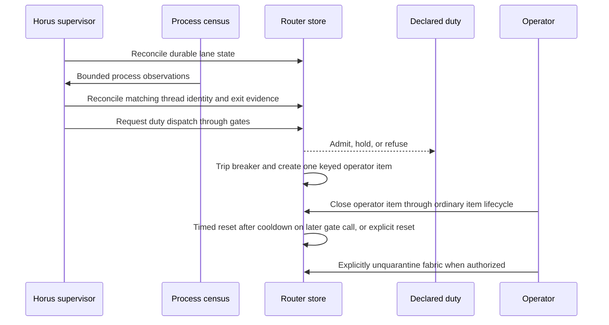

Plain English: supervision coordinates declared jobs; it does not gain broad
effect authority from being the supervisor. Durable breaker/quarantine state
and operator resolution remain distinct from the local process snapshot.

**Source / tests:** `internal/router/supervisor.go`, `supervisorduties.go`,
`census.go`, `nodestatus.go`, `fabricquarantine.go`, `providerquota.go`,
`internal/routerstore/breaker.go`, `dispatch.go`, `reconcile.go`, `items.go`,
`internal/router/fabricquarantine.go`, `cmd/sirsi/routercmd.go`;
`supervisor_test.go`, `supervisorduties_test.go`, `census_test.go`,
`fabricquarantine_test.go`, `breaker_test.go`, `dispatch_contract_test.go`,
`reconcile_test.go`. The router-store README lists durable breakers, quotas,
items, leases, and wake events. Test existence is not a current duty-run or
alert-resolution receipt.

---

<a id="pt-p63"></a>
## PT-P63 — Finite notice reconciliation

**Owner:** Ra service authority; authorized SSA/Horus principal performs the
finite coordination action. **Requirement/story:** reconcile only an approved
finite set of exact notice IDs and row digests, under the authenticated
principal and unexpired approval. Refuse changed, leased, expired, or
unapproved rows. Commit the acknowledgment and custody audit atomically and
make exact retries idempotent without exposing foreign item contents.
**State:** guarded source path; live finite approval and notice readback remain
open unless separately receipted.

### Logical and data view

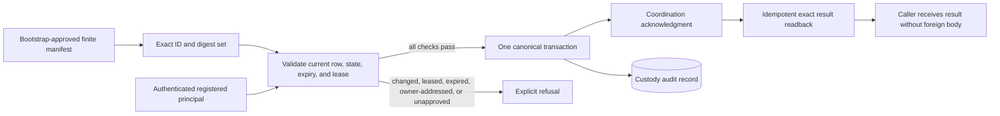

### State and recovery view

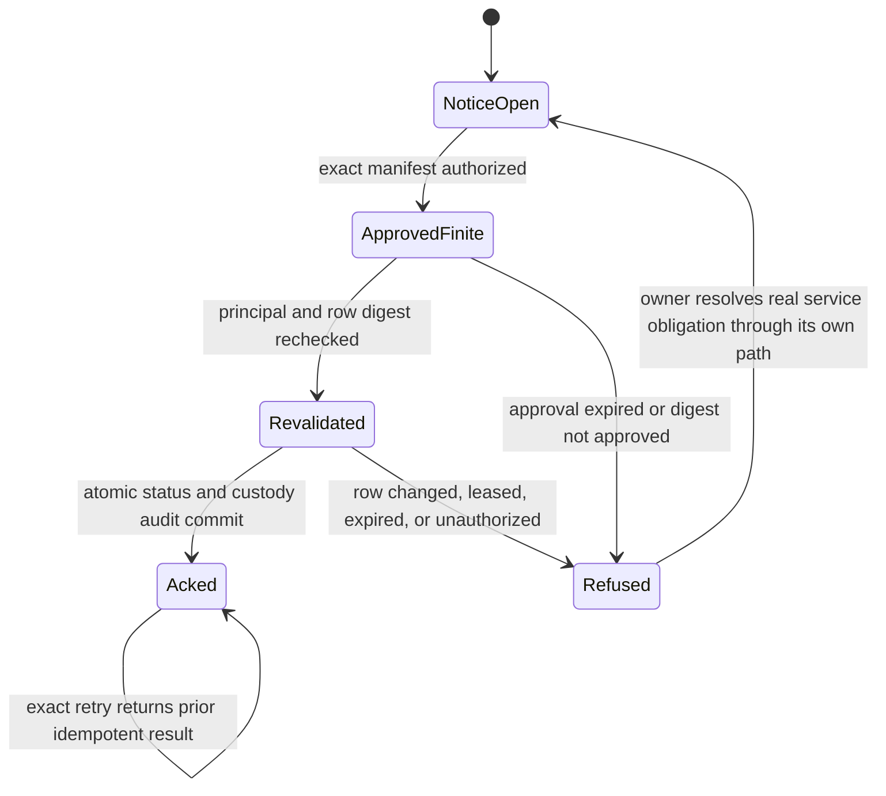

**Recovery:** a refusal leaves the underlying service obligation open. A
changed or leased row is not force-closed. An exact repeat can return the
stored result; it cannot broaden the manifest or change the principal. Real
work is not marked complete by this coordination acknowledgment.

### Actor sequence

```mermaid
sequenceDiagram
  participant Reviewer as Authorized reviewer
  participant Caller as Registered principal
  participant Service as Router service
  participant Store as Canonical store
  Reviewer->>Caller: Provide finite approved IDs, digests, and expiry
  Caller->>Service: Submit exact reconciliation request
  Service->>Store: Authenticate and revalidate principal and every row
  Store->>Store: Atomically ACK coordination and append custody audit
  Store-->>Service: Idempotent result or typed refusal
  Service-->>Caller: Return bounded result, no foreign notice body
  Caller->>Service: Retry exact request if prior result was uncertain
```

Plain English: this path acknowledges a finite coordination notice. It does
not answer the notice, close unrelated work, reassign ownership, or prove the
notice's requested deliverable is complete.

**Source / tests:** `internal/routerstore/mailboxreconcile.go`,
`mailboxreconcile_serve.go`, `mailboxreconcile_remote.go`,
`cmd/sirsi/routermailboxreconcile.go`; `mailboxreconcile_test.go`,
`cmd/sirsi/routermailboxreconcile_test.go`. Contract: recipe component
`finite-service-mailbox-reconciliation`; Ra canon component catalog and
traceability row “Finite historical notice custody.” The recipe requires
SQLite/PostgreSQL and restricted-shell HTTP qualification before live action.

---

<a id="pt-p64"></a>
## PT-P64 — FabricBoard generation, projections, and compatibility

**Owner:** Ra owns canonical router facts; Horus owns the derived local board
surface. **Requirement/story:** produce one privacy-bounded generation from
canonical facts, keep task/message/runtime/host planes distinct, paginate
against a generation digest, preserve honest stale/unavailable state, and feed
existing web, native, CLI, and compatibility consumers without creating
another authority. Native handoff uses the fixed Horus sender.
**State:** producer and consumer source are described; mixed-consumer
qualification and cross-surface readback remain separate.

### Logical and data view

```mermaid
flowchart LR
  Router[(Canonical router and thread facts)] --> Producer[One Fabric generation]
  Ledger[(Canonical task snapshot)] --> Producer
  Readiness[Existing lane readiness projection] --> Producer
  Host[Bounded host facts] --> Producer
  Fleet[Same-snapshot observed transitions] --> Producer
  Producer --> Planes[Distinct task, message, runtime, host planes]
  Producer --> Page[64-row page and exact detail]
  Page --> Digest[Public projection digest continuation]
  Digest -->|same generation| Next[Next page]
  Digest -->|changed projection| Conflict[409, explicit first-page refresh]
  Producer --> Web[Existing web endpoint and renderer]
  Producer --> Native[Native canonical reader]
  Producer --> Compat[Detached read-only compatibility adapters]
  Native -->|fixed sender and typed payload| Service[Canonical router service]
```

### State and recovery view

```mermaid
stateDiagram-v2
  [*] --> Unseeded
  Unseeded --> Current: producer obtains canonical snapshot
  Current --> Current: same facts, no synthetic transition
  Current --> Changed: real observed task status transition
  Changed --> Current: generation built from current snapshot
  Current --> Retained: read failure preserves last observation with age and error
  Retained --> Current: later successful read
  Current --> Unavailable: producer failure, surface reports unavailable
  Current --> PageConflict: continuation digest changed
  PageConflict --> Current: explicit first-page refresh
  Current --> Detail: exact selected task detail
  Detail --> Current: return to same selected board context
```

**Recovery:** no source read means unavailable, not an empty board. The first
observation seeds without synthetic transitions. A failed page read retains
the last observation with age/error; a changed continuation refuses rather
than skipping rows. Private task bodies, leases, local reference paths, and
foreign raw payloads stay outside the bounded projection. Existing SSE and
legacy wire contracts remain compatibility surfaces until their owning
qualification/readback is recorded.

### Actor sequence

```mermaid
sequenceDiagram
  participant CLI as Protected CLI producer
  participant Store as Canonical router and ledger reads
  participant Board as Fabric generation builder
  participant Web as Web consumer
  participant Native as Native consumer
  participant Service as Router service
  CLI->>Store: Read canonical facts once
  Store-->>Board: Snapshot, readiness, and safe evidence
  Board->>Board: Join planes and bind page digest
  Web->>Board: Request first page or exact continuation
  Board-->>Web: Current page, 409, or honest producer error
  Native->>CLI: Request typed bounded board read
  CLI-->>Native: Canonical data and source status
  Native->>Service: Fixed-sender typed handoff action
```

Plain English: Fabric is a read model. It joins existing canonical facts and
projects them for display; it neither repairs the router nor decides whether a
worker is authorized. Task activity, inbox messages, runtime, and host health
remain separate planes.

**Source / tests:** `internal/ledger/fabric*.go`, `internal/router/readiness_projection.go`,
`internal/routerboard/generation.go`, `internal/routerboard/http.go`,
`internal/dashboard/fabric_generation.go`, `internal/dashboard/fabric.go`,
`internal/dashboard/fleet.go`, `internal/dashboard/ui/fabric.js`,
`internal/dashboard/ui/app.js`, `macapp/Sources/SirsiMenubar/CanonicalFabric.swift`,
`SirsiEngine.swift`, `Views.swift`; recipe component `fabric-board` names the
producer and consumer test inventory. Canon: `FABRIC_TASKS_AND_ROLES_V1.md`
and `FABRIC_SURFACE_PRODUCER_V1.md`. Those canon files explicitly separate
authored/unrun fixtures, R3 installed adoption, R4 same-wire convergence, and
foreign Nexus/Horus readback.

---

<a id="pt-p65"></a>
## PT-P65 — Scoped native execution and locality selection

**Owner:** Ma'at owns the scoped native executor; Ra owns task/session
authority; Pantheon PT owns integration. **Requirement/story:** choose the
existing local executor only from exact enrolled endpoint, kernel interface,
native UID, and executor identity evidence. Otherwise retain the existing
strict pinned remote route. Local refusal, metadata cleanup uncertainty, and
SSH/auth failure are terminal; no fallback can widen authority.
**State:** source candidate and inert fixtures are described; actual own-host
execution and installed adoption remain open until separately receipted.

### Logical and data view

```mermaid
flowchart LR
  Request[Closed target, work, CPU, timeout, literal argv] --> Selector[Existing fabric-run selector]
  Selector --> Observe[Bounded native endpoint, UUID, UID observations]
  Observe -->|exact unique endpoint and account match| Local[Existing registered native executor]
  Observe -->|unknown or remote| Remote[Existing strict proxy and pinned SSH path]
  Observe -->|fatal cleanup or malformed authority| Refuse[Terminal refusal]
  Local --> Admission[Existing scoped admission]
  Remote --> Admission
  Admission --> Execute[One supervised execution]
  Execute --> Receipt[Existing execution and completion evidence]
  Local -->|no fallback on refusal| Refuse
  Remote -->|no local retry on failure| Refuse
```

### State and recovery view

```mermaid
stateDiagram-v2
  [*] --> Planned
  Planned --> LocalQualified: exact endpoint, UUID, and UID evidence
  Planned --> RemoteSelected: locality unknown or another enrolled host
  Planned --> Refused: malformed observation or unreaped metadata child
  LocalQualified --> Admitted: normal executor validates existing scope
  RemoteSelected --> Admitted: strict host pin and proxy path validate
  Admitted --> Executed: exact argv runs once under supervisor
  Admitted --> Refused: authorization or admission fails
  Executed --> ReceiptRecorded: existing lifecycle records outcome
  RemoteSelected --> Refused: proxy, SSH, or authentication fails
  Refused --> Planned: caller makes a new explicit attempt with current evidence
```

**Recovery:** status 0 from the locality selector means only that locality
qualified; status 3 selects the unchanged remote path; fatal cleanup status
prevents either executor from starting. A plan is observation-free. UUID is an
executor observation, not a new enrolled target binding. Existing payload
masking, literal argv, supervision, receipt, and completion rules stay in
force. No direct SSH retry, credentials, or enrollment is implied.

### Actor sequence

```mermaid
sequenceDiagram
  participant Caller
  participant Selector as Native locality selector
  participant Kernel as Bounded native metadata readers
  participant Runner as Existing scoped executor
  participant Remote as Existing pinned remote transport
  Caller->>Selector: Closed target and exact literal invocation
  Selector->>Kernel: Read interface, native UUID, and configured UID
  Kernel-->>Selector: Bounded result with child lifecycle status
  alt Exact locality proof
    Selector->>Runner: Execute existing registered local route once
  else Unknown or remote
    Selector->>Remote: Use existing proxy and strict pin path
  else Fatal observation cleanup
    Selector-->>Caller: Terminal refusal, no execution
  end
  Runner-->>Caller: Existing execution lifecycle result
  Remote-->>Caller: Existing remote execution lifecycle result
```

Plain English: local selection avoids an unnecessary network hop only when
native machine facts meet the existing target contract. It does not grant a
new lane capability. Both paths converge on existing executor admission and
evidence rules.

**Source / tests:** `scripts/maat/fabric-run.sh`,
`scripts/maat/fabric-endpoints.py`, `scripts/maat/README.md`,
`docs/stacklab/ra/canon/NATIVE_FABRIC_SELF_DISPATCH_V1.md`;
`fabric-endpoints.test.py`, `fabric-run.test.py`, `fabric-locality.test.py`,
`fabric-self-dispatch.test.py`. Recipe component `scoped-native-transport`.
Canon says these authored suites and the actual own M5 route belong to Main's
qualification; this document records neither execution nor remote SSH repair.

---

<a id="pt-p66"></a>
## PT-P66 — Canonical service migration and release effects

**Owner:** Ra owns router store/service compatibility; SSA owns signing and
publication execution; service operators own traffic and installed-host
readback. **Requirement/story:** migrate canonical state with schema and
identity preservation, deploy a compatible server before clients that require
new methods, stage traffic, read back actual service behavior, and retain an
evidence-based rollback route. Installation, process restart, loaded image,
service traffic, and client adoption are separate effects. **State:** recipe
and source contracts define boundaries; current rollout state is not inferred.

### Logical and data view

```mermaid
flowchart LR
  Source[(Canonical existing backend)] --> Plan[Exact migration inventory and compatibility checks]
  Plan --> Stage[Staged candidate schema and server]
  Stage --> Server[Compatible service revision]
  Server --> Traffic[Staged traffic change]
  Traffic --> Readback[Service schema, revision, and method readback]
  Readback --> Client[Client release requiring new method]
  Client --> Install[Signed package installation]
  Install --> Loaded[Kernel loaded-image adoption]
  Loaded --> Consumer[Existing client consumer readback]
  Readback -->|failed evidence gate| Rollback[Declared rollback procedure]
  Install -->|install does not prove adoption| Verify[Separate installed and loaded verification]
```

### State and recovery view

```mermaid
stateDiagram-v2
  [*] --> ExistingService
  ExistingService --> MigrationPlanned: exact schema and row plan
  MigrationPlanned --> CandidateReady: migration and compatibility gates pass
  CandidateReady --> ServerStaged: compatible server deployed without client cutover
  ServerStaged --> TrafficVerified: traffic and readback match intended revision
  TrafficVerified --> ClientReleased: compatible client release is published
  ClientReleased --> Installed: signed artifact installed
  Installed --> Adopted: exact loaded image and consumer readback confirmed
  MigrationPlanned --> Refused: invariant or compatibility check fails
  ServerStaged --> RollbackRequired: failed service readback
  TrafficVerified --> RollbackRequired: failed client or behavior readback
  RollbackRequired --> ExistingService: only declared rollback with verified result
  Installed --> Installed: install alone leaves adoption unknown
```

**Recovery:** store-migration refusal preserves source state according to the
migration contract; rollback must follow the actual owner-operated procedure
and verify the resulting revision/data. Server-first compatibility is required
where a new client method needs a new server method. No schema rollback,
traffic reversal, deployment, install, restart, or automatic recovery is
claimed from source. The historical RA-P04 sequence must not be used as proof
of this current staged release train.

### Actor sequence

```mermaid
sequenceDiagram
  participant Dev as Pantheon source owner
  participant ServiceOwner as Router service operator
  participant SSA as SSA release custodian
  participant Server as Canonical service
  participant Client as Installed client consumer
  Dev->>Dev: Prepare compatible source, migration, and exact release evidence
  ServiceOwner->>Server: Stage server/schema before dependent clients
  ServiceOwner->>Server: Shift intended traffic and read back revision and behavior
  SSA->>SSA: Sign and publish the reviewed paired artifact through existing authority
  Client->>Server: Use supported method and read back canonical result
  Client->>Client: Verify installed and kernel-loaded identity separately
  ServiceOwner->>Server: Invoke declared rollback only when evidence gate fails
```

Plain English: source acceptance, migration success, service traffic, signed
publication, installed files, and a running loaded client are distinct
milestones. Each needs its own attributable receipt before it can be described
as complete.

**Source / tests:** `internal/routerstore/migratestore.go`, `migrationgate.go`,
`readcompat.go`, `open_postgres.go`, `serve.go`,
`scripts/release-train.sh`, `scripts/release-consumer-preservation.test.sh`,
`.github/workflows/release.yml`, `docs/stacklab/RELEASE_CONSUMER_PRESERVATION.md`,
`docs/stacklab/ra/canon/RELEASE.md`, `RUNBOOK.md`, and the recipe's
`router-service`, `stacklab-contract`, and `relay-owned-outbox-observation`
components. Migration, CI, release, and adoption fixtures exist at distinct
boundaries; do not report them as run here or collapse installation into
loaded runtime evidence.

---

<a id="pt-p67"></a>
## PT-P67 — Ra fleet commands, process effects, and evidence capture

**Owner:** Pantheon PT owns this repository's Ra CLI implementation; Ra's
orchestrator dispatches declared repo tasks. The target repository and its
owners retain their code and release authority. **Requirement/story:** make
task, broadcast, health/test/lint, nightly, deploy, kill, collect, watch, and
pipeline side effects explicit. A prompt or spawned terminal is not permission
to cross repo boundaries, change service state, publish, or claim a result.
**State:** legacy `sirsi ra` CLI and Go orchestration support are source
described; they do not establish current router-fabric dispatch or fleet
completion.

### Logical and data view

```mermaid
flowchart LR
  Operator[Operator invokes sirsi ra command] --> CLI[Ra CLI command and flags]
  CLI --> Orchestrator[Resolved Python orchestrator]
  Orchestrator --> Scope[Declared repo task or fleet subcommand]
  Scope --> Effects[Subprocess, terminal, or target-repo work]
  Effects --> Output[Captured stdout, stderr, exit state]
  Output --> Monitor[Ra monitor and collect paths]
  Output --> Pipeline{Optional record pipeline}
  Pipeline --> Filter[Seshat secret filter]
  Filter --> Knowledge[(Knowledge items)]
  Knowledge --> Thoth[Thoth sync and pipeline status]
  Deploy[Ra deploy scopes] --> DryRun{Dry run?}
  DryRun -->|yes| Preview[Prompt preview only]
  DryRun -->|no| Spawn[Protect current window, kill prior Ra windows, spawn scopes]
  Spawn --> Watch[Command Center watch]
  Spawn --> Collect[Wait and collect when requested]
```

### State and recovery view

```mermaid
stateDiagram-v2
  [*] --> CommandSelected
  CommandSelected --> Refused: invalid arguments or orchestrator unavailable
  CommandSelected --> DryRunPreview: deployment dry-run
  CommandSelected --> Dispatched: valid task or fleet subcommand
  Dispatched --> Running: orchestrator process starts
  Running --> Completed: process returns success
  Running --> Failed: process returns error or nonzero outcome
  Running --> Crashed: monitor cannot establish process/exit result
  Completed --> Recorded: optional filter, Seshat export, and Thoth sync path
  Completed --> Unrecorded: record option absent or optional sync unavailable
  Dispatched --> Deployed: non-dry-run scope windows spawned
  Deployed --> Watching: monitor reads PID, exit, and log files
  Watching --> Collected: wait/collect returns results
  Watching --> Crashed: PID or exit evidence is unavailable
  Failed --> CommandSelected: explicit new invocation after diagnosis
  Crashed --> CommandSelected: operator inspects evidence before retry
```

**Recovery and effect authority:** `--record` filters captured output before
Seshat export; Thoth sync failure is represented as unsynced, while pipeline
status recording is non-fatal in the cited code. A failed orchestrator returns
an error. `ra deploy` has a dry-run preview path; non-dry-run code protects the
front window, kills existing Ra windows, clears the Stele, writes prompts, and
spawns windows. Monitor state derives from pid/exit/log files and can classify
missing evidence as crashed. These are real local process/file effects, not
authorization for target-repo writes, service deploy, signing, publication,
or destructive actions. Current Ra control-plane commands, if separately
introduced, must retain their own authenticated task and effect boundaries.

### Actor sequence

```mermaid
sequenceDiagram
  participant Operator
  participant CLI as sirsi ra
  participant Orchestrator as Python orchestrator
  participant Repo as Declared target repository
  participant Monitor as Ra monitor and collector
  participant Seshat
  participant Thoth
  Operator->>CLI: Choose task, broadcast, nightly, or deploy options
  CLI->>Orchestrator: Run selected subcommand with explicit arguments
  Orchestrator->>Repo: Perform declared scoped work
  Repo-->>Orchestrator: stdout, stderr, and exit status
  Orchestrator-->>CLI: Result or error
  CLI->>Monitor: Read deployment state and collect only when requested
  opt --record pipeline
    CLI->>Seshat: Filter and ingest captured output
    Seshat->>Thoth: Export accepted items and sync memory
  end
  CLI-->>Operator: Report observed command and recording outcome
```

Plain English: the Ra CLI is an orchestration surface, not a universal grant.
The command's arguments select work; the orchestrator's observable process
result supports a report. Recording output does not make the work's effects
authorized or complete, and a process PID alone is not success evidence.

**Source / tests:** `cmd/sirsi/ra.go`, `internal/ra/pipeline.go`, `deploy.go`,
`monitor.go`, `terminal.go`, `process_unix.go`, `process_windows.go`,
`internal/seshat`, `internal/thoth`; `internal/ra/ra_test.go`,
`monitor_test.go`, and related pipeline/deploy tests. `ra.go` delegates task, broadcast,
nightly, health, test, and lint to `scripts/sirsi-orchestrator.py`; the optional
pipeline captures output, filters it, exports knowledge, then attempts Thoth
sync. Read together with Ra canon `ARCHITECTURE.md`, `RUNBOOK.md`, and
`SECURITY_THREAT_MODEL.md`. This is not proof that the CLI is the canonical
router-service dispatcher or that any fleet command ran.

---

## PT-P57–PT-P67 traceability and next action

| ID | Source boundary | Owner | Requirement / story | Next action |
|---|---|---|---|---|
| PT-P57 | `internal/routerstore/{items,lease,tasks,tasklease,taskeligibility,taskresume,wakeevents,reconcile}.go` | Ra / routerstore | Preserve separate item/task lifecycles, eligibility, dependencies, fenced resume, exact direct-wake ACK, and non-executing proven DONE residue. | Main: qualify focused, race, and PostgreSQL paths, then record actual compatible-service rollout and exact current/pending/DONE wake readback. |
| PT-P58 | `internal/router/{threads,register,census,discover,supervisor,sessionreaper,prune}.go` | Ra; Horus local observer | Register/retry, heartbeat, attended hold, safe adoption, explicit suspend/resume, exit reconciliation, close and retention-bounded prune. | Main: correlate signed loaded supervisor generation with fresh duty/queue evidence and preserve host-scoped lifecycle checks. |
| PT-P59 | `internal/routerstore/{resolve,remote,hosttokens,sessions,serve}.go` | Ra service owner | Canonical authority and authenticated host/session/runtime/nonce/audience/expiry with explicit revoke/refusal. | Service owner: capture current service revision, auth/audience, expiry/revoke, and client readback receipts; no fallback inference. |
| PT-P60 | `internal/routerstore/{spool,spoolobservation,spoolhealth,spoolrepair}.go`, native handoff | Ra relay owner; Horus observer | Durable correlated delivery, bounded retry, lane isolation, health observation, scoped repair, fixed-sender native handoff. | Main and service owner: qualify exact selected producer/consumer and record fresh outbox health plus correlated receipt without restarting active consumers. |
| PT-P61 | `internal/router/{wake,providerquota,wakeimage,wakeconsumer_reload,threads}.go`, `internal/routerstore/{runnable,tasklease}.go` | Ra wake runtime; Horus | Current durable wake, quota and capacity gates, observer generation, loaded-image adoption, join refresh, bounded cleanup. | Main: qualify successor source and signed adoption, then retain real suppression, join, current-source refresh, and sequential queue receipts. |
| PT-P62 | `internal/router/{supervisor,supervisorduties,census,fabricquarantine}.go`, `internal/routerstore/{breaker,dispatch,reconcile}.go` | Horus supervisor; Ra durable authority | Declared duty dispatch, census, explicit quarantine/stand-down, breaker and escalation resolution. | Duty owner: attach current pass and state-transition evidence for each active duty; exercise only authorized explicit lift/reset and retain the resulting receipt. |
| PT-P63 | `internal/routerstore/mailboxreconcile*.go`, `cmd/sirsi/routermailboxreconcile.go` | Ra service; authorized SSA/Horus principal | Finite exact notice/digest reconciliation with principal/expiry/lease fences, atomic audit, idempotent bounded readback. | Authorized owner: qualify SQLite, PostgreSQL, and restricted-shell HTTP, then reconcile only the approved finite manifest and verify exact rows. |
| PT-P64 | `internal/ledger/fabric*.go`, `internal/routerboard`, `internal/dashboard`, native `CanonicalFabric` | Ra facts; Horus projection | One private generation, distinct planes, digest-bound detail/pages, honest stale/error state, compatible consumers and fixed sender. | Main plus each consumer owner: run Go-to-web/native wire qualification, then record actual endpoint/SSE/native readback and Nexus/Horus mapping separately. |
| PT-P65 | `scripts/maat/fabric-run.sh`, `fabric-endpoints.py`, existing native executor | Ma'at executor; Ra task authority; Pantheon integration | Native locality only on exact evidence; otherwise strict pinned remote path; terminal refusal and existing evidence semantics. | Main: run all inert locality/selector controls, then the reviewed own-host invocation with executor, admission, terminal, completion, and release receipts. |
| PT-P66 | `internal/routerstore/migratestore.go`, `migrationgate.go`, release workflow and operator runbook | Ra service; SSA publication; service operator | Compatible migration, server-first staging, traffic/readback, signed release, loaded adoption, declared rollback. | Service and release owners: document the actual release train, traffic and rollback receipts, then independently verify installed and loaded consumers. |
| PT-P67 | `cmd/sirsi/ra.go`, `internal/ra/{pipeline,deploy,monitor,terminal}.go` | Pantheon PT CLI; target repo owners retain effects | Bound task/broadcast/nightly/pipeline/deploy/kill/collect/watch effects and evidence without implied cross-repo or release authority. | Ra CLI owner: reconcile legacy process orchestration with current authorized dispatch contract and document per-command effect gates and current evidence source. |

**Completion boundary:** this matrix is a source map and an ordered next-action
list. None of the next actions is represented as run here. The recipe pin,
existing test names, old RA-P01–P05 diagrams, and any stale forced-restart
observation do not satisfy an installed/runtime or release receipt.
