# Pantheon PT diagrams — Ma'at governance and operation records

This document maps eleven source-described Ma'at and adjacent governance
workflows from the current e26 source base. Mermaid diagrams describe code and
contracts, not a live installation, successful runtime execution, complete
qualification, or installed release behavior. A test reference identifies
source-level coverage; it is not a runtime receipt. The Stack Lab recipes are
the component inventory and upgrade-boundary authority: `contracts/stacklab/maat-system-one-recipe-v1.json`
and `contracts/stacklab/maat-pod-authority-service-recipe-v1.json`.

Each row has a logical flow, a data flow, and a state/recovery view. Sequence
diagrams are included where a boundary crosses actors, durable stores, an
external process, or an OS service. Related narrow paths are explicitly named
inside their row; they remain separate routes where their authority differs.

<a id="pt-p41"></a>
## PT-P41 — Ma'at assessments, evidence coverage, and health signals

**Plain English.** Ma'at assessors turn available source observations into
typed assessments. `sirsi maat audit` composes coverage, canon, and pipeline
assessors, then records the report in the DecisionJournal. Outside a Go module
it reports unmeasured. Canon and pipeline assessors can report unavailable input;
coverage distinguishes measured zero from missing coverage and applies declared
module floors; Pulse records whether measurements were actually made; Proof and
Platform expose their own evidence. These are related assessment paths, not one
combined all-or-nothing pass. A cache hit is a coverage input and must cover
the configured floors before fast mode can rely on it. Missing evidence remains unavailable or
unmeasured rather than being silently promoted to a pass.

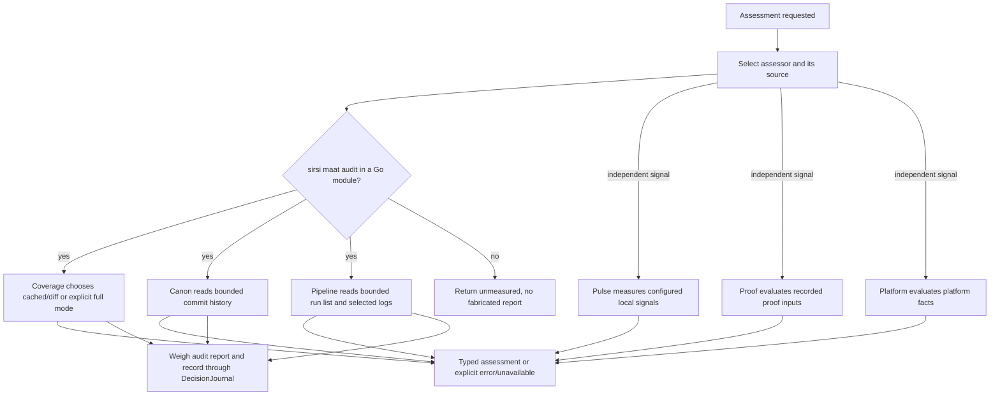

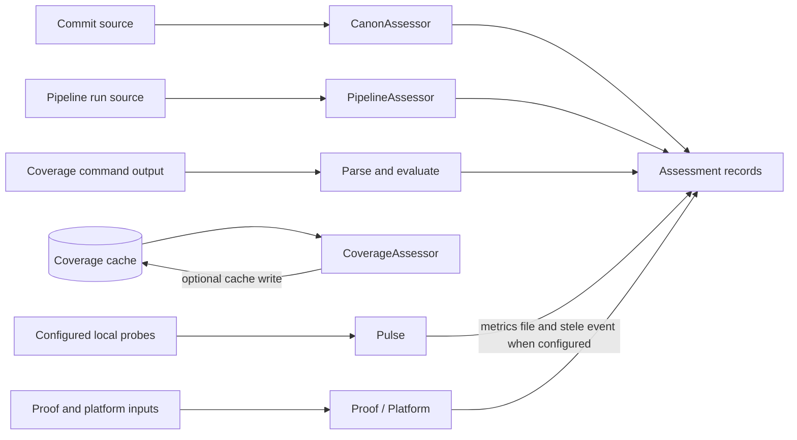

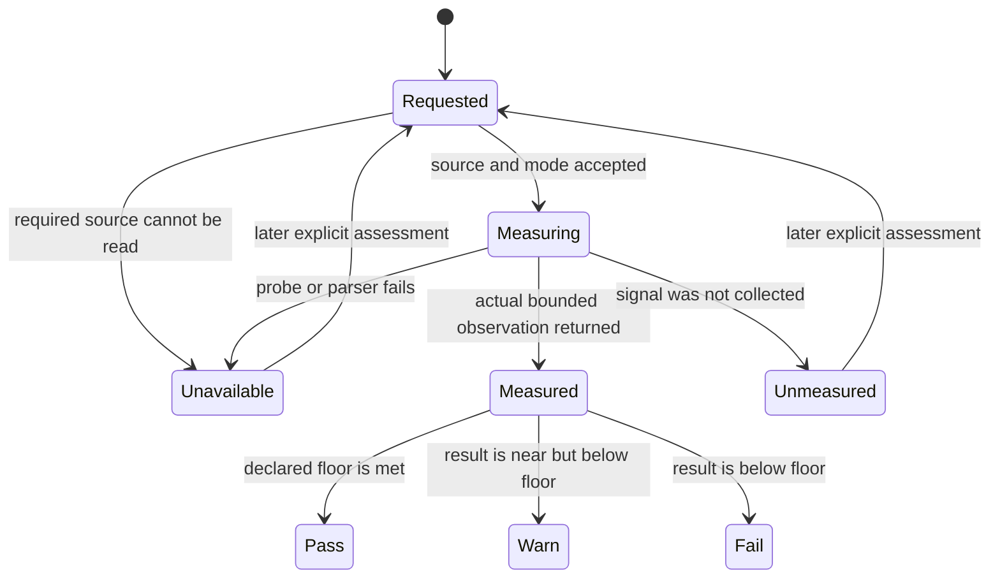

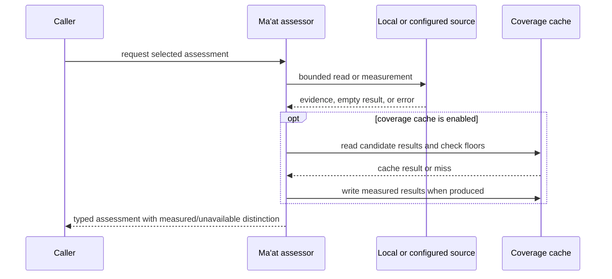

**Evidence references.** Sources: `cmd/sirsi/maat.go`, `internal/maat/maat.go`,
`internal/maat/canon.go`, `internal/maat/coverage.go`,
`internal/maat/pipeline.go`, `internal/maat/pulse.go`,
`internal/maat/proof.go`, `internal/maat/platform.go`.
Tests: `internal/maat/maat_test.go`, `canon_test.go`, `coverage_test.go`,
`coverage_fastmode_test.go`, `pipeline_test.go`, `pipeline_sprint_test.go`,
`pulse_test.go`, `proof_test.go`, `platform_test.go`.

**Recovery and boundary.** Re-run the selected assessment against its source
when data is absent or stale. A cache failure does not create a live result;
skip mode uses cached coverage only when the cache covers configured floors.
This row describes source behavior only.

<a id="pt-p42"></a>
## PT-P42 — Deterministic System One source screening, floors, escalation, and calibration

**Plain English.** System One validates and canonicalizes a bounded screening
input, applies deterministic policy and emits a typed verdict. Source screening
has an explicit schema and trust boundary. A local pass is not a universal
approval: blocked or uncertain findings remain gated. Escalation and
calibration are explicit journaled actions that compare exact evidence; a
calibration record requires a matching recorded local auto-pass and distinct
frontier evidence.

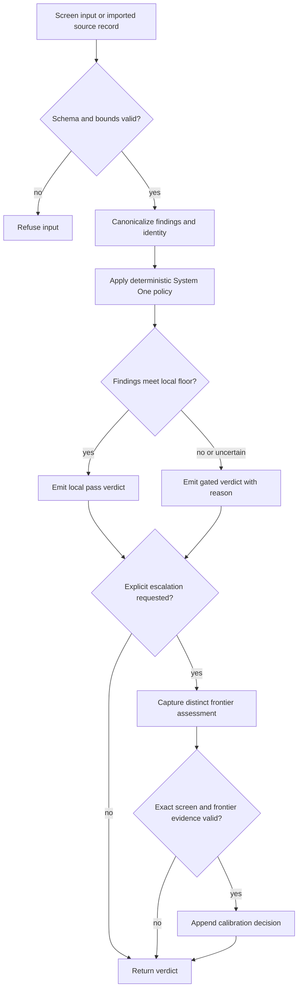

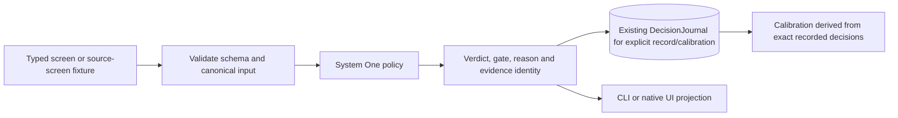

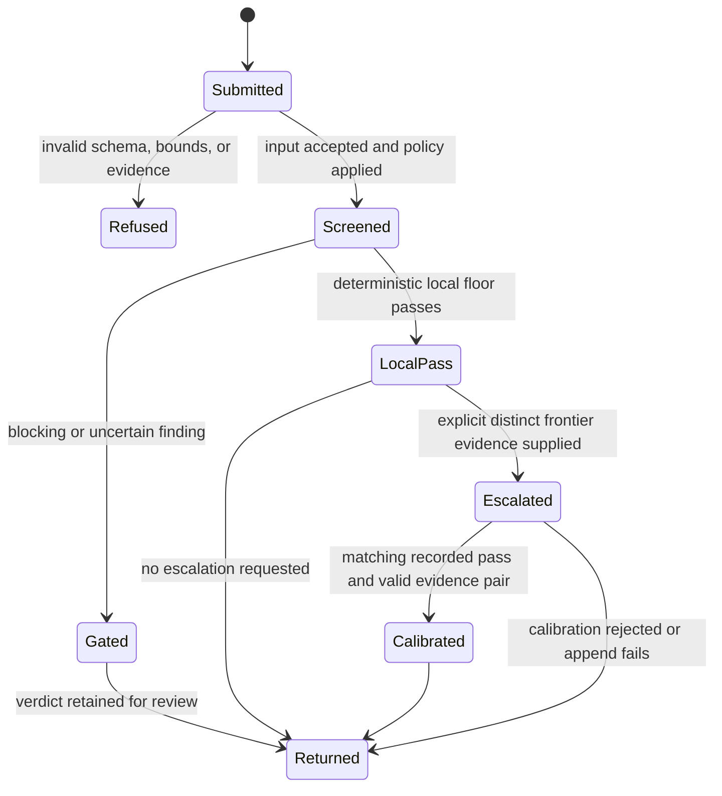

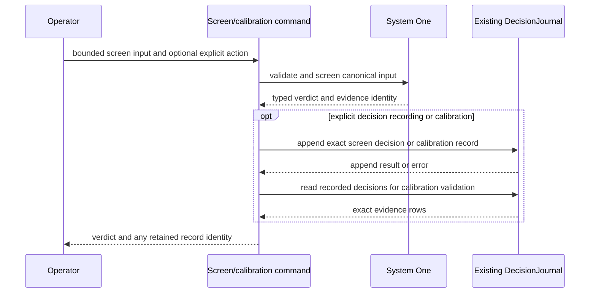

**Evidence references.** Sources: `internal/maat/systemone.go`,
`sourcescreen.go`, `decisions.go`, `cmd/sirsi/maatscreen.go`,
`cmd/sirsi/maatcalibrate.go`, `contracts/maat/source-screen-v2-fixture.json`.
Tests: `internal/maat/systemone_test.go`, `sourcescreen_test.go`,
`internal/maat/casebook/casebook_test.go`, `cmd/sirsi/maatscreen_test.go`,
`maattriage_test.go`, `maatcalibrate_test.go`, and
`macapp/Tests/SirsiMenubarTests/MaatSourceImportTests.swift`.

**Recovery and boundary.** Invalid or mismatched evidence is refused; the
caller must obtain and submit a fresh exact record. A typed local pass or
calibration does not claim release, production, or installed-runtime approval.

<a id="pt-p43"></a>
## PT-P43 — Doctor-host diagnostic recording and confirmation

**Plain English.** The host-health path composes doctor observations into a
bounded System One screen. Recording a diagnostic is a separate user-confirmed
request: it binds the request to retained observation, screen, and journal
evidence, checks freshness and request identity, then records through the
existing journal. If the outcome cannot be verified, it stays unknown for
reconciliation; it is not resubmitted as though no attempt happened.

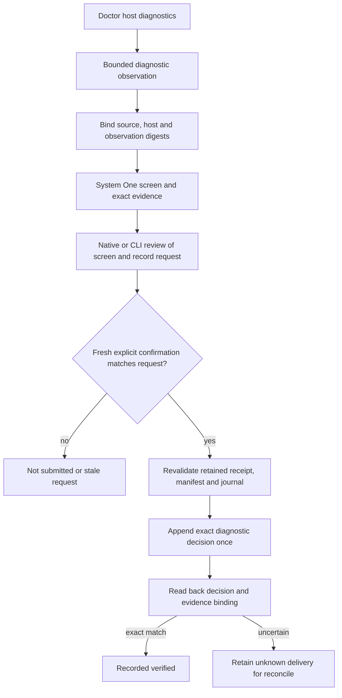

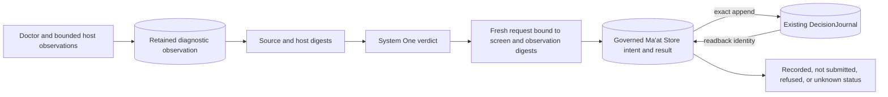

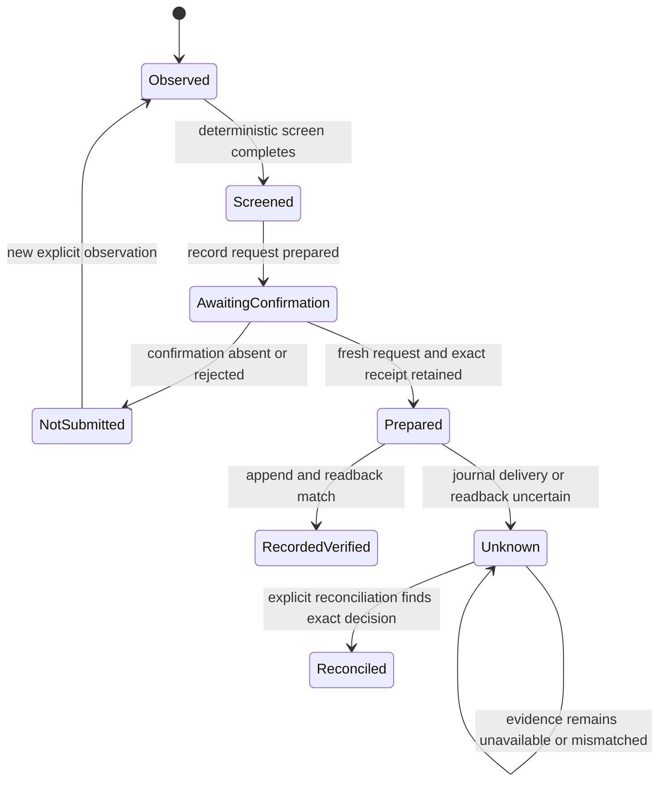

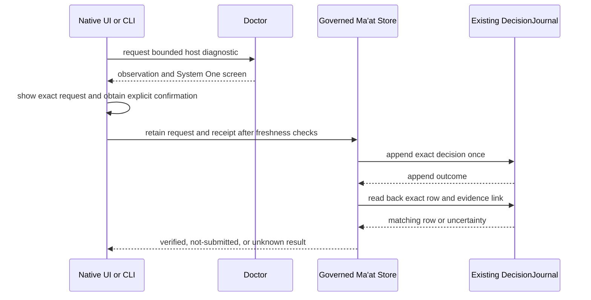

**Evidence references.** Sources: `internal/guard/doctor.go`,
`cmd/sirsi/maattriage.go`, `cmd/sirsi/maattriage_memory.go`,
`internal/maat/diagnostic_observation.go`, `internal/maat/memory_diagnostic.go`,
`internal/maat/memory_diagnostic_request.go`,
`internal/maat/memory_diagnostic_discovery.go`,
`macapp/Sources/SirsiMenubar/MaatDiagnosticRecordModel.swift`,
`macapp/Sources/SirsiMenubar/MaatDiagnosticRecordView.swift`,
`macapp/Sources/SirsiMenubar/MaatDiagnosticResolution.swift`,
`macapp/Sources/SirsiMenubar/MaatDiagnosticCorrelation.swift`,
`macapp/Sources/SirsiMenubar/MaatWorkspaceRecoveryFrame.swift`, and
`macapp/Sources/SirsiMenubar/MaatOperationState.swift`.
Tests: `internal/guard/doctor_test.go`, `internal/maat/systemone_test.go`,
`memory_diagnostic_test.go`, `memory_diagnostic_request_test.go`,
`diagnostic_binding_test.go`, `memory_diagnostic_not_submitted_test.go`,
`cmd/sirsi/maattriage_request_test.go`, and native diagnostic record,
priority, correlation, and resolution tests.

**Recovery and boundary.** Reconcile by the retained request identity and
evidence. A missing journal response is not proof of non-delivery. Recording a
diagnostic does not perform remediation.

<a id="pt-p44"></a>
## PT-P44 — Decision journal and Casebook history across surfaces

**Plain English.** Ma'at decisions are appended to the canonical decision
journal and projected into Casebook cases. History reads use a bounded,
snapshot-bound query with opaque continuation; linked decisions are resolved
against the same snapshot. CLI, dashboard, MCP, TUI, and native views are
read/projection surfaces over the shared contract. Owner acceptance and repair
are separate confirmed paths: each preflights exact evidence, retains the
decision, and preserves unresolved or unknown state. History browsing itself
never repairs or changes a decision.

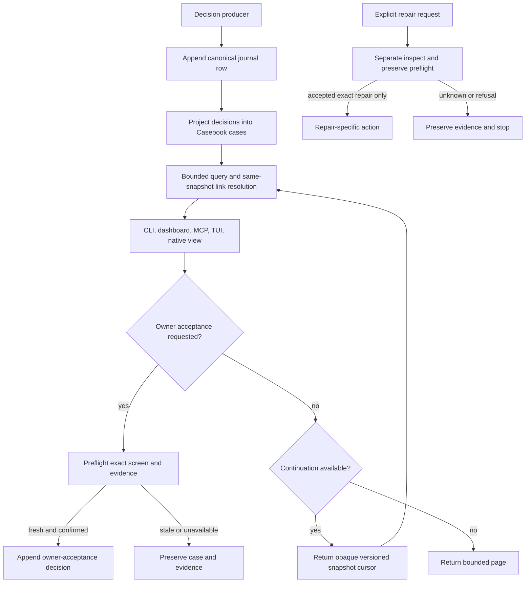

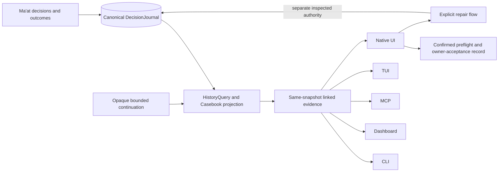

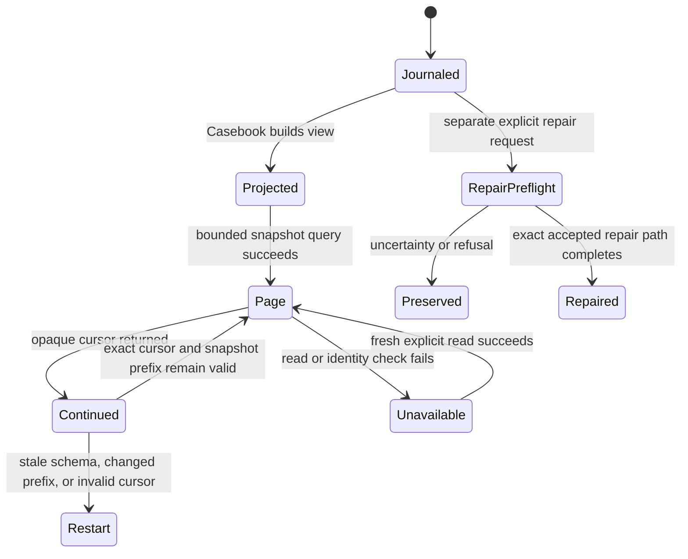

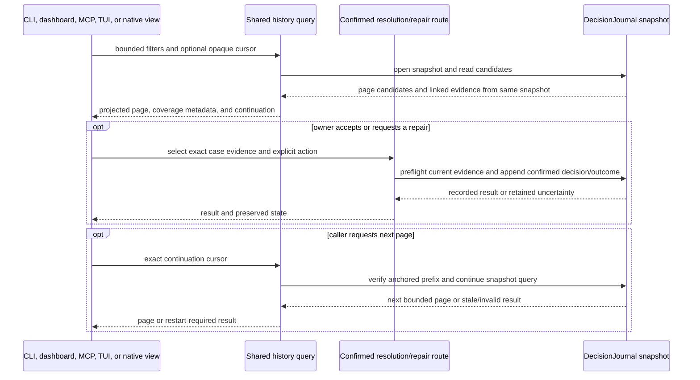

**Evidence references.** Sources: `internal/maat/decisions.go`,
`internal/maat/history_query.go`, `internal/maat/history_query_batch.go`,
`internal/maat/casebook/casebook.go`, `internal/maat/journalrepair_unix.go`,
`internal/maat/journalrepair_windows.go`, `cmd/sirsi/maatcasebook.go`,
`internal/mcp/maat_reads.go`, `internal/dashboard/maat_reads.go`,
`internal/tui/maat_history.go`, and `macapp/Sources/SirsiMenubar/MaatCasebookView.swift`.
Tests: `internal/maat/decisions_test.go`, `history_query_test.go`,
`history_query_batch_test.go`, `internal/maat/casebook/history_test.go`,
`internal/mcp/maat_history_test.go`, `internal/dashboard/maat_history_test.go`,
`internal/tui/maat_history_test.go`, `cmd/sirsi/maatcasebook_history_test.go`,
and `internal/maat/journalrepair_unix_test.go`.

**Recovery and boundary.** A stale cursor requires a fresh query. Corrupt or
unreadable journal state is unavailable, not an empty Casebook. Repair uses its
own exact preflight and durable evidence; a read surface confers no repair
authority.

<a id="pt-p45"></a>
## PT-P45 — Failure-memory lifecycle and retained receipts

**Plain English.** Failure memory is a private local evidence store with
explicit initialization and typed receipts. Prepared work records intent
before an external boundary; committed evidence is then verified and linked to
the decision journal. Attempt, receipt, local disposition, and incident are
distinct records. Recovery reconciles retained evidence and projection debt;
it does not repeat an unknown external action. Intake and local prevention
routes add evidence and dispositions under their own scoped contracts.

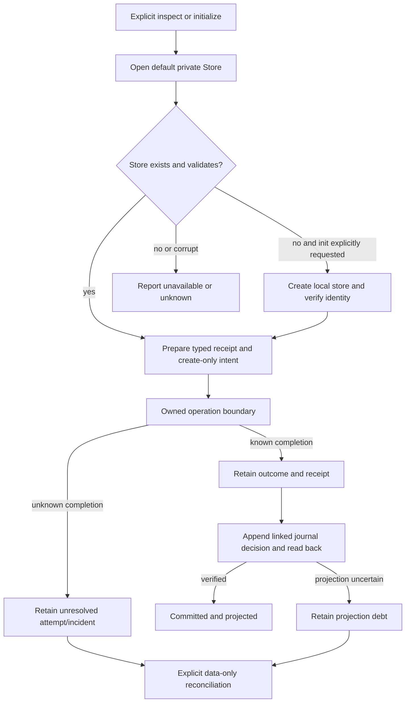

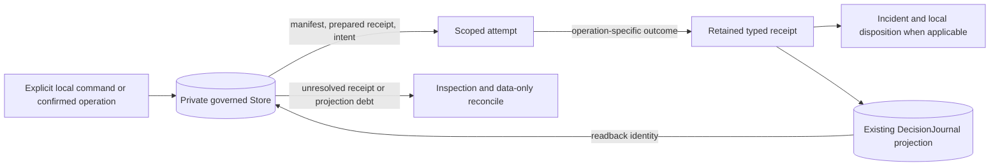

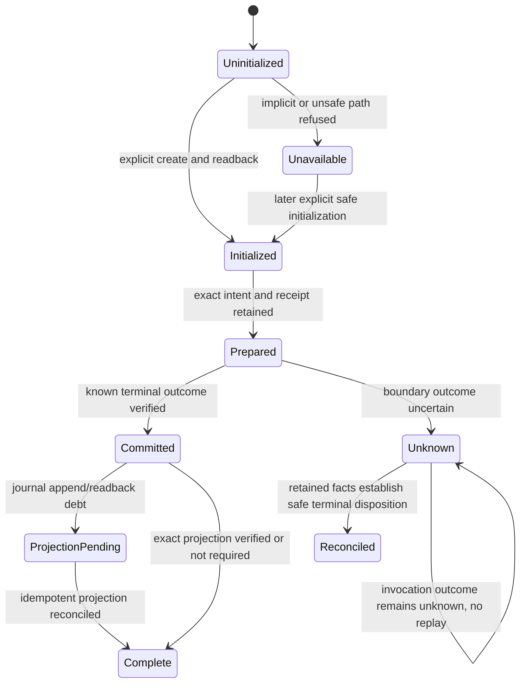

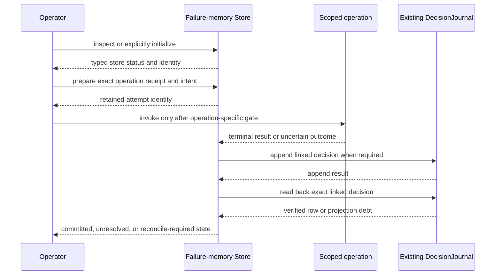

**Evidence references.** Sources: `internal/maat/memory.go`,
`internal/maat/memory_receipts.go`, `internal/maat/memory_prepared_receipts.go`,
`internal/maat/memoryguard.go`, `internal/maat/memory_root.go`,
`internal/maat/memory_liveness.go`, `internal/maat/memory_intake.go`,
`internal/maat/memory_local_events.go`,
`internal/maat/memory_local_disposition.go`,
`internal/maat/memory_app_update.go`, `internal/maat/memory_diagnostic.go`,
`cmd/sirsi/maatmemory.go`, `cmd/sirsi/maatmemory_prepared.go`,
`cmd/sirsi/maatmemory_local.go`, and
`cmd/sirsi/maatrepair_liveness.go`.
Tests: `internal/maat/memory_test.go`, `memory_receipts_test.go`,
`memory_receipt_recovery_test.go`, `memory_prepared_receipts_test.go`,
`memoryguard_test.go`, `memory_root_test.go`, `memory_local_lifecycle_test.go`,
`cmd/sirsi/maatmemory_test.go`, `maatmemory_prepared_test.go`,
`maatmemory_local_test.go`, and `cmd/sirsi/maatrepair_liveness_test.go`.

**Recovery and boundary.** Initialize only through the explicit command and
verify the exact store. Reconcile retained records and idempotent journal
projection. Unknown invocation outcomes remain unresolved and are never
replayed by inspection or journal repair.

<a id="pt-p46"></a>
## PT-P46 — Managed liveness watch and selected repair

**Plain English.** The local watch path observes bounded per-user metadata and
records a typed result in Ma'at. Install, run, status, uninstall, and restore of
an explicitly disabled state are distinct operations. A selected repair
reviews the exact finding and manifest, confirms consent, retains an attempt,
revalidates the local engine, installs only the selected watch, and makes a
fresh post-observation. Reconciliation can finish evidence projection but
does not repeat an uncertain installation.

```mermaid
flowchart TD
  OP[Operator chooses watch action] --> ACTION{run, status, install, uninstall, restore-disabled?}
  ACTION -->|run| OBS[Read bounded local watch metadata]
  ACTION -->|status| READ[Inspect current local watch state]
  ACTION -->|install/uninstall/restore| EXPLICIT[Validate explicit lifecycle request]
  OBS --> RECORD[Record local observation in Ma'at journal]
  EXPLICIT --> FINDING[Selected actionable finding and exact manifest]
  FINDING --> REVIEW[Show bounded plan and obtain confirmation]
  REVIEW --> PREFLIGHT[Revalidate engine, memory and current watch state]
  PREFLIGHT --> ATTEMPT[Retain attempt before installer boundary]
  ATTEMPT --> INSTALL[Apply selected per-user watch change]
  INSTALL --> POST[Fresh bounded post-observation]
  POST --> OUTCOME[Retain outcome and project evidence]
  POST -->|unknown| DEBT[Keep attempt unresolved, prohibit replay]
```

```mermaid
flowchart LR
  WATCH[Per-user watch metadata] --> OBS[LocalWatch observer]
  OBS --> JOURNAL[(Existing per-user Ma'at journal)]
  USER[Explicit owner selection and confirmation] --> CLI[maat repair liveness-watch]
  CLI --> STORE[(Failure-memory attempt and outcome)]
  CLI -->|selected exact lifecycle operation only| AGENT[Per-user launchd watch]
  AGENT --> POST[Fresh local metadata observation]
  POST --> STORE
  STORE --> JOURNAL
  STATUS[status command] -->|read only| AGENT
```

```mermaid
stateDiagram-v2
  [*] --> Unobserved
  Unobserved --> Observed: explicit run and metadata read succeeds
  Unobserved --> Unknown: metadata read fails
  Observed --> Finding: exact actionable finding exists
  Observed --> NoChange: no actionable finding
  Finding --> AwaitingConsent: exact manifest presented
  AwaitingConsent --> Refused: consent missing or evidence stale
  AwaitingConsent --> AttemptPrepared: receipt and intent retained
  AttemptPrepared --> Applied: selected install/uninstall/restore completes
  AttemptPrepared --> Unknown: action boundary or result uncertain
  Applied --> Postchecked: fresh observation recorded
  Unknown --> Reconciled: retained evidence and projection reconciled
  Unknown --> Unknown: action outcome remains uncertain, no replay
```

```mermaid
sequenceDiagram
  participant Owner
  participant CLI as Ma'at repair CLI
  participant Store as Local failure memory
  participant Launchd as Selected per-user watch
  participant Journal as Existing Ma'at journal
  Owner->>CLI: select exact finding and confirm displayed manifest
  CLI->>Store: retain attempt and prepared receipt
  CLI->>Launchd: apply one selected lifecycle change
  Launchd-->>CLI: operation result or uncertainty
  CLI->>Launchd: fresh bounded status/metadata observation
  Launchd-->>CLI: post-observation or unavailable
  CLI->>Store: retain outcome and local disposition
  Store->>Journal: append/read back linked decision
  Journal-->>Store: verified projection or debt
  Store-->>Owner: postcheck and retained state
```

**Evidence references.** Sources: `internal/liveness/localwatch.go`,
`internal/liveness/localinstall_unix.go`, `cmd/sirsi/livenesswatchcmd.go`,
`cmd/sirsi/maatrepair_liveness.go`, `internal/maat/memory_liveness.go`,
and `docs/LOCAL_LIVENESS_WATCH.md`.
Tests: `internal/liveness/localwatch_test.go`,
`internal/liveness/localinstall_darwin_test.go`,
`internal/liveness/localwatch_completion_darwin_test.go`,
`cmd/sirsi/livenesswatch_local_test.go`, and
`cmd/sirsi/maatrepair_liveness_test.go`.

**Recovery and boundary.** On uncertain action completion, inspect fresh
status and reconcile retained evidence; do not reinstall automatically.
`restore-disabled` preserves the user's disabled preference. Source fixtures do
not establish installed watch behavior.

<a id="pt-p47"></a>
## PT-P47 — Binary drift repair and updater no-replay boundary

**Plain English.** The binary-only repair route screens exact managed targets,
shows a typed preview, and asks for explicit confirmation. The Homebrew path
uses the existing owned updater once; the raw CLI self-update is a separate
route through the existing SafeReplace owner. Both retain attempts and an
invocation barrier before acting, then require fresh identity and schema
postchecks. An unknown updater result blocks replay. This row does not describe
the whole-app signed-PKG/Installer route.

```mermaid
flowchart TD
  FINDING[Canonical binary-drift finding] --> SCREEN[Require exact binary-only System One screen]
  SCREEN --> TARGETS[Resolve paths, manager, versions, hashes and provenance]
  TARGETS --> PREVIEW[Typed preview bound to exact targets]
  PREVIEW --> CONFIRM{Owner confirms exact preview?}
  CONFIRM -->|no| REF[Refuse without updater call]
  CONFIRM -->|yes| RETAIN[Retain receipt, attempt and invocation barrier]
  RETAIN --> ROUTE{Target route}
  ROUTE -->|Homebrew| BREW[Existing owned updater once]
  ROUTE -->|raw CLI self-update| RAW[Existing SafeReplace owner]
  BREW --> POST[Fresh bounded target identity and schema observations]
  RAW --> POST
  POST -->|exact expected targets| RESULT[Retain factual result and linked projection]
  POST -->|unknown or mismatched| UNKNOWN[Keep unresolved and refuse replay]
```

```mermaid
flowchart LR
  OBS[Screen and provenance observations] --> PREVIEW[Exact typed preview]
  PREVIEW --> STORE[(Failure-memory receipt and attempt)]
  STORE --> JOURNAL[(Operation-wide journal claim, if exact ownership link is retained)]
  STORE -->|invocation barrier| UPDATER[Homebrew updater or raw SafeReplace route]
  UPDATER --> TARGETS[Managed binary targets]
  TARGETS --> POST[Fresh postcheck]
  POST --> STORE
  STORE -->|terminal projection intent and readback| JOURNAL
  BROWSE[Casebook/history] -. read only, no replay authority .-> STORE
```

```mermaid
stateDiagram-v2
  [*] --> Screened
  Screened --> Refused: target, source, or screen is not exact
  Screened --> Previewed: all target identities match preview
  Previewed --> NotInvoked: owner declines or preflight fails
  Previewed --> Retained: exact confirmation and receipt stored
  Retained --> Invoked: typed invocation barrier read back
  Invoked --> Terminal: updater completion observed
  Invoked --> Unknown: interruption or outcome unavailable
  Terminal --> Postchecked: fresh exact identity and schema checks
  Postchecked --> Projected: terminal record and journal projection verified
  Postchecked --> ProjectionDebt: terminal known, projection not verified
  ProjectionDebt --> Projected: data-only reconciliation
  Unknown --> Unknown: no replay while invocation outcome is unknown
```

```mermaid
sequenceDiagram
  participant Owner
  participant CLI as Canonical repair command
  participant Store as Governed Ma'at Store
  participant Journal as Existing operation-wide journal
  participant Updater as Existing updater/SafeReplace owner
  Owner->>CLI: review and confirm exact typed preview
  CLI->>Store: retain attempt and full-manifest receipt
  Store->>Journal: claim operation when ownership can be proven
  Journal-->>Store: exact claim evidence or refusal
  CLI->>Store: retain and read back invocation barrier
  CLI->>Updater: invoke once after final revalidation
  Updater-->>CLI: terminal result or unknown
  CLI->>Updater: observe exact target identities and schema
  CLI->>Store: retain outcome and projection intent
  Store->>Journal: append/read back terminal projection
  Journal-->>Store: verified projection or retained debt
```

**Evidence references.** Sources: `cmd/sirsi/maatrepair_binary_drift.go`,
`cmd/sirsi/selfupdate.go`, `cmd/sirsi/selfupdate_maat.go`,
`cmd/sirsi/owned_updater_unix.go`,
`internal/selfupdate/selfupdate.go`, `internal/maat/memory_binary_update.go`,
`internal/maat/memory_raw_self_update.go`,
`internal/maat/memory_diagnostic.go`, and
`internal/maat/casebook/casebook.go`.
Tests: `cmd/sirsi/maatrepair_binary_drift_test.go`,
`cmd/sirsi/selfupdate_maat_test.go`, `cmd/sirsi/owned_updater_unix_test.go`,
`internal/selfupdate/probe_bounded_unix_test.go`,
`internal/maat/memory_binary_update_test.go`,
`internal/maat/memory_raw_self_update_test.go`,
`internal/maat/casebook/history_repair_test.go`,
and `cmd/sirsi/maatcasebook_repair_history_test.go`.

**Recovery and boundary.** A retained not-invoked fact can be reconciled as
not-invoked; a known terminal outcome can complete projection/readback debt.
Invocation with unknown outcome remains unresolved and cannot be replayed.
Neither this path nor its tests establish installed-release qualification.

<a id="pt-p48"></a>
## PT-P48 — Private known-failure proposals and review promotion

**Plain English.** The known-failure catalog is read separately from private
proposals. Source implements a create-only local proposal queue and a separate
source-catalog registration/resolution path. The native surface exposes a
Stack Lab review route, but there is no proposal status mutation or promotion
command: a reviewer must assess the exact proposal and use the existing RA-02
governed catalog subflow to register it. Resolution of a
catalog entry separately requires a real regression guard. Proposal creation
does not edit the canonical catalog.

```mermaid
flowchart TD
  AUTHOR[Owner records recurring issue] --> PROPOSAL[Create private proposal]
  PROPOSAL --> VALIDATE[Validate identity, fields and evidence]
  VALIDATE -->|invalid| HOLD[Keep rejected or private]
  VALIDATE -->|valid| QUEUE[(Private proposal queue)]
  REVIEWER[Reviewer inspects proposal] --> QUEUE
  QUEUE --> REVIEW[Visible Stack Lab review route]
  REVIEW -->|not selected for promotion| PRIVATE[Proposal remains local and proposed]
  REVIEW -->|selected for catalog registration| HANDOFF[Explicit reviewer handoff to RA-02]
  HANDOFF --> PROMOTE[RA-02 governed catalog registration subflow]
  PROMOTE --> CATALOG[(Canonical known-failure catalog)]
  CATALOG --> GUARD[Later resolve requires real regression guard]
```

```mermaid
flowchart LR
  CLI[maat knownfail commands] --> PROPOSAL[(Private proposal records)]
  PROPOSAL --> REVIEW[Explicit review and guard validation]
  REVIEW -->|explicit reviewed handoff| RA02[RA-02 catalog registration subflow]
  RA02 --> CATALOG[(internal/maat/knownfail/catalog.json)]
  CATALOG --> RESOLVE[Separate resolve requires real regression guard]
  READ[Catalog listing] --> CATALOG
  CATALOG --> READ
  REVIEW -. no proposal status mutation .-> PROPOSAL
```

```mermaid
stateDiagram-v2
  [*] --> Draft
  Draft --> Queued: valid private proposal retained
  Draft --> Rejected: malformed or unsafe proposal
  Queued --> ReviewRoute: reviewer opens visible Stack Lab route
  ReviewRoute --> Queued: not promoted, proposal remains proposed
  ReviewRoute --> Handoff: reviewer explicitly hands off to RA-02
  Handoff --> Promoted: governed registration succeeds
  Promoted --> GuardRequired: later resolution requires a real regression guard
  GuardRequired --> Resolved: guard exists and catalog resolution succeeds
  Resolved --> [*]
```

```mermaid
sequenceDiagram
  participant Author
  participant CLI as Known-failure CLI
  participant Queue as Private proposal queue
  participant Reviewer
  participant Catalog as Canonical catalog
  Author->>CLI: register recurring issue
  CLI->>Queue: validate and retain private proposal
  Queue-->>CLI: proposal identity and status
  Reviewer->>CLI: review exact proposal
  CLI->>Queue: read proposal and validate disposition
  Queue-->>CLI: proposal evidence
  opt promotion approved and regression guard exists
    CLI->>Catalog: apply governed catalog promotion
    Catalog-->>CLI: promoted record or refusal
  end
  CLI-->>Reviewer: retained review or promotion result
```

**Evidence references.** Sources: `internal/maat/knownfail/proposal.go`,
`internal/maat/knownfail/registrar.go`, `internal/maat/knownfail/knownfail.go`,
`internal/maat/knownfail/catalog.json`, `cmd/sirsi/maatknownfail.go`, and
`macapp/Sources/SirsiMenubar/MaatCasebookView.swift`.
Tests: `internal/maat/knownfail/proposal_test.go`,
`internal/maat/knownfail/knownfail_test.go`,
`internal/maat/knownfail/registrar_test.go`, and
`macapp/Tests/SirsiMenubarTests/CoreContractsTests.swift`.

**Recovery and boundary.** Invalid proposals are refused at creation or read;
an incomplete review leaves the proposal in its proposed state. The native
surface exposes a Stack Lab review route but no proposal status mutation or
direct promotion operation; the reviewer must carry the reviewed proposal into
RA-02. Registration and resolution are distinct catalog changes. The private
queue is not the canonical known-failure catalog.

<a id="pt-p49"></a>
## PT-P49 — Resource capacity reservations and executor cleanup

**Plain English.** The scheduler reads configured capacity, checks a requested
resource grant against current reservations, and retains a bounded heartbeat
lease before admission. Core and memory amounts are advisory to the scheduler;
the selected caller/executor must honor those grants. If memory capacity has no
explicit receipt or configuration, it remains unknown rather than being
invented. A reservation can be renewed or extended only through its current
identity; release ends its claim. Cede is a separate voluntary request and
does not itself mutate the reservation. Conflict and defer are explicit
results. Executor admission and cleanup are separate: an admitted job is
released after the owned job group is stopped and direct children are reaped;
unknown cleanup remains held for reconciliation instead of freeing capacity by
assumption.

```mermaid
flowchart TD
  REQUEST[Capacity request] --> CAP[Read typed capacity and memory floor]
  CAP --> CONFLICT{Conflicts or insufficient reserve?}
  CONFLICT -->|yes and caller requests queue| QUEUE[Retain queued reservation]
  CONFLICT -->|yes and caller does not queue| DEFER[Return conflict/defer or floor grant]
  CONFLICT -->|no| RESERVE[Create bounded reservation]
  QUEUE -->|prior holder ends and admission rechecked| RESERVE
  RESERVE --> ADMIT[Admit selected executor]
  ADMIT --> RUN[Run within grant and lease]
  RUN --> TERM{Terminal state and cleanup known?}
  TERM -->|yes| RELEASE[Release or cede reservation]
  TERM -->|no| HOLD[Retain reservation and cleanup debt]
  HOLD --> RECOVER[Inspect owned executor and reconcile]
  RECOVER -->|verified cleanup| RELEASE
  RECOVER -->|unknown| HOLD
  RUN --> RENEW[Heartbeat renewal or explicit extension]
  RENEW --> RUN
  CEDE[Separate holder/requester cede request and response] -->|pending cede can cap future grant to floor| CONFLICT
```

```mermaid
flowchart LR
  SEBA[Typed capacity authority] --> SCHED[Ma'at scheduler]
  REQUEST[Resource request] --> SCHED
  SCHED -->|reservation, expiry, grant| STORE[(Canonical local reservation store)]
  SCHED -->|separate requests and responses| CEDEST[(Cede ledger)]
  CEDEST -->|pending cede references| STORE
  STORE --> ADMISSION[Selected admission controller]
  ADMISSION --> EXEC[Selected executor]
  EXEC --> JOB[Owned job group]
  JOB --> CLEANUP[Stop and reap owned children]
  CLEANUP --> STORE
  SCHED -->|conflict or defer| USER[Caller]
```

```mermaid
stateDiagram-v2
  [*] --> Unreserved
  Unreserved --> Deferred: capacity unavailable and no queue requested
  Unreserved --> Queued: caller requests waiting behind live holder
  Unreserved --> Reserved: bounded grant retained
  Queued --> Reserved: holder ends and admission is rechecked
  Reserved --> Running: executor admission succeeds
  Running --> Renewed: valid heartbeat renewal
  Renewed --> Running
  Running --> Extended: explicit extension rechecks grant
  Extended --> Running
  Running --> CedePending: cede request recorded separately
  CedePending --> Running: holder responds with grant, counter, or decline
  Running --> CleanupPending: job ending or lease boundary reached
  CleanupPending --> Released: owned cleanup verified
  CleanupPending --> HeldUnknown: stop/reap outcome uncertain
  HeldUnknown --> Released: reconciliation verifies cleanup
  HeldUnknown --> HeldUnknown: unknown executor remains
  Reserved --> Released: explicit release or cede before execution
  Deferred --> Unreserved: fresh request after capacity change
```

```mermaid
sequenceDiagram
  participant Client
  participant Scheduler as Ma'at scheduler
  participant Store as Reservation store
  participant Admission as Admission controller
  participant Executor
  Client->>Scheduler: request capacity grant
  Scheduler->>Store: inspect conflicts and retain reservation
  Store-->>Scheduler: reservation identity and expiry or conflict
  Scheduler-->>Client: reservation identity and advisory resource grant
  Client->>Admission: submit work under returned grant
  Admission->>Executor: run admitted work
  Executor-->>Admission: terminal result or uncertainty
  Admission->>Executor: stop owned process group and reap direct child
  Executor-->>Admission: cleanup result or uncertainty
  Admission->>Store: release only after verified cleanup
  Store-->>Client: released, deferred, or held status
```

**Evidence references.** Sources: `internal/maat/schedule/capacity.go`,
`internal/maat/schedule/reservation.go`, `internal/maat/schedule/conflict.go`,
`internal/maat/schedule/cede.go`, `internal/maat/schedule/plan.go`,
`cmd/sirsi/maatcapacity.go`,
`internal/stacklab/maat_recipe_test.go`, and the existing release admission
boundary in `scripts/maat/admitted-run.py`.
Tests: `internal/maat/schedule/reservation_test.go`,
`internal/maat/schedule/cede_test.go`,
`internal/routerstore/maatscheduler_test.go`,
`internal/routerstore/maatcpufloororder_test.go`, and
`scripts/maat/test_release_admission.py`.

**Recovery and boundary.** Renew, extend, release, and cede require the current
reservation identity. Unknown executor cleanup remains reserved/held. The
capacity planner does not itself start inference; the recipe keeps SNE
admission as the execution authority.

<a id="pt-p50"></a>
## PT-P50 — Finite delegated pod authority and dormant service recipe

**Plain English.** The canonical router scheduler owns a finite delegation.
Delegation changes such as delegate, renew, revoke, and booking operate on that
authority record and its expiry/nonce. The native authority service recipe is
a separate preparation path: it validates an existing fresh delegation and
creates a private dormant launch recipe. Preparation does not activate a
LaunchAgent, enable login startup, create credentials, or claim a running
service. Offline expiry and catch-up are bounded scheduler/reconciliation
states; stale authority cannot be made current by restoring an old recipe.

```mermaid
flowchart TD
  OWNER[Authorized delegation owner] --> MUTATE[Delegate, renew, revoke, or booking request]
  MUTATE --> SCHED[Canonical AtomicDelegationScheduler]
  SCHED --> CHECK[Validate finite scope, expiry, nonce and conflict]
  CHECK -->|accepted| AUTH[(Canonical delegation state)]
  CHECK -->|expired, duplicate, conflict or invalid| REF[Refuse or defer]
  AUTH --> SERVICE[Optional explicit recipe preparation]
  SERVICE --> VERIFY[Check fresh delegation, machine, bindings and installed engine]
  VERIFY -->|valid| RECIPE[Write selected private dormant recipe]
  VERIFY -->|invalid| HOLD[No recipe activation]
  RECIPE --> ACTIVATE{Separate explicit start/login consent?}
  ACTIVATE -->|no| DORMANT[Remain dormant]
  ACTIVATE -->|yes| NATIVE[Existing explicit service activation path]
  OFFLINE[Offline interval] --> EXPIRY[Expiry and nonce catch-up]
  EXPIRY --> SCHED
```

```mermaid
flowchart LR
  REQUEST[Finite delegation request] --> ROUTER[Canonical router scheduler]
  ROUTER --> DELEGATION[(Canonical delegation state)]
  ROUTER --> BOOKING[(Online/offline booking and nonce state)]
  DELEGATION --> PREP[authority-serve recipe preparation]
  INSTALLED[Canonical installed engine] --> PREP
  TLS[Explicit approved TLS path references and client bindings] --> PREP
  PREP -->|selected destination only| DORMANT[Private dormant recipe]
  DORMANT -. no implicit write .-> LAUNCH[LaunchAgents]
  DORMANT -. no secret material .-> CREDS[Credential store]
```

```mermaid
stateDiagram-v2
  [*] --> NoDelegation
  NoDelegation --> Delegated: canonical finite delegation accepted
  Delegated --> Renewed: authorized renewal before expiry
  Delegated --> Revoked: canonical revocation accepted
  Delegated --> Expired: expiry reached
  Delegated --> BookedOffline: bounded offline booking retained
  BookedOffline --> Catchup: canonical service reconnects
  Catchup --> Delegated: nonce and expiry reconcile current
  Catchup --> Expired: booking is stale or invalid
  Delegated --> RecipePrepared: separate explicit recipe preparation succeeds
  RecipePrepared --> Dormant: private recipe installed at selected destination
  Dormant --> Running: separate explicit start and login consent plus activation
  RecipePrepared --> Refused: installed engine or binding validation fails
  Revoked --> Refused
  Expired --> Refused
```

```mermaid
sequenceDiagram
  participant Owner
  participant Router as Canonical delegation scheduler
  participant Store as Delegation state
  participant CLI as Ma'at authority service preparation
  participant Engine as Canonical installed Sirsi engine
  Owner->>Router: finite delegate/renew/revoke/booking request
  Router->>Store: validate scope, expiry, nonce and conflicts
  Store-->>Router: accepted state or refusal
  opt owner separately requests dormant recipe preparation
    Owner->>CLI: prepare recipe for existing delegation
    CLI->>Store: verify fresh canonical delegation and machine binding
    CLI->>Engine: resolve installed engine and canonical registry directory
    Engine-->>CLI: canonical installed identity or refusal
    CLI->>CLI: write create-only private dormant recipe
    CLI-->>Owner: configured/verified/installed status, not running status
  end
```

**Evidence references.** Sources: `internal/setup/podauthority.go`,
`podauthority_darwin.go`, `cmd/sirsi/maatpodservice_darwin.go`,
`cmd/sirsi/maatpodauthority_unix.go`, `cmd/sirsi/maatdelegate.go`,
`internal/maat/schedule/delegation.go`, `internal/routerstore/maatscheduler.go`, and
`docs/user-guides/MAAT_POD_AUTHORITY_SERVICE.md`.
Tests: `internal/setup/podauthority_test.go`,
`cmd/sirsi/maatpodservice_darwin_test.go`,
`internal/stacklab/podauthority_recipe_test.go`,
`internal/packageinventory/inventory_test.go`,
`internal/maat/schedule/delegation_test.go`,
`internal/routerstore/maatscheduler_test.go`,
`internal/routerstore/maatdelegation_transaction_test.go`, and
`cmd/sirsi/maatpod_cli_qualification_test.go`.

**Recovery and boundary.** Re-read canonical delegation state and reconcile
nonce/expiry before preparing any new recipe. Occupied destinations are
preserved. Recipe preparation is dormant and source-described; activation and
running service behavior require separate evidence.

<a id="pt-p51"></a>
## PT-P51 — Public credential readiness observation and confirmed handoff

**Plain English.** Credential preflight reads only non-secret public
certificate observations and classifies required Developer ID identities as
observed, missing, or unavailable. Even when both identities are observed, the
overall release credential floor remains blocked because notarization is not
observed by this command. It never prints or copies private material.
When an owner confirms a readiness decision for handoff, Ma'at records that
decision in the canonical journal with an exact evidence identity. The public
observer and journal handoff are separate: observation alone does not authorize
release signing or credential use.

```mermaid
flowchart TD
  REQUEST[Release credential readiness request] --> OBSERVE[Observe local non-secret certificate metadata]
  OBSERVE --> CLASSIFY{Observation result}
  CLASSIFY -->|complete observation includes required identities| IDENTITIES[Developer ID identities observed]
  CLASSIFY -->|complete observation omits required identity| MISSING[Missing identity]
  CLASSIFY -->|probe failed or output partial| UNAVAILABLE[Unavailable observation]
  IDENTITIES --> REVIEW[Owner reviews exact evidence]
  MISSING --> REVIEW
  UNAVAILABLE --> REVIEW
  REVIEW --> CONFIRM{Explicit confirmed journal handoff?}
  CONFIRM -->|no| STATUS[Return observation only]
  CONFIRM -->|yes| JOURNAL[RecordSystemOne appends confirmed readiness decision]
  JOURNAL -->|success| RECORDED[Handoff recorded]
  JOURNAL -->|error| ERROR[Return record error]
```

```mermaid
flowchart LR
  PUBLIC[Non-secret certificate metadata] --> PREFLIGHT[Credential preflight observer]
  PREFLIGHT --> RESULT[Required Developer ID identities observed, absent, or observation unavailable]
  RESULT --> NOTARY[Notarization deliberately not inspected]
  RESULT --> OWNER[Owner review and explicit confirmation]
  OWNER --> JOURNAL[(Canonical DecisionJournal)]
  JOURNAL -->|RecordSystemOne result| RESULT
  SECRET[Private keys and notarization credentials] -. never read or emitted .-> PREFLIGHT
  RESULT -. does not grant .-> SIGN[Signing or publication authority]
```

```mermaid
stateDiagram-v2
  [*] --> NotObserved
  NotObserved --> IdentitiesObserved: complete observation includes required identities
  NotObserved --> Missing: complete observation omits required identity
  NotObserved --> Unavailable: command fails or output is partial
  IdentitiesObserved --> Reviewed: exact evidence shown to owner
  Missing --> Reviewed: exact evidence shown to owner
  Unavailable --> Reviewed: uncertainty shown to owner
  Reviewed --> ObservationOnly: handoff not confirmed
  Reviewed --> HandoffPrepared: explicit confirmation retained
  HandoffPrepared --> Recorded: RecordSystemOne append succeeds
  HandoffPrepared --> RecordError: journal append returns an error
  Recorded --> [*]
  RecordError --> Reviewed: owner may rerun a fresh explicit confirmed check
```

```mermaid
sequenceDiagram
  participant Owner
  participant CLI as Credential preflight
  participant Observer as Public credential observer
  participant Journal as DecisionJournal
  Owner->>CLI: request readiness observation
  CLI->>Observer: read non-secret metadata only
  Observer-->>CLI: ready, missing, unavailable, or invalid
  CLI-->>Owner: bounded evidence and precise state
  opt explicit owner-confirmed handoff
    Owner->>CLI: confirm exact evidence and decision
    CLI->>Journal: RecordSystemOne append readiness decision
    Journal-->>CLI: appended decision evidence or error
    CLI-->>Owner: recorded decision evidence or journal error
  end
```

**Evidence references.** Sources: `internal/maat/credentialpreflight.go`,
`cmd/sirsi/maatpreflight.go`, `internal/maat/decisions.go`,
`macapp/Sources/SirsiMenubar/MaatCasebookView.swift`, and
`macapp/Sources/SirsiMenubar/ReleaseWorkspaceView.swift`.
Tests: `internal/maat/credentialpreflight_test.go`,
`macapp/Tests/SirsiMenubarTests/CoreContractsTests.swift`,
`internal/stacklab/maat_recipe_test.go`, and
`scripts/verify-maat-credential-preflight-contract.sh`.

**Recovery and boundary.** If the `security find-identity` observation fails
or returns partial output, report unavailable rather than infer missing
identities. A complete observation that omits a required Developer ID
identity can report it missing. Notarization credentials are deliberately not
observed here; they are not a missing local observation. `--confirm` records
the resulting System One verdict through `RecordSystemOne`. Credential
readiness is an observation and journal handoff, not signing, key access, or
publication authority.
