# Pantheon PT diagrams — product operations census

**Process IDs:** PT-P52–PT-P56 and PT-P68–PT-P84  
**Reviewed source pin:** `e26e324be107ab541ec8d4d1400392e1ee55fc26`  
**Implementation label:** Source-described at this pin. Runtime, installed-host and production observations are **UNKNOWN** unless a linked existing receipt says otherwise. These diagrams do not promote source or tests to qualification or certification.

This sidecar adds 22 process groups to the Pantheon PT census. Together with PT-P01–PT-P40 and the concurrent PT-P41–PT-P51 and PT-P57–PT-P67 owners, the target whole-wing denominator is 84. This file covers its assigned 22/22 IDs. It makes no claim that the concurrent groups or the whole-wing census are complete.

The diagrams name source-supported branches. Unsupported or unverified behavior is marked explicitly. No diagram below authorizes live model, GPU, network, host-service, destructive-cleanup, signing, release, or mirror activity.

## Requirement, owner, source and next-action crosswalk

`PT-REQ` and `PT-US` descriptions refer to this candidate’s current Pantheon PT PRD and stories, separately from the behavior source pin. Tests are cited by checked-in path or name only. They were not run for this documentation change.

| Process | Owner and mapping | Source and existing evidence anchor | Source state and next action |
|---|---|---|---|
| PT-P52 Stack Lab doctor, origin/pin/roster/catalog and Ma’at handoff | Pantheon PT, Stack Lab contract owners, Ma’at preflight owner. PT-REQ-05,08,10,11. PT-US-05,08,10. | `cmd/sirsi/stacklabcmd.go`, `internal/stacklab/doctor.go`, `internal/stacklab/catalog.go`, `StackLabView.swift`, `StackLabCatalogView.swift`, `internal/maat/releasepreflight.go`; `internal/stacklab/doctor_test.go`, `catalog_test.go`, native Stack Lab contract/accessibility fixtures; recipes `native-stacklab-surface-recipe-v1.json`, `pantheon-native-workspace-v1.json`, `maat-system-one-recipe-v1.json`, `pantheon-release-artifact-recipe-v1.json`. | Read-only source path and typed handoff. Next: independently qualify installed origin/pin and selected-project handoff, retaining unknown on unavailable reads. |
| PT-P53 Apollo plan and admitted installed native chat | Apollo owns inference/profile/telemetry; Ma’at owns admission; Pantheon owns UI projection. PT-REQ-05,07,08,09,10. PT-US-05,08,09. | `internal/apollo/catalog.go`, `telemetry.go`, `cmd/sirsi/apollo.go`, `apollo_native.go`, `ApolloRunPlannerView.swift`; `internal/apollo/catalog_test.go`, `telemetry_test.go`, `cmd/sirsi/apollo_native_test.go`; `apollo-sne-telemetry-v1.json`, native workspace and Ma’at system-one recipes. | Plan is non-executing. Native chat is source-described and profile/admission-bound. Next: separate signed installed-profile and authorized run/teardown receipt. No general cluster is inferred. |
| PT-P54 Ask and model-routing | Pantheon model-router owner, provider owners, Ma’at privacy/evidence owner. PT-REQ-01,06,07,09. PT-US-01,06,07,09. | `cmd/sirsi/ask.go`, `internal/modelrouter/router.go`, `stream.go`, `decision_record.go`, `internal/provider`; `internal/modelrouter/*_test.go`, `cmd/sirsi/ask_requirements_test.go`; `model-router-v1-recipe-v1.json`. | Source-described policy and redacted decision journal. Next: current-head composed route/stream qualification and actual routed-request evidence. No prompt/output journal is claimed. |
| PT-P55 Human/shared Gemma lifecycle | Pantheon broker/worker integration; Ra owns router item and lease authority; Apollo owns qualified model. PT-REQ-01,07,09. PT-US-01,06,09. | Lifecycle source at `e3e457e2d95576d63cb0149dbe0e34aad5785928`: `internal/setup/launchdgemma.go`, `internal/setup/launchdgemma_darwin.go`, `cmd/sirsi/gemma_worker.go`, `internal/routerstore/lease.go`; adjacent shared, serve, quarantine and orphan-reap sources; tests `internal/setup/launchdgemma_test.go`, `internal/setup/launchdgemma_native_darwin_test.go`, `cmd/sirsi/gemma_worker_test.go` are separate component evidence; Ra-Horus fabric and Apollo telemetry recipes. | Source describes durable lane acquire-intent, idle barrier, joined worker and lease maintainer pause, child-registration closure, PID/kernel-child absence checks, replacement identity readback and guarded restart. Next: independently qualify installed lifecycle, broker/service and native receipt. Source tests are not qualification receipts and were not run here. No live GPU or model run in this task. |
| PT-P56 Mercury producer contract and consumers | Mercury owns producer/schema; Pantheon CLI, web, MCP and native components own their projections. PT-REQ-05,07,08,10. PT-US-05,08,09. | `internal/mercury/{dashboard-v1.schema.json,reader.go,presentation.go,scene.go}`, `cmd/sirsi/mercury.go`, `internal/mcp/mercury.go`, `internal/dashboard/mercury.go`, `MercuryMonitor.swift`, `MercuryWorkspaceRefresh.swift`; reader, MCP, dashboard and native Mercury fixtures; `mercury-consumer-recipe-v1.json`, `pantheon-native-workspace-v1.json`, `apollo-sne-telemetry-v1.json`. | Reader/consumer source is present; producer runtime unknown. Next: pin producer schema and qualify fresh/stale/error parity across actual installed consumers. |
| PT-P68 Storage scan, judge and selected cleanup | Anubis/Jakal and Ka scan owners; Scales policy owner; Anubis cleaner owner. PT-REQ-05,06,09. PT-US-05,06,07. | `cmd/sirsi/main.go`, `cmd/sirsi/anubis.go`, `internal/jackal`, `internal/ka`, `internal/scales`, `internal/cleaner`; scan, policy, purge, duplicate and ghost fixtures; Ma’at system-one recipe. | Source-described scan and dry-run/confirmation boundaries. Next: host-specific evidence for each selected cleanup and retained partial/cancel result. No purge was executed. |
| PT-P69 Hapi live resource guard and swap hygiene | Hapi/guard owner, with Gemma broker and OS process owners retaining their authority. PT-REQ-05,07,09. PT-US-05,06,09. | `cmd/sirsi/hapi.go`, `internal/guard/hapi.go`, `hapi_daemon.go`, `relieve.go`, `internal/reaper`, `internal/swaphygiene`; Hapi, relieve, reaper and swap-hygiene fixtures. | Warn-only by default; governed processes can be suspended/resumed and at emergency killed. Kill is not reversible. Next: live pressure/host qualification and operation-specific recovery proof. |
| PT-P70 Isis diagnosis and bounded repair | Isis owns diagnosis contract; guard/platform adapters own each network, LaunchServices and Spotlight control. PT-REQ-05,06,09. PT-US-05,06,07. | `cmd/sirsi/main.go`, `internal/isis`, `internal/guard/{doctor.go,network.go,spotlightmarkers.go}`, `internal/autoheal`, `internal/brain/spotlight.go`; Isis, network, Spotlight-marker and remediation fixtures. | Source contains distinct diagnostics and supported repairs. Next: host-specific preflight, selected consent, postcheck and retained recovery per adapter. No host repair was run. |
| PT-P71 Horus code context and Vault | Horus owns code graph/context; Vault owns local content/index store; RTK owns output filtering. PT-REQ-05,06,08,09. PT-US-05,07,08. | `internal/horus`, `internal/vault`, `internal/rtk`, `cmd/sirsi/vault.go`, `cmd/sirsi/horus.go`; Horus parser/watcher and Vault store/index/search/prune fixtures; Ma’at system-one recipe where shared local reads apply. | Independent local read/store/index paths are source-described. Next: qualify bounded local traversal, data retention and cross-surface filter parity. No code indexing was run. |
| PT-P72 Thoth init, sync, compact, status and continuation | Thoth owns continuity file formats and journal; repo owns its source files. PT-REQ-02,09,11. PT-US-02,10. | `internal/thoth/{init.go,sync.go,compact.go,journal.go,router_snapshot.go}`, `cmd/sirsi/thoth.go`, `thoth_status.go`, `internal/seshat/adapter_thoth.go`; Thoth init/sync/compact/status fixtures. | Source-described local continuation. Next: qualify idempotent sync and bounded continuation on a selected repo with before/after file identity. Model memory is not canonical evidence. |
| PT-P73 Workstream lifecycle and Neith alignment | Workstream owner and Neith goal-weaving owner; target repo owns PRD, ADR and evidence. PT-REQ-04,08,11. PT-US-04,08,10. | `internal/workstream`, `cmd/sirsi/workstream.go`, `internal/work`, `internal/neith`, `internal/prd`; workstream and Neith loom fixtures. | CRUD/launch and source alignment are distinct paths. Next: qualify exact target repo, owner authority and evidence links. No automatic satisfy/waive authority is inferred. |
| PT-P74 Osiris risk and checkpoint | Osiris owns risk/checkpoint source; Git owns commit state. PT-REQ-02,04,09. PT-US-02,04. | `internal/osiris/{osiris.go,checkpoint.go}`, `cmd/sirsi/osiris.go`; `internal/osiris/osiris_test.go`, checkpoint fixtures. | Risk is observational; checkpoint is an explicit Git mutation. Next: qualify retained dirty-work identity and checkpoint/restore boundary on actual selected worktrees. No checkpoint was created. |
| PT-P75 Seba discovery, topology, fleet, profile and compute | Seba owns local topology/hardware projections; Scarab/network owner controls fleet discovery; Vitals/Insight own their schemas. PT-REQ-05,07,09,10. PT-US-05,08,09. | `cmd/sirsi/seba.go`, `internal/seba`, `internal/vitals`, `internal/insight`, `internal/scarab`; Seba and hardware/profile fixtures. | Local observation is source-described. Fleet discovery requires explicit targets/confirmation. Next: host-specific source/freshness and explicit benchmark evidence. No network scan or benchmark was run. |
| PT-P76 Brain roles and Conduit | Brain owns provider/role policy; Ra owns task dispatch; Conduit owns installed tick scheduling. PT-REQ-01,04,07,09. PT-US-01,04,09. | `internal/brain`, `cmd/sirsi/braincmd.go`, `cmd/sirsi/conduitarm.go`, `conduittick.go`, `internal/horus/conduit.go`; brain config/controlplane and conduit fixtures. | Autonomous operation defaults off; an armed scheduler is distinct from one explicit tick. Next: qualify provider resolution, grant, task mutation and disarm/readback on the supported host. No tick was run. |
| PT-P77 Desktop custody and authenticated recovery | Desktop custody owner, Ra/router custody authority, desktoprecovery gateway owner, host operator. PT-REQ-04,05,09. PT-US-02,04,05. | `internal/desktopcustody`, `cmd/sirsi/desktopsleep.go`, `internal/desktoprecovery`, `cmd/sirsi/recovery.go`; custody return/budget/controller tests and gateway auth/replay tests. | Finite sleep and bounded authenticated recovery are separate. Next: actual host enrollment, expiry/replay refusal and independently authenticated return qualification. No sleep or recovery session occurred. |
| PT-P78 Seshat compatibility import/export | Ma’at owns canonical knowledge; Seshat owns compatibility adapters and explicit export only. PT-REQ-06,08,09. PT-US-07,08. | `cmd/sirsi/seshat.go`, `internal/seshat`, `internal/maat/knowledge`; Seshat adapter and Ma’at knowledge fixtures. | Local Claude ingestion delegates to Ma’at. Chrome profile ingestion, unsupported adapters, prune and bidirectional sync refuse. Next: qualify one explicitly configured local source and one separately selected export target. No new user authority is added. |
| PT-P79 Mail poison and sender census | Ma’at/Anubis hygiene; mailbox account owner retains OAuth consent. PT-REQ-05,06,09. PT-US-05,06,07. | `cmd/sirsi/mailopscmd.go`, `internal/mailops/{auth.go,authflow.go,gmail.go,mailops.go,receipt.go}`; `internal/mailops/mailops_test.go`. | Poison scan defaults dry-run. Apply only archives by removing INBOX label and records a local receipt. Sender census is read-only. OAuth scopes exclude send and delete-all. Next: explicit mailbox consent and reviewed archive outcome if ever operated. |
| PT-P80 First-run setup and install lifecycle | Pantheon setup owner; selected surface/dependency installers and macOS package owner retain their own writes. PT-REQ-03,04,05,10. PT-US-03,04,05. | `cmd/sirsi/setup.go`, `internal/setup`, `internal/runner`, `cmd/sirsi/main.go`, native app entry/lifecycle sources; setup, installer and runner fixtures; native workspace and release artifact recipes. | Setup status and selected installers are source-described. Next: signed installed-host install/refresh/uninstall readback and per-surface single-instance evidence. No installer was invoked. |
| PT-P81 Activity and Stele event custody | Oplog owns destructive-operation readback; Stele owns hash-chained event log; Ma’at owns consent/decision records; native surfaces own presentation. PT-REQ-02,05,06,09. PT-US-02,05,06,10. | `cmd/sirsi/activitycmd.go`, `internal/oplog`, `internal/stele`, native activity and Ma’at views; oplog and Stele append/read/verify fixtures; Ma’at system-one recipe. | Oplog and Stele are distinct stores. Next: qualify capture-to-postcheck correlation and native consent-once presentation. Unknown outcome stays unknown. |
| PT-P82 Web, TUI and MCP surface protocols | Dashboard, TUI and MCP owners; Ra owns the router-MCP subsystem only. PT-REQ-01,05,08,09. PT-US-01,05,08. | `internal/dashboard/{actions.go,runner.go,server.go,events.go}`, `internal/tui`, `internal/mcp/{server.go,tools.go,resources.go}`, `cmd/sirsi/main.go`; dashboard confirmation/runner, TUI and MCP fixtures; Ra-Horus and native surface recipes. | Independent protocol paths are source-described. PT-P04 is only the router shared-core MCP process. Next: qualify authorization/confirmation, SSE cancellation, TUI health and tool/resource admission per surface. |
| PT-P83 Qualification, pre-push and review bind | Source owner writes controls; finite Ma’at runner owns admitted execution; independent reviewer owns result binding. PT-REQ-03,08,11. PT-US-03,08,10. | `.github/workflows/ci.yml`, `scripts/maat/admitted-run.py`, `scripts/maat/apollo-bounded-qualification.sh`, `scripts/verify-*`, private execution wrapper; script contract and qualification fixtures. | Source only. No CI, private SDK, hardware executor, native bootstrap or model run was invoked. Next: review exact source pin, causal controls, execution limits and immutable result binding before an authorized run. |
| PT-P84 Canon publication and completion debt | Main owns the 13-criterion certification record; SSA publication custodian owns external mirrors; Pantheon owns source pin and completion validator. PT-REQ-02,03,11. PT-US-02,03,10. | PT `CERTIFICATION.md`, `DIAGRAM_INDEX.md`, `DEITY_AND_MODULE_MAP.md`, origin/pin sources, `internal/canon`, `internal/completionproof`, existing mirror/publication records and `RELEASE_SIGNING.md`. | Repository evidence and source pins are inspectable; external origin/mirror readback and current completion decision remain separate evidence. Next: Main reconciles each criterion, origin/pin, three-home mirrors and retained completion debt. This diagram asserts no pass. |

## Nine recipe contracts reviewed

These are the existing recipe contracts whose declared source, test and write boundaries were checked against the diagrams. Their inclusion is not a claim that any recipe is signed, selected, installed or independently qualified.

| Recipe | Processes informed |
|---|---|
| `maat-system-one-recipe-v1.json` | PT-P52, PT-P68, PT-P70, PT-P71, PT-P81 |
| `maat-pod-authority-service-recipe-v1.json` | PT-P52 selected authority handoff boundaries |
| `ra-horus-fabric-recipe-v1.json` | PT-P55 and PT-P82 router, task and fabric authority boundaries |
| `apollo-sne-telemetry-v1.json` | PT-P53 and PT-P56 |
| `mercury-consumer-recipe-v1.json` | PT-P56 |
| `model-router-v1-recipe-v1.json` | PT-P54 |
| `native-stacklab-surface-recipe-v1.json` | PT-P52 and PT-P80 |
| `pantheon-native-workspace-v1.json` | PT-P52, PT-P53, PT-P56, PT-P80 and PT-P81 |
| `pantheon-release-artifact-recipe-v1.json` | PT-P52, PT-P80 and PT-P84 |

<a id="pt-p52"></a>
## PT-P52 — Stack Lab doctor, catalog and selected Ma’at handoff

**Owner:** Pantheon Stack Lab surface. The router wing contract and each peer wing retain their own authority.  
**Logical view**

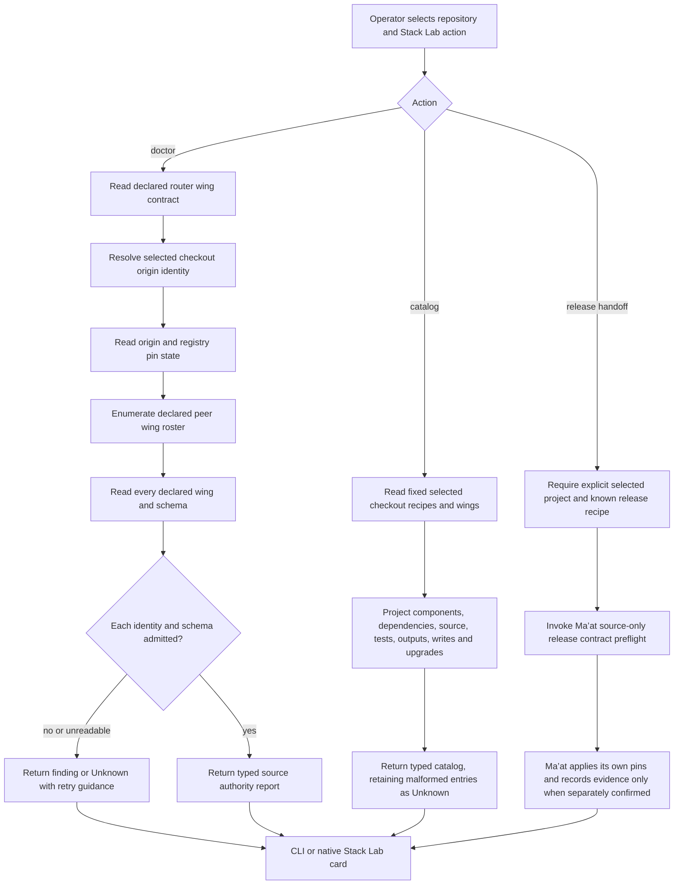

**Data and authority view**

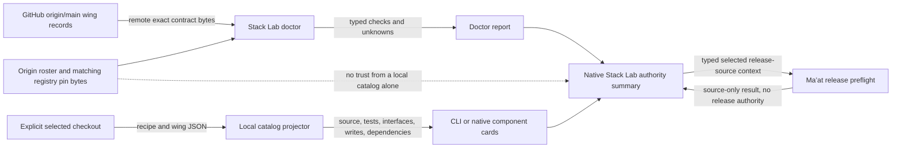

The second source above is the router wing registry, not the local catalog. A failed or unavailable origin, registry, peer or schema read stays Unknown. The native handoff chooses a selected project and delegates to Ma’at. It does not execute recipe strings or publish a release. Recovery is a fresh read of that exact project and authority source. Sequence crosses CLI/native, registry and Ma’at, so the handoff order is shown in the logical view.

<a id="pt-p53"></a>
## PT-P53 — Apollo machine planning and admitted installed native chat

**Owner:** Apollo owns models, machine estate and inference. Ma’at owns run admission. Pantheon owns native presentation. Planning and inference execution are separate paths. The implemented local plan does not create a cluster or claim one exists.

**Logical view**

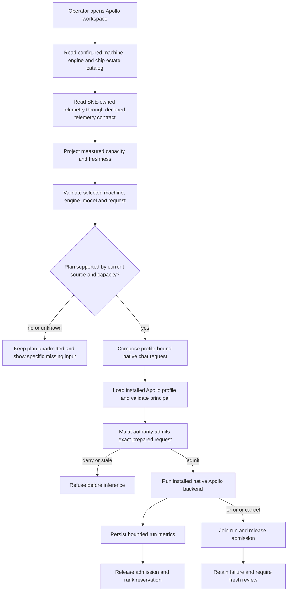

**Data and boundary view**

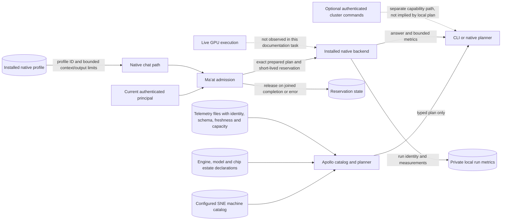

The diagram keeps machine telemetry separate from run authority. A local plan is not an installed profile, admitted request or measured benchmark. Errors and cancellation join the source run and release held admission where the implementation confirms release; otherwise report unresolved debt, never a successful teardown. Existing `internal/apollo` and `cmd/sirsi/apollo_native` fixtures are source evidence only. Runtime and installation remain Unknown.

<a id="pt-p54"></a>
## PT-P54 — Ask, model route and redacted decision journal

**Owner:** Pantheon model-router and provider owners. Ma’at retains privacy and remediation authority.

**Logical view**

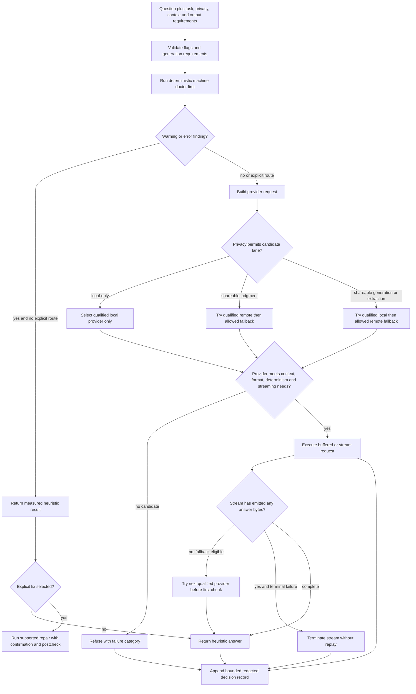

**Data and privacy view**

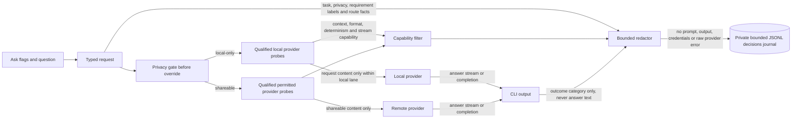

Local-only is a hard boundary. Explicit remote override cannot bypass it. Streaming may fall back only before the first emitted chunk; a post-output failure is terminal and not replayed. Cancellation propagates to the selected provider. Journal write failure does not prove route success or authorize a retry. Existing model-router and ask tests are not executed here.

<a id="pt-p55"></a>
## PT-P55 — Gemma shared submission, worker and native lifecycle

**Owner:** Pantheon owns broker/worker integration. Ra owns lane dispatch and leases. Apollo owns model/profile qualification. The process steps below are source-described at `e3e457e2d95576d63cb0149dbe0e34aad5785928`, merged after the e26 inventory. The overall sidecar remains pinned to e26 for its other groups until Main refreshes source pins.

**Logical view**

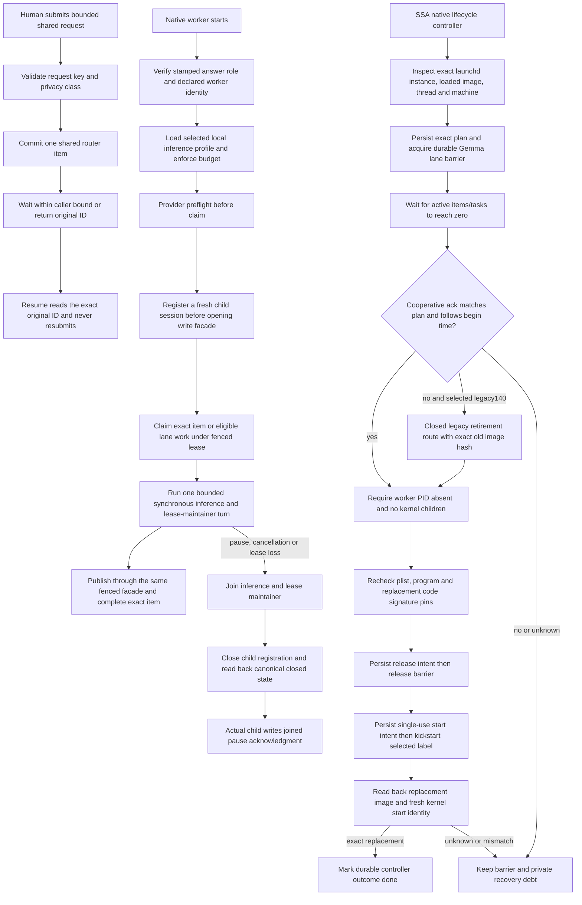

**Data and trust-boundary view**

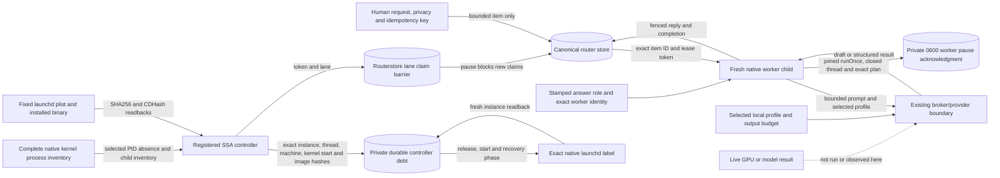

The cooperative pause path is: lane barrier blocks new claims, the worker finishes the current synchronous turn and lease maintainer, the actual worker closes its registration and reads canonical `closed`, then writes its identity-bound acknowledgment. The controller separately requires zero active tasks/items, exact acknowledgment or the narrowly recognized legacy140 retirement path, kernel PID absence, a complete kernel child inventory, unchanged plist/program identities and the replacement CDHash. It persists intent before releasing the barrier and before a single launchd start. Recovery reads retained debt and exact installed state. Unknown release/start outcomes are never replayed. Legacy140 retirement is recorded as retirement, never mislabeled as a cooperative pause acknowledgment.

Worker/serve/quarantine/reap remain separate source branches: `shared` submit/resume is idempotent; normal worker answer publication uses a lease; `serve` owns broker status/start/stop/readiness; quarantine holds automatic liveness restoration; orphan reap classifies exact broker identities before action. Their tests and lifecycle receipts are component evidence, not a live broker, GPU or installed native qualification. The new joined-lifecycle tests are named in `internal/setup/launchdgemma_test.go`, `launchdgemma_native_darwin_test.go` and `cmd/sirsi/gemma_worker_test.go`; not run here.

<a id="pt-p56"></a>
## PT-P56 — Mercury producer schema and consumer read models

**Owner:** Mercury owns producer identity and schema. Pantheon consumer surfaces must preserve declared units, nulls and freshness.

**Logical view**

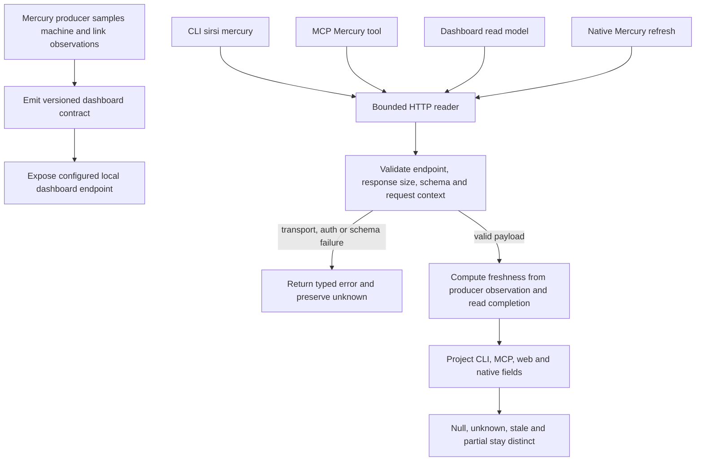

**Data contract view**

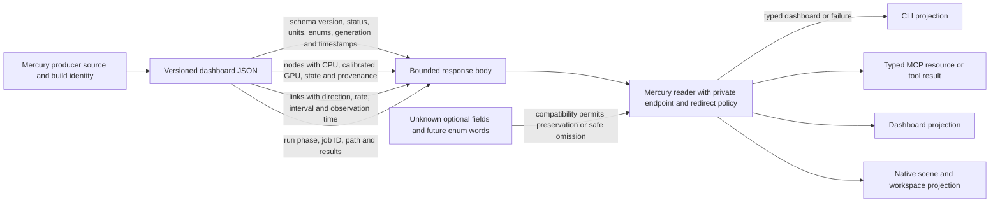

A consumer failure is an error or Unknown, never fabricated zero-valued health. GPU work remains null unless calibrated. The default endpoint is loopback, responses and headers are bounded, and caller cancellation is propagated. The consumer does not start Mercury or alter its run. Existing Go/MCP/dashboard/native tests and the Mercury consumer recipe are references only. Producer and cross-machine runtime observations are Unknown.

<a id="pt-p68"></a>
## PT-P68 — Storage scan, policy judgment and selected cleanup

**Owner:** Anubis/Jakal and Ka own enumeration; Scales owns policy; cleaner owns filesystem effects.

**Logical view**

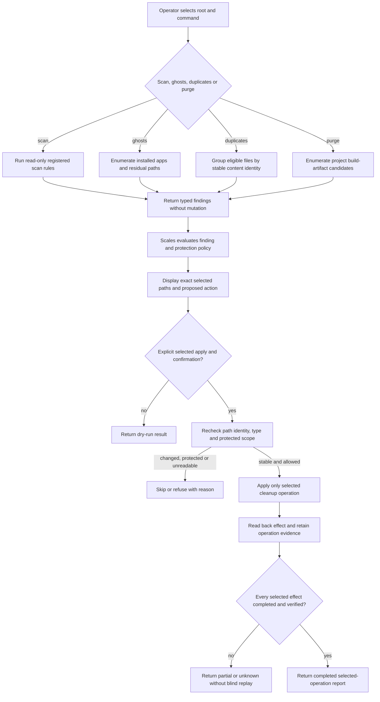

**Data and custody view**

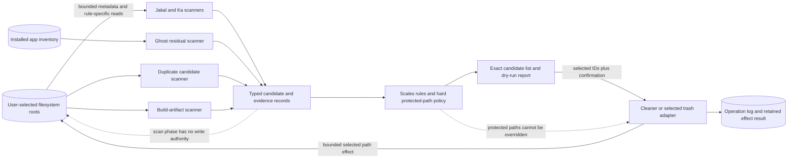

Scan and judgment are read-only. Cleanup is a later selected action; confirmation does not bypass protected-path or identity rechecks. Trash-first behavior applies only to the specific ghost-clean path that implements it. Purge and other deletion paths retain their own command contracts. Failure after some effects returns partial/unknown with the actual completed items; recovery inspects current state before any new consent. No storage scan or purge was run.

<a id="pt-p69"></a>
## PT-P69 — Hapi live guard, manual relief, reaper and swap hygiene

**Owner:** Hapi/guard owns live memory policy. Process owners retain authority over non-governed work.

**Logical view**

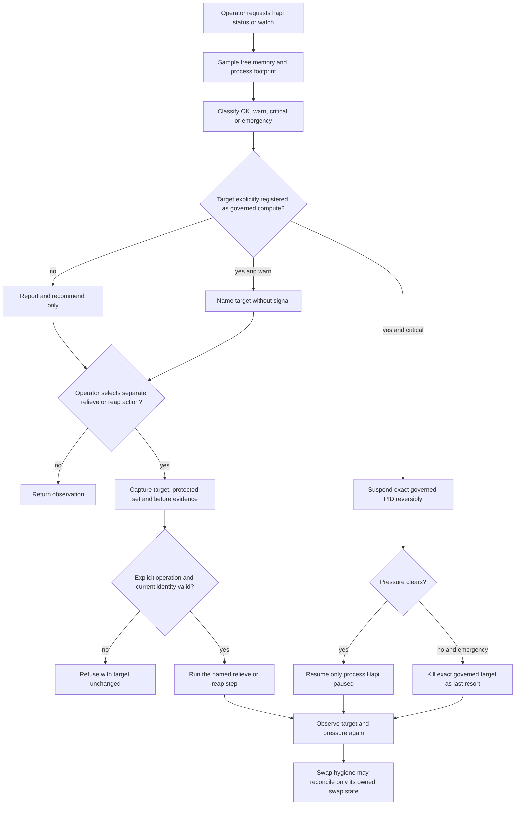

**Data and authority view**

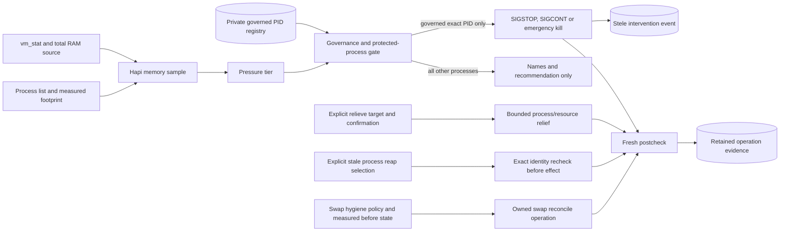

Hapi watch is warn-only unless the operator selects `--govern`. Only registered Pantheon-governed PIDs can receive automatic suspend/kill actions. Suspend is reversible and Hapi resumes only what it paused after pressure clears. Kill has no undo path. Manual relief/reaper effects need their own confirmation and target readback. Unknown sampler or target identity means no action. Swap hygiene is a separate owner-scoped operation, not a generic Hapi repair. No live guard or resource action was run.

<a id="pt-p70"></a>
## PT-P70 — Isis diagnosis, network and supported repairs

**Owner:** Isis owns diagnosis and typed findings. Guard, LaunchServices and Spotlight adapters own their narrow effects.

**Logical view**

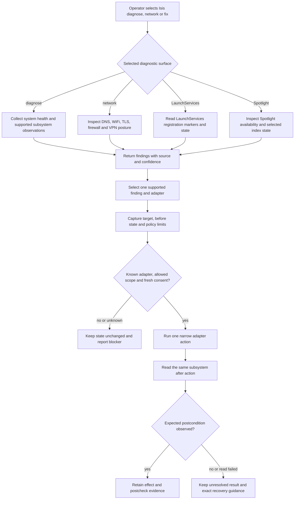

**Data and authority view**

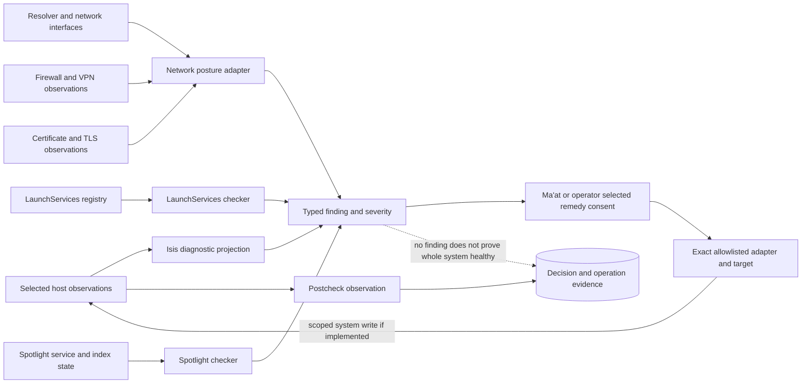

Diagnosis, network audit, LaunchServices and Spotlight are named independent subpaths. A display finding is not an effect grant. Only a supported adapter can act, after fresh scope checks and consent, then read back its own postcondition. Unreadable or mixed state remains Unknown. Recovery is adapter-specific and never a blanket daemon enable. No host action was performed.

<a id="pt-p71"></a>
## PT-P71 — Horus code context and Vault lifecycle

**Owner:** Horus owns structural code context. Vault owns local content/index storage. RTK owns output filtering.

**Logical view**

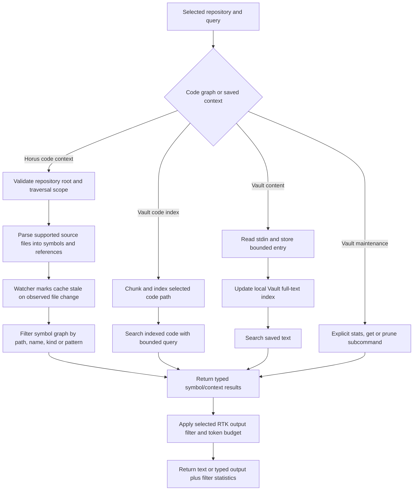

**Data and store view**

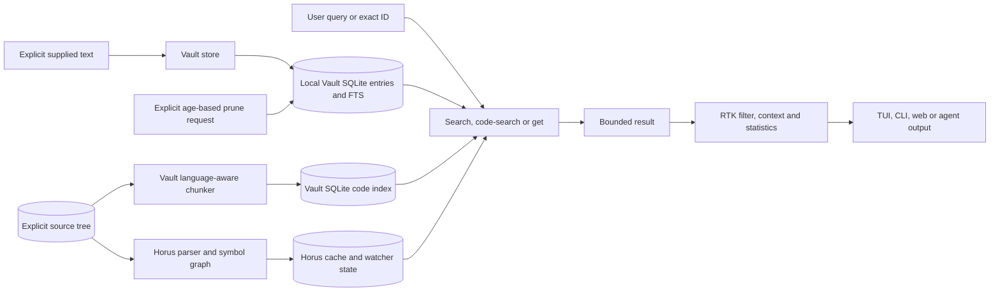

The code graph, Vault text store, Vault code index and RTK presentation filter are separate subpaths and stores. `get` addresses an exact stored ID. Prune is an explicit destructive Vault operation with its own age policy; it does not delete source files. A stale or failed Horus traversal must not be presented as a fresh graph. Recovery reopens/reindexes only the selected path and preserves stored content unless prune is separately selected. No index or prune was run.

<a id="pt-p72"></a>
## PT-P72 — Thoth initialization, sync, compact and continuation

**Owner:** Thoth owns project memory files and continuation journals. Repository canon remains source authority.

**Logical view**

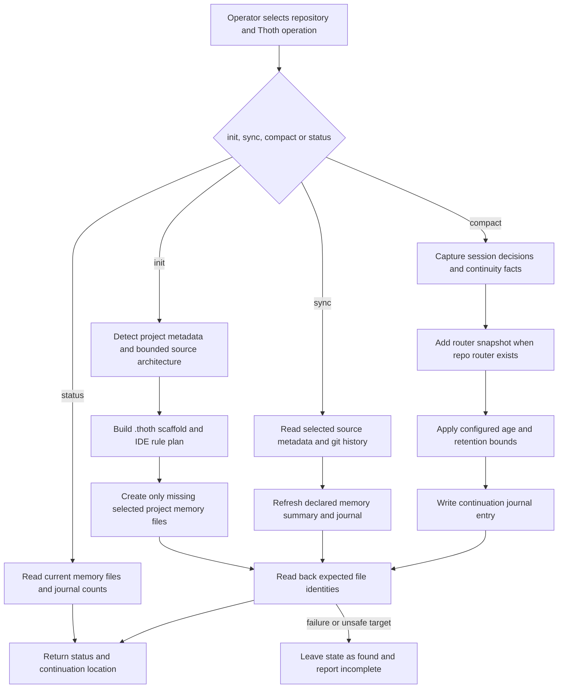

**Data and continuation view**

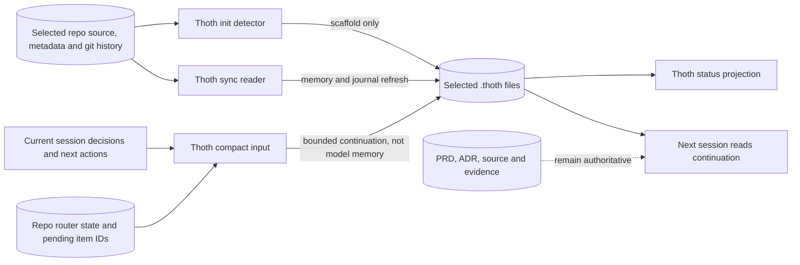

Init, sync and compact are explicit write operations on the selected repository. Status is a read. A continuation is a navigation aid, not proof that the described work exists. If a source read or write fails, report the incomplete path and do not replace the repository's canon. Recovery rereads the exact journal tail and resumes from verified files. Tests in `internal/thoth` and `cmd/sirsi/thoth*` are references only.

<a id="pt-p73"></a>
## PT-P73 — Workstream lifecycle and Neith alignment

**Owner:** Workstream owns its local selected-work list and launchers. Neith owns requirement-scope weaving. Each repository owns its PRD, ADR and evidence records.

**Logical view**

```mermaid
flowchart TD
  U[Operator opens workstream manager] --> ACTION{List, add, rename, activate, retire, delete, inventory or launch}
  ACTION -->|list| LOAD[Load local workstream store]
  ACTION -->|add| ADD[Validate name and selected directory]
  ACTION -->|rename| REN[Validate exact existing entry and new name]
  ACTION -->|retire| RET[Mark selected entry inactive]
  ACTION -->|activate| ACT[Restore selected retired entry]
  ACTION -->|delete| DEL[Explicitly remove selected local entry]
  ACTION -->|inventory| SCAN[Inspect installed AI tools, IDEs and repositories]
  ACTION -->|launch| PICK[Resolve selected workstream and installed launcher]
  PICK --> START[Start selected assistant in selected repo]
  LOAD --> VIEW[Display exact local state]
  ADD --> SAVE[Write local store]
  REN --> SAVE
  RET --> SAVE
  ACT --> SAVE
  DEL --> SAVE
  SCAN --> CACHE[Return installed-tool and repo inventory]
  ACTION -->|Neith alignment| CANON[Read target repo requirements, plan, stories and ADRs]
  CANON --> EVID[Read linked source and evidence summaries]
  EVID --> DRIFT[Report aligned, missing or drifted scope]
  DRIFT --> OWNER[Repo owner decides satisfy, waive or revise with evidence]
  START --> VIEW
  SAVE --> VIEW
```

**Data and ownership view**

```mermaid
flowchart LR
  CONFIG[(User workstream configuration)] --> CRUD[Add, rename, activate, retire and delete]
  CRUD --> CONFIG
  HOME[Local installed tool inventory] --> INVENTORY[Workstream inventory]
  REPOS[Discovered or explicitly assigned repo paths] --> INVENTORY
  CONFIG --> SELECT[Selected active workstream]
  SELECT --> RESOLVE[Resolve allowed executable and IDE]
  RESOLVE --> SESSION[Child assistant with selected repo cwd]
  REPO[(Target repo PRD, plan, stories, ADR and source)] --> NEITH[Neith scope and drift assessment]
  EVID[(Target repo traceability and receipts)] --> NEITH
  NEITH -->|findings only| OWNER[Repository owner and reviewer]
  OWNER -. sole evidence acceptance authority .-> EVID
  OWNER -. ADR required for explicit waiver .-> REPO
```

CRUD and launch are workstream functions. Neith reads the selected repository's planning canon and reports drift. This source does not give Neith permission to satisfy or waive requirements, nor does assistant launch prove work completion. Recovery rereads the exact local store or target repo after a failed operation. Never infer a launched session from a configured launcher. Existing workstream and Neith tests are not executed.

<a id="pt-p74"></a>
## PT-P74 — Osiris risk assessment and checkpoint

**Owner:** Osiris owns working-tree risk observation. Git owns checkpoint commit state.

**Logical view**

```mermaid
flowchart TD
  U[Operator selects repository and risk or checkpoint] --> ROOT[Resolve exact Git root]
  ROOT --> STATUS[Read status, staged changes and worktree count]
  STATUS --> AGE[Read latest commit and elapsed work interval]
  AGE --> STAT[Read bounded diff statistics]
  STAT --> RISK[Classify retained-work risk]
  RISK -->|risk or status| REPORT[Return report without mutation]
  RISK -->|checkpoint explicitly selected| ASK[Confirm checkpoint write]
  ASK -->|declined| REPORT
  ASK -->|confirmed| VERIFY[Recheck same repo and current worktree state]
  VERIFY --> COMMIT[Create exact Git checkpoint]
  COMMIT --> READBACK[Read new commit and remaining dirty status]
  READBACK -->|matches| DONE[Report checkpoint identity and residual changes]
  READBACK -->|failed or changed| OPEN[Report unresolved state without reset or replay]
```

**Data view**

```mermaid
flowchart LR
  REPO[(Selected Git repository)] --> STATUS[git status and worktree inspection]
  REPO --> LOG[latest commit and elapsed time]
  REPO --> DIFF[diff stat]
  STATUS --> CP[Osiris checkpoint assessment]
  LOG --> CP
  DIFF --> CP
  CP -->|risk report only| OUT[CLI or native status projection]
  CP -->|confirmed checkpoint request| INDEX[Selected Git index and worktree]
  INDEX --> COMMIT[(Git commit object)]
  COMMIT --> VERIFY[Commit and residual-status readback]
  VERIFY --> OUT
  BACKUP[No independent snapshot store in this path] -. checkpoint is Git history only .-> OUT
```

Risk assessment does not mutate. Checkpoint is an explicit durable Git commit and is not an automatic restore point for arbitrary uncommitted work after the checkpoint. A failed commit requires fresh status inspection. No Git checkpoint was created in this task.

<a id="pt-p75"></a>
## PT-P75 — Seba discovery, topology book, fleet, profile and compute

**Owner:** Seba owns topology/hardware projections. Scarab owns fleet scanning. The operator selects local roots, target ranges and benchmark intent.

**Logical view**

```mermaid
flowchart TD
  U[Operator selects Seba operation] --> OP{scan, diagram, book, hardware, profile, compute or fleet}
  OP -->|scan| LOCAL[Observe local host, processes, interfaces and services]
  OP -->|diagram| TOPO[Project observed nodes and edges]
  OP -->|book| DISC[Enumerate selected project roots and metadata]
  OP -->|hardware| HW[Read CPU, RAM, GPU and accelerator descriptors]
  OP -->|profile| PROF[Collect selected host profile fields]
  OP -->|compute| COMP[Prepare explicit tokenizer or compute request]
  COMP --> BENCH{Benchmark explicitly selected?}
  BENCH -->|no| RUN[Run only the requested supported computation]
  BENCH -->|yes| WARM[Apply declared warmup and finite sample count]
  WARM --> MEASURE[Record exact host, workload, units and sample count]
  OP -->|fleet| TARGET{Explicit network targets and confirmation supplied?}
  TARGET -->|no| REFUSE[Refuse network discovery]
  TARGET -->|yes| SCAN[Scan only selected target range]
  LOCAL --> OBS[Return observed source and freshness]
  TOPO --> OBS
  DISC --> OBS
  HW --> OBS
  PROF --> OBS
  RUN --> OBS
  MEASURE --> OBS
  SCAN --> OBS
```

**Data and trust view**

```mermaid
flowchart LR
  HOST[Local OS and hardware sources] --> SCAN[Seba local scanners]
  SCAN --> GRAPH[Typed topology graph]
  GRAPH --> DIAG[Diagram projection]
  SCAN --> BOOK[(Selected project Pantheon Book records)]
  HW[CPU, memory, accelerator probes] --> PROFILE[Hardware and machine profile]
  PROFILE --> VITALS[Vitals and Insight projections]
  REQUEST[Explicit compute request] --> COMPUTE[Supported local compute path]
  COMPUTE --> RESULT[Typed result with host and workload identity]
  TARGETS[Explicit network target range and opt-in] --> FLEET[Scarab fleet scanner]
  FLEET --> REMOTE[Remote topology observations with source identity]
  GRAPH --> OUTPUT[CLI and native views]
  BOOK --> OUTPUT
  VITALS --> OUTPUT
  RESULT --> OUTPUT
  REMOTE --> OUTPUT
  CLAIM[Unmeasured performance or unobserved hardware] -. stays unknown .-> OUTPUT
```

Local observation, project book, hardware profile, compute and network fleet are separate source paths. Fleet scan never defaults to whole-network discovery. A benchmark result without workload identity, sample count and units is not a measurement claim. Probe failure remains unavailable/unknown. No fleet scan or explicit benchmark was run.

<a id="pt-p76"></a>
## PT-P76 — Brain role configuration and Conduit tick lifecycle

**Owner:** Brain owns local role/provider configuration. Ra owns task eligibility and dispatch. Conduit owns its local scheduler installation and tick journal.

**Logical view**

```mermaid
flowchart TD
  OP[Operator selects brain or conduit command] --> MODE{Brain inspect, route, use or doctor, or Conduit arm, tick, disarm}
  MODE -->|brain inspect| READ[Read role configuration and provider inventory]
  MODE -->|brain route| RESOLVE[Resolve one declared role without loading model]
  MODE -->|brain use| CHANGE[Validate role and selected provider]
  CHANGE --> SAVE[Persist role mapping for next read]
  MODE -->|brain doctor| CHECK[Inspect config, registry, wake and RAM invariants]
  MODE -->|conduit arm| ARM[Write fixed scheduler definition after explicit command]
  ARM --> LOAD[Load selected scheduler]
  MODE -->|conduit tick| AUTH[Read runnable queues and existing grants]
  AUTH --> ADMIT{Task has current authority and target is runnable?}
  ADMIT -->|no| OBS[Retain no-op or refused tick outcome]
  ADMIT -->|yes| DISPATCH[Dispatch bounded exact authorized work]
  DISPATCH --> RETURN[Wait for acknowledged store mutation or explicit failure]
  RETURN --> JOURNAL[Retain tick result and next wake condition]
  MODE -->|conduit disarm| STOP[Unload only the selected scheduler]
  READ --> REPORT[Return status]
  RESOLVE --> REPORT
  CHECK --> REPORT
  SAVE --> REPORT
  LOAD --> REPORT
  STOP --> REPORT
  OBS --> REPORT
  JOURNAL --> REPORT
```

**Data and authority view**

```mermaid
flowchart LR
  CFG[(Private Brain role configuration)] --> ROLE[Role to provider map]
  ROLE -->|read-only route| PROVIDER[Provider resolver]
  ROLE -->|explicit use write| CFG
  PROVIDERS[Installed provider capabilities] --> PROVIDER
  PROVIDER --> REPORT[Route and health report]
  QUEUE[(Ra task ledger and inbox)] --> GATE[Conduit authorization gate]
  GRANTS[(Current role grant and task identity)] --> GATE
  GATE -->|authorized exact item| DISPATCH[Existing Router dispatch API]
  DISPATCH --> QUEUE
  DISPATCH --> ACK[Observed durable acknowledgment]
  ARM[Explicit arm request] --> PLIST[Fixed local scheduler definition]
  PLIST --> TICK[Conduit invocation]
  TICK --> JOURNAL[(Local tick outcome and continuation)]
  MODEL[Provider inference] -. not performed by route/status/doctor .-> PROVIDER
```

`brain route`, `status` and dry-run `test` are observational. `brain use` changes role configuration. Autonomous dispatch defaults off. `conduit tick` is a bounded invocation that dispatches only already-authorized work; a process/heartbeat alone is not a completed task. `arm` and `disarm` affect the selected scheduler, not provider roles. Unknown queue or acknowledgment state does not trigger duplicate dispatch. No provider or conduit tick was run.


<a id="pt-p77"></a>
## PT-P77 — Desktop custody, finite sleep coordination and authenticated recovery

**Owner:** Desktop Custody owns the bounded sleep session and its returned facts. Desktop Recovery owns authenticated admission, replay expiry and recovery-session cleanup. The operating system owns sleep and wake events.

**Logical view**

```mermaid
flowchart TD
  CALL[CLI requests desktop sleep custody] --> AUTH{Exact local admission valid?}
  AUTH -->|no| DENY[Refuse before starting a session]
  AUTH -->|yes| PLAN[Create finite session and record admission]
  PLAN --> PRE[Record bounded pre-sleep inventory]
  PRE --> SLEEP[Request the selected sleep operation]
  SLEEP --> WAKE[Observe wake and return event]
  WAKE --> POST[Collect bounded return facts]
  POST --> CLOSE[Close session and retain result]
  REMOTE[Recovery client connects] --> SERVE{Loopback service behind authenticated Tailscale Serve?}
  SERVE -->|no| REJECT[Reject unauthenticated or nonlocal request]
  SERVE -->|yes| CAP{Node and short-lived capability match allowlist?}
  CAP -->|no| REJECT
  CAP -->|yes| REPLAY{Capability already admitted through expiry?}
  REPLAY -->|yes| REJECT
  REPLAY -->|no| ADMIT[Persist admission and expiry]
  ADMIT --> SESSION[Open bounded recovery session]
  SESSION --> FACTS[Return only authorized recovery facts]
  FACTS --> DISCONNECT[Disconnect or expire]
  DISCONNECT --> CLEAN[Close session and clear transient state]
```

**Data and trust view**

```mermaid
flowchart LR
  OP[Local operator request] --> CUSTODY[Desktop custody controller]
  CUSTODY --> ADMISSION[(Exact admission record)]
  OS[Sleep and wake notifications] --> EVENT[Bounded lifecycle event]
  INVENTORY[Selected local inventory] --> PRE[(Pre-sleep facts)]
  EVENT --> RETURN[(Return facts and outcome)]
  ADMISSION --> CUSTODY
  PRE --> RESULT[Local session result]
  RETURN --> RESULT
  CLIENT[Remote recovery client] --> TS[Tailscale Serve authentication]
  TS --> LOOP[Loopback recovery endpoint]
  LOOP --> CAP[Short-lived exact-node capability check]
  CAP --> REPLAYDB[(Admission replay and expiry ledger)]
  CAP --> SESSION[Bounded recovery response]
  SESSION --> CLEANUP[Disconnect and expiry cleanup]
  CONFIG[Screen Sharing, Tailscale or launchd configuration] -. not configured by these paths .-> LOOP
```

The source paths are `internal/desktopcustody`, `cmd/sirsi/desktopsleep.go`, `internal/desktoprecovery` and `cmd/sirsi/recovery.go`. This describes source behavior. No host sleep, remote session, permissions change or recovery admission was exercised. Unknown return state is retained as unknown rather than synthesized as a successful wake.

<a id="pt-p78"></a>
## PT-P78 — Seshat compatibility export and refusal boundaries

**Owner:** Seshat owns legacy command compatibility and explicit export. Ma’at owns canonical local archive ingestion. Each external target owns its export-side authentication and acceptance.

**Logical view**

```mermaid
flowchart TD
  OP[Operator invokes Seshat command] --> CMD{Ingest, export, auth, prune or sync?}
  CMD -->|ingest| ADAPTER{Configured supported local reader?}
  ADAPTER -->|yes| MAAT[Delegate to canonical Ma’at archive]
  ADAPTER -->|no| REFUSE[Refuse unsupported adapter]
  CMD -->|export| TARGET{Explicit supported destination selected?}
  TARGET -->|no| REFUSE
  TARGET -->|yes| AUTH[Use target-specific configured authentication]
  AUTH --> SEND[Export selected content]
  SEND --> RESULT[Report target response]
  CMD -->|auth or profile| PROFILE[Inspect or update existing target profile path]
  CMD -->|prune| SAFE[Refuse destructive legacy snapshot edits]
  CMD -->|sync| LEGACY[Return legacy synchronization refusal]
  CHROME[Chrome profile ingest request] --> REFUSE
  MAAT --> RESULT
  PROFILE --> RESULT
  SAFE --> RESULT
  LEGACY --> RESULT
```

**Data and authority view**

```mermaid
flowchart LR
  INPUT[Selected legacy input] --> SESHAT[Seshat compatibility command]
  SESHAT -->|supported ingest| MAAT[Ma’at canonical archive API]
  MAAT --> ARCHIVE[(Ma’at archive records)]
  ARCHIVE -->|explicit export only| EXPORT[Target export adapter]
  AUTH[(Existing target auth profile)] --> EXPORT
  EXPORT --> TARGET[Selected external target]
  TARGET --> ACK[Target response]
  RETIRED[(Retired raw snapshots)] -. migration input only .-> SESHAT
  CHROME[Browser profile data] -. unsupported ingestion .-> SESHAT
  PRUNE[Legacy destructive prune] -. refusal .-> SESHAT
  SYNC[Legacy bidirectional sync] -. refusal .-> SESHAT
  NEWAUTH[New user authority] -. not granted by compatibility .-> EXPORT
```

The path is `cmd/sirsi/seshat.go` plus the canonical Ma’at archive and target adapters. Unsupported ingest, prune and legacy sync remain explicit refusals. Export and profile operations do not create a new authority source. Runtime target acceptance and external authentication state are unknown.

<a id="pt-p79"></a>
## PT-P79 — Mail poison and sender analysis

**Owner:** MailOps owns read-only message inspection and sender census. Gmail owns label mutation and resulting mailbox state. Local receipt storage owns the apply record.

**Logical view**

```mermaid
flowchart TD
  OP[Operator selects mailops command] --> MODE{Poison scan or sender census?}
  MODE -->|poison scan| LIST[Read selected inbox messages]
  LIST --> MIME[Inspect MIME part sizes and text/plain payload]
  MIME --> POISON{Zero-byte plain text part found?}
  POISON -->|no| REPORT[Return read-only classification]
  POISON -->|yes| PLAN[Default to dry-run finding]
  PLAN --> APPLY{Explicit apply flag supplied?}
  APPLY -->|no| REPORT
  APPLY -->|yes| LABEL[Remove Gmail INBOX label only]
  LABEL --> RECEIPT[Write local signed apply receipt]
  MODE -->|sender census| CENSUS[Read sender and unsubscribe metadata]
  CENSUS --> COUNTS[Return top counts and unsubscribe signals]
  COUNTS --> REPORT
  SEND[Send message] -. not an operation .-> REPORT
  DELETE[Delete message] -. not an operation .-> REPORT
```

**Data and trust view**

```mermaid
flowchart LR
  GMAIL[(Selected Gmail inbox)] --> READ[MailOps read path]
  READ --> MIME[Message MIME metadata and bounded body fields]
  MIME --> CLASS[Poison classification]
  READ --> SENDER[Sender census]
  SENDER --> COUNTS[Counts and List-Unsubscribe observations]
  CLASS --> DRY[Dry-run report]
  CLASS -->|explicit apply| MODIFY[Remove INBOX label]
  MODIFY --> GMAIL
  MODIFY --> RECEIPT[(Local signed apply receipt)]
  SCOPES[OAuth modify and basic settings scopes] --> READ
  SCOPES --> MODIFY
  OUTBOUND[Send or delete capability] -. absent from command contract .-> GMAIL
```

The source is `cmd/sirsi/mailopscmd.go` and `internal/mailops`. The apply path archives by removing only the INBOX label and writes a local signed receipt. It does not send or delete mail. No mailbox action was run. The consent and application of any real Gmail token remain unverified.

<a id="pt-p80"></a>
## PT-P80 — Setup, quickstart, surfaces and managed app lifecycle

**Owner:** Setup owns selected-surface setup ordering and permission guidance. App lifecycle and updater own their distinct install, refresh and removal paths. The user owns permission grants and surface selection.

**Logical view**

```mermaid
flowchart TD
  OP[Operator starts setup or quickstart] --> PREFLIGHT[Read setup mode and selected surfaces]
  PREFLIGHT --> JSON{JSON inspection mode?}
  JSON -->|yes| PLAN[Return setup plan without applying]
  JSON -->|no| SURFACE[Select CLI, TUI or IDE surfaces]
  SURFACE --> DEPS[Check and prepare declared dependencies]
  DEPS --> FDA[Explain required Full Disk Access permission]
  FDA --> ROUTER[Register selected AI CLI and Horus router integration]
  ROUTER --> APP[Install selected menubar app component where configured]
  APP --> DONE[Return setup result and unresolved steps]
  OP --> LIFE{Install, refresh, update or uninstall app?}
  LIFE -->|install| INSTALL[Use the sourced app install path]
  LIFE -->|refresh or update| REFRESH[Use the sourced refresh or updater path]
  LIFE -->|uninstall| REMOVE[Use the sourced removal path]
  INSTALL --> APPRESULT[Report observed lifecycle outcome]
  REFRESH --> APPRESULT
  REMOVE --> APPRESULT
  UNKNOWN[Single-instance guarantee or unobserved host state] -. retain unknown .-> DONE
```

**Data and trust view**

```mermaid
flowchart LR
  SELECT[Operator surface selection] --> PLAN[Setup plan]
  HOST[Host dependency probes] --> PLAN
  PLAN -->|inspection only| OUTPUT[Plan output]
  PLAN -->|explicit apply| SETUP[Setup executor]
  SETUP --> SURFACES[Selected CLI, TUI and IDE registrations]
  SETUP --> FDA[Permission instructions and user grant boundary]
  SETUP --> ROUTER[Selected AI CLI and Horus registration]
  SETUP --> MENUBAR[Configured menubar app installation]
  APP[Managed app lifecycle command] --> INSTALLER[Install, refresh or remove path]
  UPDATER[Updater source] --> INSTALLER
  INSTALLER --> STATE[Observed app lifecycle state]
  SURFACES --> OUTPUT
  FDA --> OUTPUT
  ROUTER --> OUTPUT
  MENUBAR --> OUTPUT
  STATE --> OUTPUT
  CONSENT[User permission decision] --> FDA
  SINGLE[Single-instance runtime evidence] -. unknown until qualified .-> STATE
```

Relevant sources include `cmd/sirsi/setup.go`, `internal/setup`, `internal/runner`, the native app lifecycle and updater. Setup JSON inspection is non-mutating. Permission granting is not performed by setup. Do not infer single-instance enforcement or successful managed install from source wiring alone. No setup, install, update or uninstall was run.

<a id="pt-p81"></a>
## PT-P81 — Activity, Stele and native consent classification

**Owner:** Oplog owns local operation history. Stele owns its separate append-only hash chain and reader offset. Native classification owns the local user consent decision and one-time capture boundary.

**Logical view**

```mermaid
flowchart TD
  OP[Operator requests activity or Stele view] --> READ{Activity, Stele stream or native classification?}
  READ -->|activity| OREAD[Read last N typed operation records newest first]
  READ -->|Stele| SREAD[Read append-only chain from stored offset]
  READ -->|classification| CLASS[Classify selected native content]
  CLASS --> CONSENT{Consent already recorded for this capture?}
  CONSENT -->|no| ASK[Ask once for this exact capture]
  ASK -->|declined| STOP[Retain declined outcome and stop]
  ASK -->|approved| CAPTURE[Capture the selected content once]
  CONSENT -->|yes| CAPTURE
  CAPTURE --> POST[Run bounded post-capture checks]
  POST --> RESULT[Record known, failed or unknown outcome]
  UNKNOWN[Postcheck unavailable] --> RESULT
  WRITE[Destructive cleanup or purge] --> LOG[Append operation record]
  OPT[Oplog opt-out environment flag] -->|enabled| NOLOG[Oplog append skipped]
  OREAD --> VIEW[Display typed records]
  SREAD --> VIEW
  RESULT --> VIEW
  LOG --> OREAD
```

**Data and audit view**

```mermaid
flowchart LR
  ACTION[Local operation] --> OPLOG[(operations.log typed records)]
  OPTOUT[SIRSI_NO_OPLOG=1] -. disables oplog append .-> OPLOG
  ACTION -->|separate append-only path| STELE[(Stele hash chain)]
  OFFSET[(Stele reader offset)] --> STREAM[Stele continuation reader]
  STELE --> STREAM
  CONTENT[Selected native content] --> CLASS[Native classifier]
  CONSENT[(Immutable decision for this capture)] --> CLASS
  CLASS -->|approved once| CAPTURE[Single capture operation]
  CAPTURE --> CHECK[Postcheck]
  CHECK --> CLASSIFIED[Classification outcome]
  OPLOG --> ACTIVITY[Activity CLI view]
  STREAM --> STELEVIEW[Stele stream view]
  CLASSIFIED --> NATIVEVIEW[Native activity view]
  RAW[Unbounded prompt or free-text capture] -. outside typed operation read contract .-> ACTIVITY
```

`cmd/sirsi/activitycmd.go`, `internal/oplog`, `internal/stele` and native classification sources describe separate records and flows. Oplog and Stele must not be conflated. The native consent/capture flow needs its installed-component receipt; this diagram is not that receipt. Runtime consent behavior and postcheck outcomes are unknown here.

<a id="pt-p82"></a>
## PT-P82 — Web, TUI, MCP and runner surface protocols

**Owner:** Each surface owns its admission and confirmation contract. The shared action runner owns bounded execution and event delivery. PT-P04 refers only to the shared Router A2A path, not every MCP operation.

**Logical view**

```mermaid
flowchart TD
  CALL[Surface request] --> SURFACE{Web, TUI or MCP?}
  SURFACE -->|web| TOKEN[Validate dashboard action token]
  TOKEN --> CONFIRM{Required action confirmation present?}
  CONFIRM -->|no| REFUSE[Reject action]
  CONFIRM -->|yes| RUNNER[Submit one bounded runner action]
  SURFACE -->|TUI| TUI[TUI command and health check]
  TUI --> TCONFIRM{Interactive confirmation required?}
  TCONFIRM -->|no| REFUSE
  TCONFIRM -->|yes| RUNNER
  SURFACE -->|MCP| MCPCHECK[Authenticate and validate named tool or resource]
  MCPCHECK -->|invalid| REFUSE
  MCPCHECK -->|valid| MCPROUTE[Dispatch only admitted MCP operation]
  MCPROUTE -->|Router A2A operation| ROUTER[Shared Router A2A core]
  MCPROUTE -->|other tool or resource| MCPLOCAL[Named MCP handler]
  RUNNER --> EVENT[SSE action events and final result]
  ROUTER --> RESULT[Typed operation result]
  MCPLOCAL --> RESULT
  REFUSE --> RESULT
  EVENT --> RESULT
```

**Data and protocol view**

```mermaid
flowchart LR
  WEB[Dashboard request] --> TOKEN[Action token and confirmation fields]
  TOKEN --> ACTIONS[Dashboard action handler]
  ACTIONS --> RUNNER[Runner action queue]
  RUNNER --> EVENTS[SSE event stream]
  TUI[TUI input] --> CONFIRM[Visible confirmation and health gate]
  CONFIRM --> RUNNER
  MCPCLIENT[MCP client] --> AUTH[Tool or resource authentication]
  AUTH --> MCPREG[Named MCP tool and resource registry]
  MCPREG --> HANDLER[Selected handler]
  HANDLER -->|Router A2A only| ROUTER[Shared Router A2A core]
  HANDLER -->|all other MCP operations| MCPDATA[Selected handler data]
  RUNNER --> EVENTS
  RUNNER --> STATE[Action result state]
  MCPDATA --> STATE
  ROUTER --> STATE
  RESOURCE[Read-only MCP resource] --> MCPREG
```

Sources are `internal/dashboard/actions.go`, runner and server/events, `internal/tui` and `internal/mcp`. Web confirmation/token checks, TUI interaction and MCP tool/resource admission are distinct. The exact operation state is the runner’s returned outcome. No surface action was executed in this documentation task.

<a id="pt-p83"></a>
## PT-P83 — Qualification pre-push CI and finite private executor boundary

**Owner:** CI owns public repository static checks and test orchestration. Ma’at admitted-run scripts own their finite local qualification orchestration. Private SDK, native bootstrap and any external executor own their independent environment receipts.

**Logical view**

```mermaid
flowchart TD
  CHANGE[Proposed documentation or source change] --> TRIGGER{Applicable pre-push or CI trigger?}
  TRIGGER -->|no| NOTRUN[No qualification claim]
  TRIGGER -->|yes| STATIC[Run declared static verification steps]
  STATIC -->|failure| FAIL[Retain failure and source revision]
  STATIC -->|pass| SELECT[Select finite named qualification plan]
  SELECT --> CAUSAL[Run declared causal controls and bounded cases]
  CAUSAL --> RESULT[Collect process result and diagnostics]
  RESULT --> REVIEW[Human reviews scope, output and source identity]
  REVIEW --> BIND[Bind accepted receipts to exact revision and component]
  PRIVATE[Private SDK or native bootstrap required] --> AVAIL{Executor and environment receipt available?}
  AVAIL -->|no| GAP[Mark qualification pending]
  AVAIL -->|yes| EXEC[Run only the declared finite executor plan]
  EXEC --> RESULT
  GAP --> REVIEW
  FAIL --> REVIEW
```

**Evidence and executor view**

```mermaid
flowchart LR
  SOURCE[Exact source revision] --> CI[Public CI workflow]
  CI --> VERIFY[Named scripts and static checks]
  VERIFY --> TESTS[Named bounded test targets]
  TESTS --> CIRESULT[(CI result tied to revision)]
  PLAN[Ma’at admitted-run plan] --> WRAPPER[Finite qualification wrapper]
  WRAPPER --> CONTROLS[Causal controls and target cases]
  CONTROLS --> LOCALRESULT[(Local process output and receipt)]
  PRIVATE[Private SDK and native environment] --> AVAIL[Independent availability evidence]
  AVAIL --> EXECUTOR[External finite executor]
  EXECUTOR --> EXTERNAL[(Separate executor and environment receipt)]
  CIRESULT --> REVIEW[Review and scope binding]
  LOCALRESULT --> REVIEW
  EXTERNAL --> REVIEW
  REVIEW --> ACCEPTED[(Accepted component receipt or explicit debt)]
  NEVER[Unrun model, live service or signing action] -. never inferred from diagram .-> ACCEPTED
```

Relevant sources include `.github/workflows/ci.yml`, `scripts/maat/admitted-run.py`, `scripts/maat/apollo-bounded-qualification.sh` and `scripts/verify-*`. This is a process description, not a test run or qualification receipt. Private SDK and native bootstrap availability remains independently evidenced or pending. Do not count a CI workflow definition as a passing result.

<a id="pt-p84"></a>
## PT-P84 — Canon publication, independent criteria review and retained debt

**Owner:** Canon maintainers own source documents, diagrams and source pins. Independent reviewers own criteria-level evidence review. The publication operator owns mirror updates and readbacks. Completion status remains the decision of the designated certifier.

**Logical view**

```mermaid
flowchart TD
  EDIT[Prepare canon changes in owned files] --> SCOPE[Check write-set ownership and source revision]
  SCOPE --> REVIEW[Independent review against each current criterion]
  REVIEW -->|evidence sufficient| RECORD[Record criterion evidence and source pin]
  REVIEW -->|evidence missing or contradictory| DEBT[Record precise unresolved debt]
  RECORD --> PUBLISH[Publish to approved existing canon locations]
  DEBT --> PUBLISH
  PUBLISH --> READBACK[Read back each published location]
  READBACK --> MATCH{Readback matches source and pin?}
  MATCH -->|no| REPAIR[Record publication defect and repair explicitly]
  REPAIR --> READBACK
  MATCH -->|yes| INVENTORY[Update current inventory and evidence references]
  INVENTORY --> DECIDE[Certifier evaluates all criteria and limitations]
  DECIDE -->|all required evidence accepted| OUTCOME[Record certifier decision]
  DECIDE -->|open criteria| DEBT
  OUTCOME --> COMPLETE{Completion proof and explicit closure?}
  COMPLETE -->|yes| CLOSE[Record bounded completion state]
  COMPLETE -->|no| OPEN[Keep status open with debt]
```

**Data, provenance and publication view**

```mermaid
flowchart LR
  SRC[(Canonical source tree at exact revision)] --> PIN[Source revision and origin identity]
  PIN --> CRITERIA[Current criterion ledger]
  EVIDENCE[(Criterion evidence and receipts)] --> REVIEW[Independent review]
  CRITERIA --> REVIEW
  REVIEW -->|accepted| ACCEPTED[Criterion-specific accepted record]
  REVIEW -->|insufficient| DEBT[(Explicit debt with owner and next action)]
  SRC --> MIRRORS[Approved existing publication locations]
  ACCEPTED --> MIRRORS
  DEBT --> MIRRORS
  MIRRORS --> READBACK[Read back published contents and identity]
  READBACK --> INVENTORY[Current public inventory]
  INVENTORY --> CERTIFIER[Certifier decision input]
  ACCEPTED --> CERTIFIER
  DEBT --> CERTIFIER
  CERTIFIER --> STATE[Decision plus residual limitations]
  SIGN[Signing evidence] -. separate evidence domain .-> CERTIFIER
  UNKNOWN[Unread mirror or unpinned source] -. stays unresolved .-> STATE
```

This process must use the current Main-owned certification and signing requirements without restating or replacing them. Source publication, mirror readback, origin identity, signing and criterion review are separate evidence domains. A diagram or inventory row does not prove that a mirror was updated, a source pin was read back, a signature verified or any criterion passed. Those states remain unknown until their actual evidence is recorded.

## Assignment completeness and limits

This file covers **22 assigned groups**: PT-P52–56 and PT-P68–84. Each has separate logical and data/trust Mermaid views. State, sequence, refusal and recovery edges are included where the source process has them. No Mermaid label contains a semicolon. The overall finite census target is **84 groups** across the three concurrently authored product, governance and fabric diagram files: 40 existing process groups plus P41–51, P57–67 and this file’s 22. This file does not assert that the other groups, current certification criteria, runtime paths, installed native components, publication readbacks or receipts are complete or passing. Runtime observation for this documentation task is unknown.
