# Pantheon PT diagrams — product operations census

**Process IDs:** PT-P52–PT-P56 and PT-P68–PT-P84  
**Reviewed source pin:** `e26e324be107ab541ec8d4d1400392e1ee55fc26`  
**Implementation label:** Source-described at this pin. Fidelity corrections in this revision were checked against candidate source `3779e90b1f226527723491fe8eadc929890b98e3`. Runtime, installed-host and production observations are **UNKNOWN** unless a linked existing receipt says otherwise. These diagrams do not promote source or tests to qualification or certification.

This sidecar adds 22 process groups to the Pantheon PT census. Together with PT-P01–PT-P40 and the concurrent PT-P41–PT-P51 and PT-P57–PT-P67 owners, the target whole-wing denominator is 84. This file covers its assigned 22/22 IDs. It makes no claim that the concurrent groups or the whole-wing census are complete.

The diagrams name source-supported branches. Unsupported or unverified behavior is marked explicitly. No diagram below authorizes live model, GPU, network, host-service, destructive-cleanup, signing, release, or mirror activity.

## Requirement, owner, source and next-action crosswalk

`PT-REQ` and `PT-US` descriptions refer to this candidate’s current Pantheon PT PRD and stories, separately from the behavior source pin. Tests are cited by checked-in path or name only. They were not run for this documentation change.

| Process | Owner and mapping | Source and existing evidence anchor | Source state and next action |
|---|---|---|---|
| PT-P52 Stack Lab doctor, origin/pin/roster/catalog and Ma’at handoff | Pantheon PT, Stack Lab contract owners, Ma’at preflight owner. PT-REQ-05,08,10,11. PT-US-05,08,10. | `cmd/sirsi/stacklabcmd.go`, `internal/stacklab/doctor.go`, `internal/stacklab/catalog.go`, `StackLabView.swift`, `StackLabCatalogView.swift`, `internal/maat/releasepreflight.go`; `internal/stacklab/doctor_test.go`, `catalog_test.go`, native Stack Lab contract/accessibility fixtures; recipes `native-stacklab-surface-recipe-v1.json`, `pantheon-native-workspace-v1.json`, `maat-system-one-recipe-v1.json`, `pantheon-release-artifact-recipe-v1.json`. | Read-only source path and typed handoff. Next: independently qualify installed origin/pin and selected-project handoff, retaining unknown on unavailable reads. |
| PT-P53 Apollo plan, separate telemetry read and admitted native chat | Apollo owns plan and inference; SNE owns session telemetry; Ma’at owns native chat admission; Pantheon owns projection. PT-REQ-05,07,08,09,10. PT-US-05,08,09. | `cmd/sirsi/apollo.go`, `internal/apollo/catalog.go`, `internal/apollo/telemetry.go`, `cmd/sirsi/apollo_native.go`, `ApolloRunPlannerView.swift`; catalog, telemetry and native chat fixtures; `apollo-sne-telemetry-v1.json`, native workspace and Ma’at system-one recipes. | `apollo plan` collects local hardware/provider route and validates a resource plan without inference. `apollo telemetry` separately reads the SNE session file. Native chat is separate and admitted. Next: qualify installed profile, admission, actual telemetry freshness and chat run/teardown as separate receipts. No cluster or runtime pass is inferred. |
| PT-P54 Ask and model-routing | Pantheon model-router owner, provider owners, Ma’at privacy/evidence owner. PT-REQ-01,06,07,09. PT-US-01,06,07,09. | `cmd/sirsi/ask.go`, `internal/modelrouter/router.go`, `stream.go`, `decision_record.go`, `internal/provider`; `internal/modelrouter/*_test.go`, `cmd/sirsi/ask_requirements_test.go`; `model-router-v1-recipe-v1.json`. | Source-described policy and redacted decision journal. Next: current-head composed route/stream qualification and actual routed-request evidence. No prompt/output journal is claimed. |
| PT-P55 Human/shared Gemma lifecycle | Pantheon broker/worker integration; Ra owns router item and lease authority; Apollo owns qualified model. PT-REQ-01,07,09. PT-US-01,06,09. | Lifecycle source at `e3e457e2d95576d63cb0149dbe0e34aad5785928`: `internal/setup/launchdgemma.go`, `internal/setup/launchdgemma_darwin.go`, `cmd/sirsi/gemma_worker.go`, `internal/routerstore/lease.go`; adjacent shared, serve, quarantine and orphan-reap sources; tests `internal/setup/launchdgemma_test.go`, `internal/setup/launchdgemma_native_darwin_test.go`, `cmd/sirsi/gemma_worker_test.go` are separate component evidence; Ra-Horus fabric and Apollo telemetry recipes. | Source describes durable lane acquire-intent, idle barrier, joined worker and lease maintainer pause, child-registration closure, PID/kernel-child absence checks, replacement identity readback and guarded restart. Next: independently qualify installed lifecycle, broker/service and native receipt. Source tests are not qualification receipts and were not run here. No live GPU or model run in this task. |
| PT-P56 Mercury producer contract and consumers | Mercury owns producer/schema; Pantheon CLI, web, MCP and native components own their projections. PT-REQ-05,07,08,10. PT-US-05,08,09. | `internal/mercury/{dashboard-v1.schema.json,reader.go,presentation.go,scene.go}`, `cmd/sirsi/mercury.go`, `internal/mcp/mercury.go`, `internal/dashboard/mercury.go`, `MercuryMonitor.swift`, `MercuryWorkspaceRefresh.swift`; reader, MCP, dashboard and native Mercury fixtures; `mercury-consumer-recipe-v1.json`, `pantheon-native-workspace-v1.json`, `apollo-sne-telemetry-v1.json`. | Reader/consumer source is present; producer runtime unknown. Next: pin producer schema and qualify fresh/stale/error parity across actual installed consumers. |
| PT-P68 Storage scan, judge and selected cleanup | Anubis/Jakal and Ka scan owners; Scales policy owner; Anubis cleaner owner. PT-REQ-05,06,09. PT-US-05,06,07. | `cmd/sirsi/main.go`, `cmd/sirsi/anubis.go`, `internal/jackal`, `internal/ka`, `internal/scales`, `internal/cleaner`; scan, policy, purge, duplicate and ghost fixtures; Ma’at system-one recipe. | Source-described scan and dry-run/confirmation boundaries. Next: host-specific evidence for each selected cleanup and retained partial/cancel result. No purge was executed. |
| PT-P69 Hapi live resource guard and swap hygiene | Hapi/guard owner, with Gemma broker and OS process owners retaining their authority. PT-REQ-05,07,09. PT-US-05,06,09. | `cmd/sirsi/hapi.go`, `internal/guard/hapi.go`, `hapi_daemon.go`, `relieve.go`, `internal/reaper`, `internal/swaphygiene`; Hapi, relieve, reaper and swap-hygiene fixtures. | Warn-only by default; governed processes can be suspended/resumed and at emergency killed. Kill is not reversible. Next: live pressure/host qualification and operation-specific recovery proof. |
| PT-P70 Isis diagnosis and bounded repair | Isis owns diagnosis contract; guard/platform adapters own each network, LaunchServices and Spotlight control. PT-REQ-05,06,09. PT-US-05,06,07. | `cmd/sirsi/main.go`, `internal/isis`, `internal/guard/{doctor.go,network.go,spotlightmarkers.go}`, `internal/autoheal`, `internal/brain/spotlight.go`; Isis, network, Spotlight-marker and remediation fixtures. | Source contains distinct diagnostics and supported repairs. Next: host-specific preflight, selected consent, postcheck and retained recovery per adapter. No host repair was run. |
| PT-P71 Horus code context and Vault | Horus owns code graph/context; Vault owns local content/index store; RTK owns output filtering. PT-REQ-05,06,08,09. PT-US-05,07,08. | `internal/horus`, `internal/vault`, `internal/rtk`, `cmd/sirsi/vault.go`, `cmd/sirsi/horus.go`; Horus parser/watcher and Vault store/index/search/prune fixtures; Ma’at system-one recipe where shared local reads apply. | Independent local read/store/index paths are source-described. Next: qualify bounded local traversal, data retention and cross-surface filter parity. No code indexing was run. |
| PT-P72 Thoth init, sync, compact, status and continuation | Thoth owns continuity file formats and journal; repo owns its source files. PT-REQ-02,09,11. PT-US-02,10. | `internal/thoth/{init.go,sync.go,compact.go,journal.go,router_snapshot.go}`, `cmd/sirsi/thoth.go`, `thoth_status.go`, `internal/seshat/adapter_thoth.go`; Thoth init/sync/compact/status fixtures. | `init --yes` overwrites memory and journal and later writes can fail after earlier replacements. Next: qualify the exact write sequence and partial-failure handling. Model memory is not canonical evidence. |
| PT-P73 Workstream lifecycle and Neith alignment | Workstream owner and Neith goal-weaving owner; target repo owns PRD, ADR and evidence. PT-REQ-04,08,11. PT-US-04,08,10. | `internal/workstream`, `cmd/sirsi/workstream.go`, `cmd/sirsi/reqcmd.go`, `cmd/sirsi/adrcmd.go`, `internal/work`, `internal/neith`, `internal/prd`; workstream and Neith loom fixtures. | CRUD/launch and source alignment are distinct paths. Next: qualify exact target repo, owner authority and evidence links. No automatic satisfy/waive authority is inferred. |
| PT-P74 Osiris risk and checkpoint | Osiris owns risk/checkpoint source; Git owns commit state. PT-REQ-02,04,09. PT-US-02,04. | `internal/osiris/{osiris.go,checkpoint.go}`, `cmd/sirsi/osiris.go`; `internal/osiris/osiris_test.go`, checkpoint fixtures. | Checkpoint directly stages all changes and commits without confirmation or second status verification, including dirtiest linked worktree selection for bare repos. Next: review exact selected tree and resulting index/commit state. No checkpoint was invoked. |
| PT-P75 Seba discovery, topology, fleet, profile and compute | Seba owns local topology/hardware projections; Scarab/network owner controls fleet discovery; Vitals/Insight own their schemas. PT-REQ-05,07,09,10. PT-US-05,08,09. | `cmd/sirsi/seba.go`, `cmd/sirsi/remediate.go`, `internal/seba`, `internal/vitals`, `internal/insight`, `internal/scarab`; Seba and hardware/profile fixtures. | Fleet defaults to local-subnet ARP plus ping discovery and ignores the parsed `--confirm-network` flag. Profile and HTML commands write files. `seba compute --tokenize` is tokenization, not the separate Go benchmarks. No network scan, profile write, HTML render or benchmark was run. |
| PT-P76 Brain roles and Conduit | Brain owns provider/role policy; Ra owns task dispatch; Conduit owns installed tick scheduling. PT-REQ-01,04,07,09. PT-US-01,04,09. | `internal/brain`, `cmd/sirsi/braincmd.go`, `cmd/sirsi/conduitarm.go`, `conduittick.go`, `internal/horus/conduit.go`; brain config/controlplane and conduit fixtures. | Autonomous operation defaults off; an armed scheduler is distinct from one explicit tick. Next: qualify provider resolution, grant, task mutation and disarm/readback on the supported host. No tick was run. |
| PT-P77 Desktop custody and authenticated recovery | Desktop custody owner, Ra/router custody authority, desktoprecovery gateway owner, host operator. PT-REQ-04,05,09. PT-US-02,04,05. | `internal/desktopcustody`, `cmd/sirsi/desktopsleep.go`, `internal/desktoprecovery`, `cmd/sirsi/recovery.go`; custody return/budget/controller tests and gateway auth/replay tests. | Sleep custody and the authenticated RFB remote-desktop gateway are separate. Next: qualify external Serve placement, capability/session admission and observed return. No sleep or recovery session occurred. |
| PT-P78 Seshat compatibility import/export | Ma’at owns canonical knowledge; Seshat owns compatibility adapters and explicit export only. PT-REQ-06,08,09. PT-US-07,08. | `cmd/sirsi/seshat.go`, `internal/seshat`, `internal/maat/knowledge`; Seshat adapter and Ma’at knowledge fixtures. | Local Claude ingestion delegates to Ma’at. Chrome profile ingestion, unsupported adapters, prune and bidirectional sync refuse. Next: qualify one explicitly configured local source and one separately selected export target. No new user authority is added. |
| PT-P79 Mail poison and sender census | Ma’at/Anubis hygiene; mailbox account owner retains OAuth consent. PT-REQ-05,06,09. PT-US-05,06,07. | `cmd/sirsi/mailopscmd.go`, `internal/mailops/{auth.go,authflow.go,gmail.go,mailops.go,receipt.go}`; `internal/mailops/mailops_test.go`. | Poison scan defaults dry-run. Apply only archives by removing INBOX label and records a local receipt. Sender census is read-only. OAuth scopes exclude send and delete-all. Next: explicit mailbox consent and reviewed archive outcome if ever operated. |
| PT-P80 First-run setup and install lifecycle | Pantheon setup owner; selected surface/dependency installers and macOS package owner retain their own writes. PT-REQ-03,04,05,10. PT-US-03,04,05. | `cmd/sirsi/setup.go`, `internal/setup`, `internal/runner`, `cmd/sirsi/main.go`, `macapp/Sources/SirsiMenubar/MenubarInstanceLease.swift`, `macapp/Sources/SirsiMenubar/AppDelegate.swift`; setup, installer and runner fixtures; native workspace and release artifact recipes. | Native source has a per-user descriptor-held instance lease and peer handoff. Installed-host lease and installer receipts remain separate qualification evidence. No installer was invoked. |
| PT-P81 Activity and Stele event custody | Oplog owns destructive-operation readback; Stele owns hash-chained event log; Ma’at owns consent/decision records; native surfaces own presentation. PT-REQ-02,05,06,09. PT-US-02,05,06,10. | `cmd/sirsi/activitycmd.go`, `cmd/sirsi/notifications.go`, `cmd/sirsi/maatresolution.go`, `internal/notify`, `internal/oplog`, `internal/stele`, `internal/tui/screen_activity.go`, `internal/tui/screen_health.go`, native activity and Ma’at views; oplog and Stele append/read/verify fixtures; Ma’at system-one recipe. | Oplog and Stele are distinct stores. Next: qualify capture-to-postcheck correlation and native consent-once presentation. Unknown outcome stays unknown. |
| PT-P82 Web, TUI and MCP surface protocols | Dashboard, TUI and MCP owners; Ra owns the router-MCP subsystem only. PT-REQ-01,05,08,09. PT-US-01,05,08. | `internal/dashboard/{actions.go,runner.go,server.go,events.go}`, `internal/tui`, `internal/mcp/{server.go,tools.go,resources.go}`, `cmd/sirsi/main.go`; dashboard confirmation/runner, TUI and MCP fixtures; Ra-Horus and native surface recipes. | Dashboard confirmation/SSE, TUI runner and named MCP handlers are separate. No global MCP authentication gate is asserted. PT-P04 is only router A2A. Next: qualify each surface and handler independently. |
| PT-P83 Qualification, pre-push and review bind | Source owner writes controls; finite Ma’at runner owns admitted execution; independent reviewer owns result binding. PT-REQ-03,08,11. PT-US-03,08,10. | `.github/workflows/ci.yml`, `scripts/maat/admitted-run.py`, `scripts/maat/apollo-bounded-qualification.sh`, `scripts/verify-*`, private execution wrapper; script contract and qualification fixtures. | Source only. No CI, private SDK, hardware executor, native bootstrap or model run was invoked. Next: review exact source pin, causal controls, execution limits and immutable result binding before an authorized run. |
| PT-P84 Canon publication and completion debt | Main owns the 13-criterion certification record; SSA publication custodian owns external mirrors; Pantheon owns source pin and completion validator. PT-REQ-02,03,11. PT-US-02,03,10. | PT `CERTIFICATION.md`, `DIAGRAM_INDEX.md`, `DEITY_AND_MODULE_MAP.md`, origin/pin sources, `internal/canon`, `internal/completionproof`, existing mirror/publication records and `RELEASE_SIGNING.md`. | Repository evidence and source pins are inspectable; external origin/mirror readback and current completion decision remain separate evidence. Next: Main reconciles each criterion, origin/pin, three-home mirrors and retained completion debt. This diagram asserts no pass. |

## Nine recipe contracts reviewed

These are the existing recipe contracts whose declared source, test and write boundaries were checked against the diagrams. Their inclusion is not a claim that any recipe is signed, selected, installed or independently qualified.

| Recipe | Processes informed |
|---|---|
| `maat-system-one-recipe-v1.json` | PT-P52, PT-P68, PT-P70, PT-P71, PT-P81 |
| `maat-pod-authority-service-recipe-v1.json` | PT-P52 selected authority handoff boundaries |
| `ra-horus-fabric-recipe-v1.json` | PT-P55 and PT-P82 router, task and fabric authority boundaries |
| `apollo-sne-telemetry-v1.json` | PT-P53 and PT-P56 |
| `mercury-consumer-recipe-v1.json` | PT-P56 |
| `model-router-v1-recipe-v1.json` | PT-P54 |
| `native-stacklab-surface-recipe-v1.json` | PT-P52 and PT-P80 |
| `pantheon-native-workspace-v1.json` | PT-P52, PT-P53, PT-P56, PT-P80 and PT-P81 |
| `pantheon-release-artifact-recipe-v1.json` | PT-P52, PT-P80 and PT-P84 |

<a id="pt-p52"></a>
## PT-P52 — Stack Lab doctor, catalog and selected Ma’at handoff

**Owner:** Pantheon Stack Lab surface. The router wing contract and each peer wing retain their own authority.  
**Logical view**

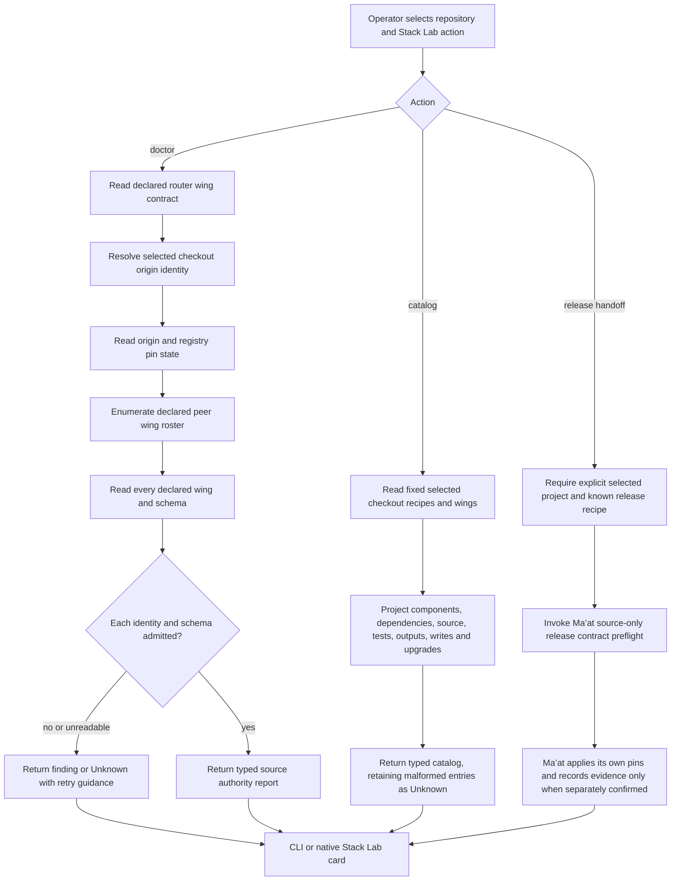

**Data and authority view**

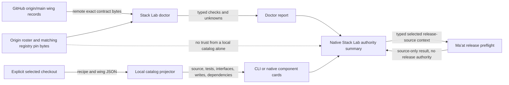

The second source above is the router wing registry, not the local catalog. A failed or unavailable origin, registry, peer or schema read stays Unknown. The native handoff chooses a selected project and delegates to Ma’at. It does not execute recipe strings or publish a release. Recovery is a fresh read of that exact project and authority source. Sequence crosses CLI/native, registry and Ma’at, so the handoff order is shown in the logical view.

<a id="pt-p53"></a>
## PT-P53 — Apollo capacity plan, separate telemetry read and admitted native chat

**Owner:** Apollo owns the local capacity plan and native inference. SNE owns session telemetry. Ma’at owns native chat admission. These are distinct command paths. The local planner does not create a cluster or claim one exists.

**Logical view**

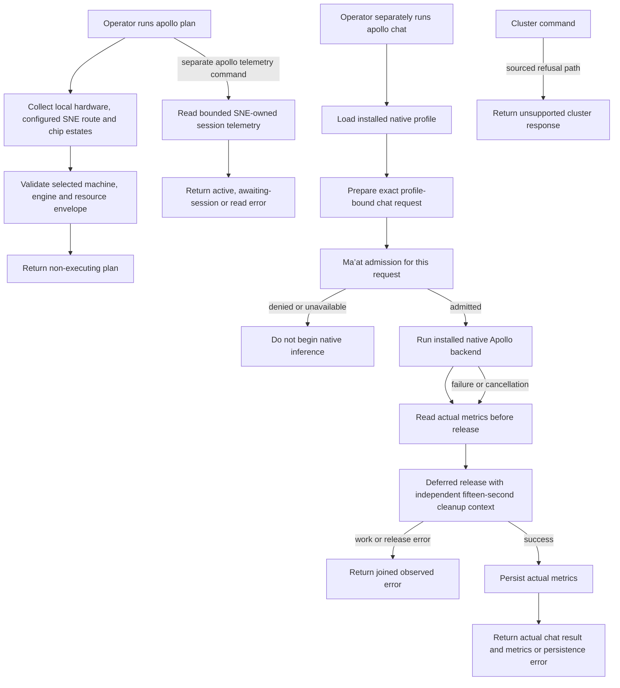

**Data and boundary view**

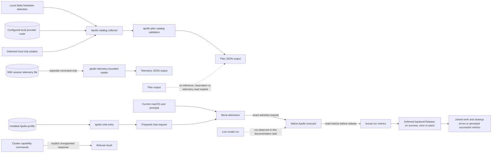

At the reviewed source, `apollo plan` calls `internal/apollo.Collect` and `BuildPlanForMachine`. It does not call the separate `apollo telemetry` reader. Telemetry reads the SNE session file only through its own command. `apollo chat` is a separate profile-bound Ma’at-admitted execution path. Cluster commands keep their explicit refusal path. No telemetry read, profile execution, chat or cluster request was made here.

<a id="pt-p54"></a>
## PT-P54 — Ask, model route and redacted decision journal

**Owner:** Pantheon model-router and provider owners. Ma’at retains privacy and remediation authority.

**Logical view**

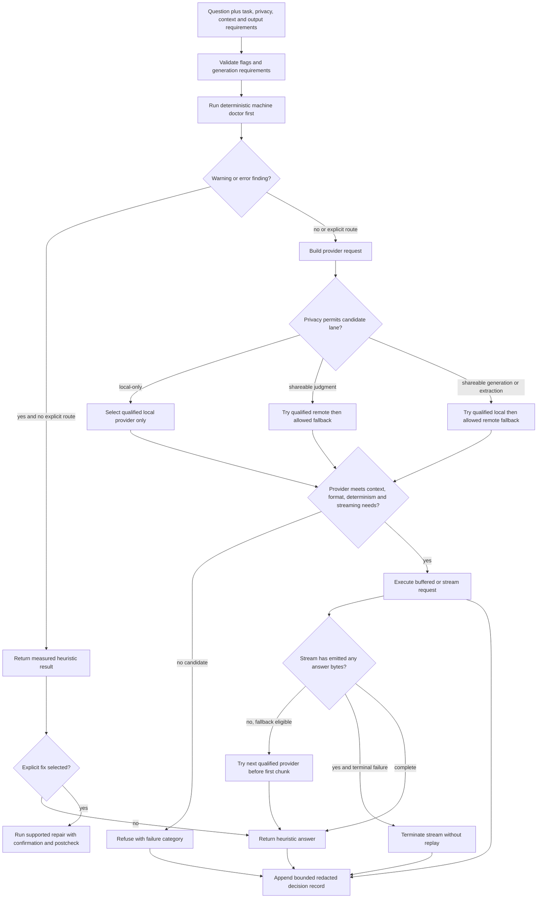

**Data and privacy view**

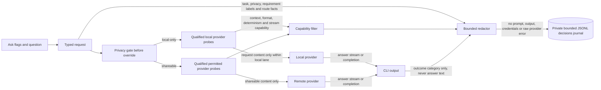

Local-only is a hard boundary. Explicit remote override cannot bypass it. Streaming may fall back only before the first emitted chunk; a post-output failure is terminal and not replayed. Cancellation propagates to the selected provider. Journal write failure does not prove route success or authorize a retry. Existing model-router and ask tests are not executed here.

<a id="pt-p55"></a>
## PT-P55 — Gemma shared submission, worker and native lifecycle

**Owner:** Pantheon owns broker/worker integration. Ra owns lane dispatch and leases. Apollo owns model/profile qualification. The process steps below are source-described at `e3e457e2d95576d63cb0149dbe0e34aad5785928`, merged after the e26 inventory. The overall sidecar remains pinned to e26 for its other groups until Main refreshes source pins.

**Logical view**

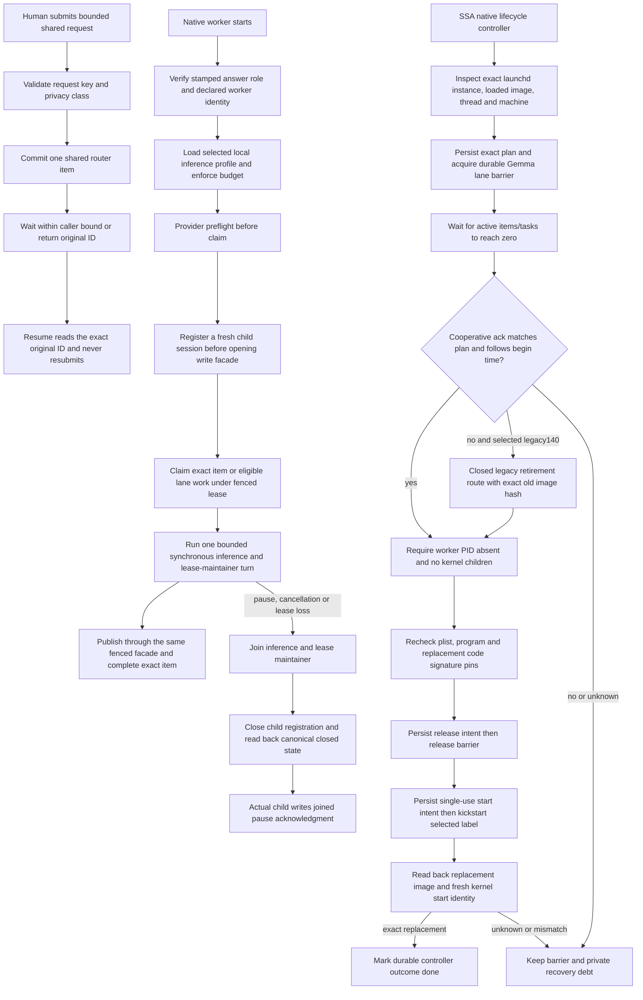

**Data and trust-boundary view**

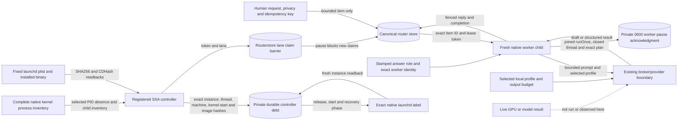

The cooperative pause path is: lane barrier blocks new claims, the worker finishes the current synchronous turn and lease maintainer, the actual worker closes its registration and reads canonical `closed`, then writes its identity-bound acknowledgment. The controller separately requires zero active tasks/items, exact acknowledgment or the narrowly recognized legacy140 retirement path, kernel PID absence, a complete kernel child inventory, unchanged plist/program identities and the replacement CDHash. It persists intent before releasing the barrier and before a single launchd start. Recovery reads retained debt and exact installed state. Unknown release/start outcomes are never replayed. Legacy140 retirement is recorded as retirement, never mislabeled as a cooperative pause acknowledgment.

**Service and orphan lifecycle view**

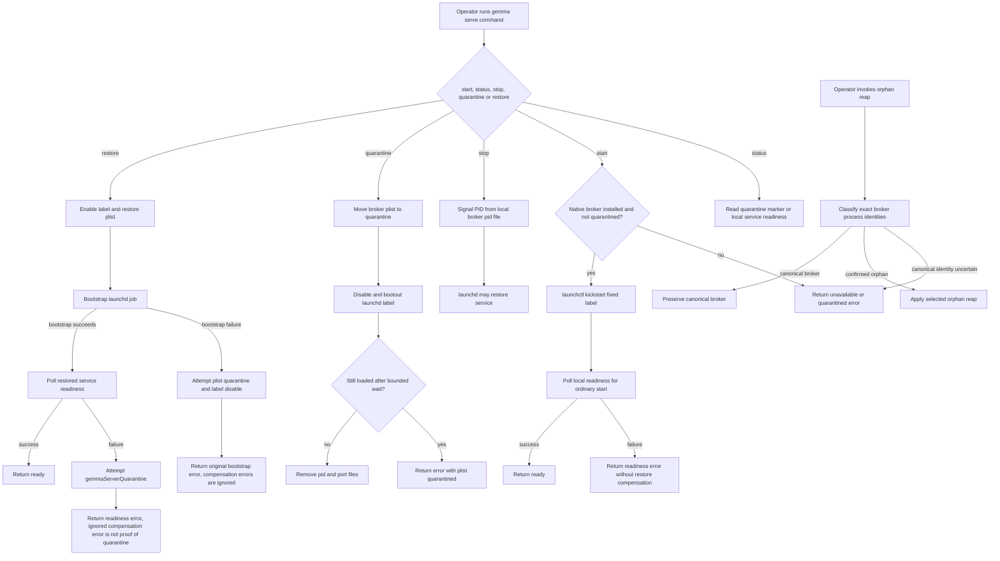

`serve` start, status, stop, quarantine, restore and orphan reap are distinct commands. Restore bootstrap failure attempts plist quarantine and disable; restore readiness failure attempts `gemmaServerQuarantine`. Both compensation calls discard errors, so this documentation cannot certify compensation succeeded. Ordinary start readiness failure simply returns its error. Quarantine checks launchd loaded state and may return an error while the plist remains quarantined. The orphan-reap path refuses to guess when canonical identity is missing. Component tests do not constitute installed lifecycle or live service receipts.

<a id="pt-p56"></a>
## PT-P56 — Mercury producer schema and consumer read models

**Owner:** Mercury owns producer identity and schema. Pantheon consumer surfaces must preserve declared units, nulls and freshness.

**Logical view**

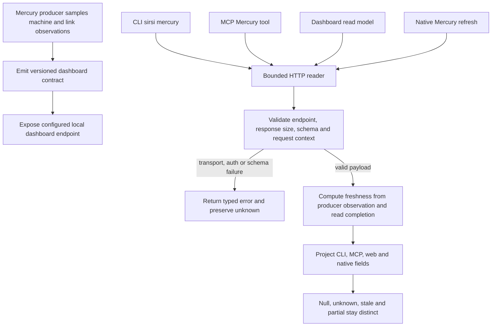

**Data contract view**

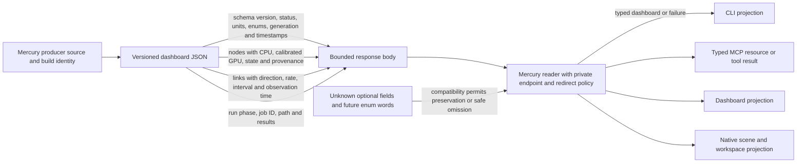

A consumer failure is an error or Unknown, never fabricated zero-valued health. GPU work remains null unless calibrated. The default endpoint is loopback, responses and headers are bounded, and caller cancellation is propagated. The consumer does not start Mercury or alter its run. Existing Go/MCP/dashboard/native tests and the Mercury consumer recipe are references only. Producer and cross-machine runtime observations are Unknown.

<a id="pt-p68"></a>
## PT-P68 — Storage scan, policy judgment and selected cleanup

**Owner:** Anubis/Jakal and Ka own enumeration; Scales owns policy; cleaner owns filesystem effects.

**Logical view**

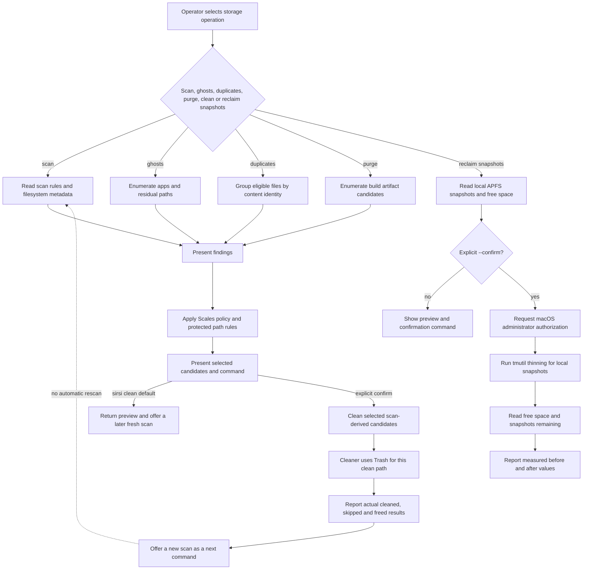

**Data and custody view**

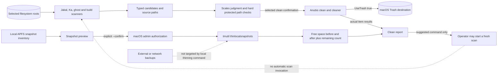

The ordinary `sirsi clean` path configures `UseTrash: true`. Its result offers a fresh `sirsi scan` as a next command. It does not run that scan automatically. Snapshot reclamation is a separate `reclaim-snapshots --confirm` path using macOS authorization and `tmutil thinlocalsnapshots`, followed by observed free-space and remaining-snapshot values. No scan, clean or thinning command was run.

<a id="pt-p69"></a>
## PT-P69 — Hapi live guard, manual relief, reaper and swap hygiene

**Owner:** Hapi/guard owns live memory policy. Process owners retain authority over non-governed work.

**Logical view**

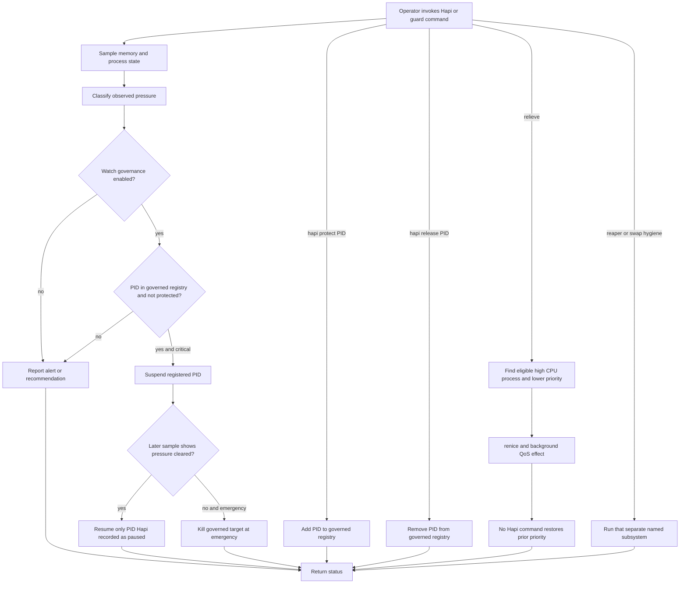

**Data and authority view**

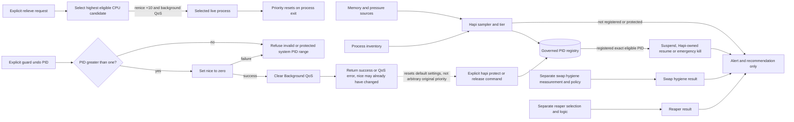

The CLI also exposes `hapi protect <pid>` and `hapi release <pid>` registry mutations. `relieve` lowers one eligible process with renice and background QoS, and `sirsi guard undo <pid>` separately rejects PID≤1, sets nice to0, then clears Background QoS. A first error stops the sequence; a QoS error may follow an already-applied nice change. This resets defaults, not an arbitrary saved original priority. The guard package notes priority returns when the process exits. Hapi registered-process signaling, user-triggered relieve, reaping and swap hygiene are distinct paths. No live action was run.

<a id="pt-p70"></a>
## PT-P70 — Isis diagnosis, network and supported repairs

**Owner:** Isis owns diagnosis and typed findings. Guard, LaunchServices and Spotlight adapters own their narrow effects.

**Logical view**

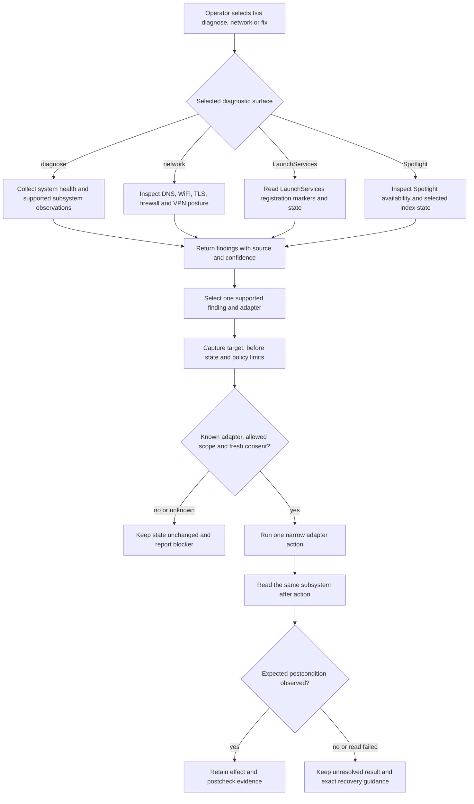

**Data and authority view**

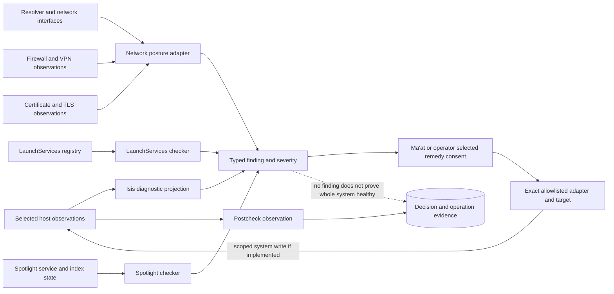

Diagnosis, network audit, LaunchServices and Spotlight are named independent subpaths. A display finding is not an effect grant. Only a supported adapter can act, after fresh scope checks and consent, then read back its own postcondition. Unreadable or mixed state remains Unknown. Recovery is adapter-specific and never a blanket daemon enable. No host action was performed.

<a id="pt-p71"></a>
## PT-P71 — Horus code context and Vault lifecycle

**Owner:** Horus owns structural code context. Vault owns local content/index storage. RTK owns output filtering.

**Logical view**

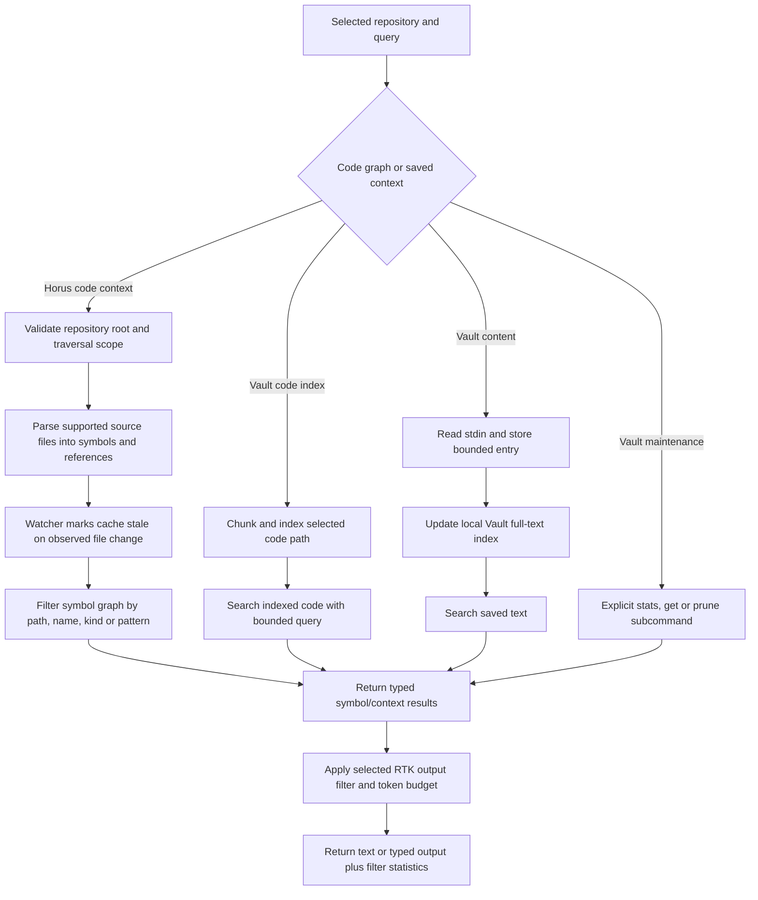

**Data and store view**

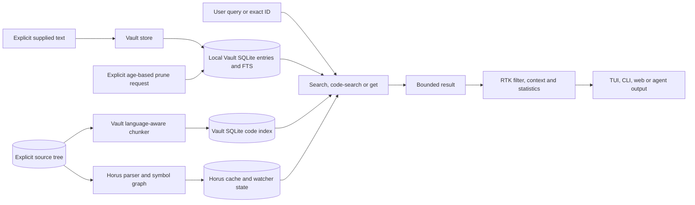

The code graph, Vault text store, Vault code index and RTK presentation filter are separate subpaths and stores. `get` addresses an exact stored ID. Prune is an explicit destructive Vault operation with its own age policy; it does not delete source files. A stale or failed Horus traversal must not be presented as a fresh graph. Recovery reopens/reindexes only the selected path and preserves stored content unless prune is separately selected. No index or prune was run.

<a id="pt-p72"></a>
## PT-P72 — Thoth initialization, sync, compact and continuation

**Owner:** Thoth owns project memory files and continuation journals. Repository canon remains source authority.

**Logical view**

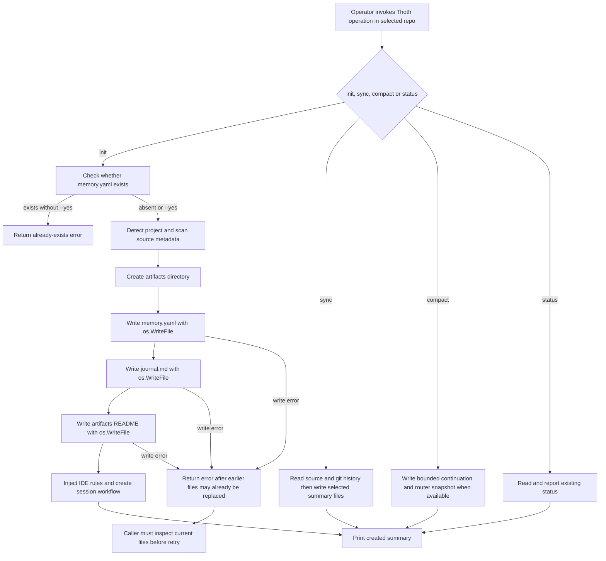

**Data and continuation view**

```mermaid
flowchart LR
  REPO[(Selected repository)] --> INIT[Thoth init]
  INIT -->|existing memory and no --yes| STOP[Refusal]
  INIT -->|absent or --yes| DETECT[Project detection and source scan]
  DETECT --> ART[Create .thoth/artifacts directory]
  ART --> MEM[(Overwrite-capable memory.yaml write)]
  MEM --> JOURNAL[(Overwrite-capable journal.md write)]
  JOURNAL --> README[(Overwrite-capable artifacts README write)]
  README --> IDE[IDE rule injection and session workflow]
  REPO --> SYNC[Thoth sync read and update]
  SESSION[Session input] --> COMPACT[Thoth compact]
  ROUTER[(Optional router snapshot)] --> COMPACT
  SYNC --> MEM
  COMPACT --> JOURNAL
  FILES[(Current files after any step)] --> STATUS[Thoth status]
  MEM -. partial failure does not roll back previous writes .-> FILES
  JOURNAL -. partial failure does not roll back previous writes .-> FILES
  CANON[(Repository source, ADRs and PRD)] -. remain the authority .-> STATUS
```

Without `--yes`, init refuses when `.thoth/memory.yaml` already exists. With `--yes`, it proceeds and `os.WriteFile` overwrites `memory.yaml`, then `journal.md`, then the artifacts README. A later write failure can leave earlier files already replaced. The source does not make this sequence transactional or roll it back. Sync, compact and status are separate command paths. Inspect all affected files after a partial error before retrying.

<a id="pt-p73"></a>
## PT-P73 — Workstream lifecycle and Neith alignment

**Owner:** Workstream owns its local selected-work list and launchers. Neith owns requirement-scope weaving. Each repository owns its PRD, ADR and evidence records.

**Logical view**

```mermaid
flowchart TD
  OP[Operator chooses workstream or canon command] --> WS{Workstream list, add, rename, activate, retire, delete, inventory or launch}
  WS -->|mutations| STORE[Write selected workstream registry]
  WS -->|launch| LAUNCH[Start selected installed assistant in selected repo]
  OP --> REQ{req add, evidence, satisfy, waive, audit or list}
  REQ -->|add or evidence| REQWRITE[Write requirement or evidence references]
  REQ -->|satisfy| CHECK{All required evidence references present?}
  CHECK -->|no| REFUSE[Return refusal]
  CHECK -->|yes| SAT[Write satisfied status]
  REQ -->|waive| WREQ[Require reason and terminal owner decision, then write waiver]
  OP --> ADR{adr claim, publish, list or audit}
  ADR -->|claim| ALLOC[Transactionally allocate next ADR number]
  ALLOC --> DOC[Owner writes ADR document separately]
  DOC -->|adr publish path| PUB[Write published identifier and path to store]
  REQ -->|list| READ[Read registry and evidence state]
  REQ -->|audit with required evidence| AUDIT[Upsert lane canon-audit marker and evidence reference]
  AUDIT --> AUDITOUT[Distinguish audited-empty lane from never-audited lane]
  WS -->|list or inventory| WSREAD[Read selected workstream inventory]
  OP -->|net status or align| NEITH[Resolve repository root and assess plan or cross-module alignment]
  NEITH --> ALIGNOUT[Return alignment findings or command failure]
  WSREAD --> OUT
  AUDITOUT --> OUT
  ALIGNOUT --> OUT
  STORE --> OUT[Return command outcome]
  LAUNCH --> OUT
  REQWRITE --> OUT
  SAT --> OUT
  WREQ --> OUT
  PUB --> OUT
  READ --> OUT
```

**Data and ownership view**

```mermaid
flowchart LR
  WS[(Workstream configuration)] <--> CRUD[Workstream add, rename, activate, retire and delete]
  WS --> LAUNCH[Selected launcher and repository]
  REQCMD[req command] --> REQSTORE[(Router requirement store)]
  REQCMD --> EV[(Commit, tests, security, design, deployment and production references)]
  EV --> REQSTORE
  REQSTORE --> SAT[Requirement satisfy only after evidence completeness check]
  OWNER[Terminal owner decision plus reason] --> WAIVE[Requirement waiver mutation]
  WAIVE --> REQSTORE
  ADRCMD[adr claim command] -->|serialized allocation| ADRSTORE[(Router identifier store)]
  ADRSTORE --> DOC[Owner authors ADR file]
  DOC --> ADRPUB[adr publish path mutation]
  ADRPUB --> ADRSTORE
  REQSTORE --> READ[Requirement list readback]
  AUDITCMD[req audit with required evidence reference] -->|MarkRequirementAudit upsert| AUDITSTORE[(Lane audit marker and evidence)]
  AUDITSTORE --> ELIGIBILITY[Runnable enumeration knows audited-empty versus never-audited]
  BUILDLOG[Selected repository build-log presence, freshness and observations] --> NETSTATUS[net status assessment or no measurable score]
  REPOCHECK[Selected repository vet, build, format and Thoth memory checks] --> NETALIGN[net align consistency assessment]
  NETSTATUS --> ALIGN[Scoped result or error]
  NETALIGN --> ALIGN
  WS --> WSLIST[workstream list or inventory readback]
  ADRSTORE --> READ
  WS --> READ
```

`req add`, `req evidence`, `req satisfy` and `req waive` mutate the router requirement store. Satisfy requires the evidence references and waiver requires a reason plus terminal owner decision. `adr claim` allocates a number transactionally, authoring the file is separate, and `adr publish` records the path. `req audit` also mutates a lane audit marker/evidence via `MarkRequirementAudit`; it is not a list/read-only command. Workstream list/inventory and Neith status/alignment are separately mapped reads/assessments. These are distinct from workstream CRUD. A failed mutation must be resolved by reading the store and repository state, not by assuming rollback.

<a id="pt-p74"></a>
## PT-P74 — Osiris risk assessment and checkpoint

**Owner:** Osiris owns working-tree risk observation. Git owns checkpoint commit state.

**Logical view**

```mermaid
flowchart TD
  OP[Operator invokes osiris risk, status or checkpoint] --> PATH[Use supplied path or current directory]
  PATH --> BARE{Checkpoint target is bare repository?}
  BARE -->|yes| CHOOSE[Choose dirtiest linked worktree]
  BARE -->|no| TARGET[Use selected worktree]
  CHOOSE --> TARGET
  TARGET --> CHECK[Check worktree and read porcelain status]
  CHECK -->|clean| NOOP[Return clean no-op]
  CHECK -->|dirty| ADD[git add -A stages all changes]
  ADD --> COMMIT[git commit checkpoint without confirmation]
  COMMIT -->|success| HASH[Read short HEAD hash and report]
  COMMIT -->|error| ERROR[Return commit error, index or tree may have changed]
  PATH -->|risk or status command| ASSESS[Read Git status, diff and commit age]
  ASSESS --> REPORT[Return risk report without mutation]
  HASH --> OUT[Command outcome]
  NOOP --> OUT
  ERROR --> OUT
  REPORT --> OUT
```

**Data view**

```mermaid
flowchart LR
  ARG[CLI path or current directory] --> GIT[Git repository discovery]
  GIT -->|risk or status| ASSESS[Read status, diff statistics and last commit]
  ASSESS --> REPORT[Risk projection]
  GIT -->|checkpoint on bare repo| LINKED[Enumerate linked worktrees and select dirtiest]
  GIT -->|checkpoint on worktree| WT[Use selected worktree]
  LINKED --> WT
  WT --> STATUS[Read porcelain status]
  STATUS -->|clean| NOOP[Successful no-op]
  STATUS -->|dirty| INDEX[git add -A]
  INDEX --> COMMIT[(Local Git commit)]
  COMMIT -->|success| HASH[Read short HEAD hash]
  COMMIT -->|failure| PARTIAL[Error with possible staged or committed side effects]
  REPORT --> OUT[CLI output]
  NOOP --> OUT
  HASH --> OUT
  PARTIAL --> OUT
  REMOTE[Remote push] -. checkpoint code does not push .-> COMMIT
```

`osiris checkpoint` calls `CommitCheckpoint` directly. It chooses the dirtiest linked worktree for a bare repo, reads status, stages all changes with `git add -A`, then commits without a confirmation prompt or a second status revalidation. It reads the short HEAD hash on commit success but does not verify residual dirty state. A staging or commit error can leave changed index state. This path does not push. No checkpoint was invoked.

<a id="pt-p75"></a>
## PT-P75 — Seba discovery, topology book, fleet, profile and compute

**Owner:** Seba owns topology/hardware projections. Scarab owns fleet scanning. The operator selects local roots, target ranges and benchmark intent.

**Logical view**

```mermaid
flowchart TD
  OP[Operator invokes Seba command] --> CMD{scan, diagram, book, hardware, profile, compute or fleet}
  CMD -->|scan| OBS[Read selected host descriptors and containers]
  OBS -->|--format html| HTML[Write .pantheon/infra-map.html]
  CMD -->|diagram| DIAG[Generate selected Mermaid diagrams]
  DIAG -->|--html| DHTML[Write .pantheon/diagrams.html and docs/seba.html]
  CMD -->|book| BOOK[Enumerate repositories and print table or dashboard]
  CMD -->|hardware| HW[Observe hardware descriptors]
  CMD -->|profile| PROF[Collect profile and write JSON report]
  CMD -->|compute --tokenize text| TOKEN[Call guard.Tokenize on supplied text]
  CMD -->|compute without text| USAGE[Print usage hint and do no computation]
  CMD -->|fleet containers| CONTAINERS[Audit Docker containers]
  CMD -->|fleet default| DISCOVER[Call Scarab Discover]
  FLAG[--confirm-network flag] -. parsed but not checked by runSebaFleet .-> DISCOVER
  DISCOVER --> SUBNET[Detect active local IPv4 subnet]
  SUBNET --> ARP[Read ARP cache]
  ARP --> PING[Parallel ping sweep of detected subnet]
  PING --> RESULT[Merge observed hosts and report]
  OBS --> RESULT
  HTML --> RESULT
  DHTML --> RESULT
  BOOK --> RESULT
  HW --> RESULT
  PROF --> RESULT
  TOKEN --> RESULT
  USAGE --> RESULT
  CONTAINERS --> RESULT
```

**Data and trust view**

```mermaid
flowchart LR
  HOST[Host descriptors, process and container sources] --> OBS[Local scan and hardware observation]
  OBS --> GRAPH[Typed graph or report]
  GRAPH -->|html option| FILE1[(.pantheon/infra-map.html)]
  DIAG[Mermaid diagram generator] -->|html option| FILE2[(.pantheon/diagrams.html and docs/seba.html)]
  CWD[Current directory project entries] --> BOOK[Inspect one-level repository entries and last commits]
  BOOK --> BOOKOUT[Printed table or dashboard, no registry-file persistence]
  PROFILE[Host profile collector] --> FILE4[(JSON profile report)]
  TEXT[Explicit tokenization text] --> COMPUTE[guard.Tokenize]
  COMPUTE --> RESULT[Token count, accelerator label and elapsed time]
  FLEET[seba fleet default path] --> DISCOVER[Scarab Discover]
  DISCOVER --> SUBNET[Automatically selected active local subnet]
  SUBNET --> PING[ARP read and parallel ping sweep]
  FLEETFLAG[confirm-network flag value] -. not read by runSebaFleet .-> DISCOVER
  PING --> HOSTS[Discovered host list]
  BENCH[Go benchmark entry points] -. separate benchmark surface, not seba compute .-> RESULT
```

`seba fleet` currently calls `scarab.Discover()` on its default path, which detects an active local subnet, reads ARP and runs a parallel ping sweep. The parsed `--confirm-network` flag is not consulted by `runSebaFleet`. Profile and HTML outputs are filesystem writes, distinct from observation. `seba compute --tokenize` calls `guard.Tokenize`; benchmark entry points elsewhere are not this command. No fleet scan, profile write, HTML render or benchmark was run.

<a id="pt-p76"></a>
## PT-P76 — Brain role configuration and Conduit tick lifecycle

**Owner:** Brain owns local role/provider configuration. Ra owns task eligibility and dispatch. Conduit owns its local scheduler installation and tick journal.

**Logical view**

```mermaid
flowchart TD
  OP[Operator runs autonomous on, off, status or run] --> CMD{Selected command}
  CMD -->|on| SETON[Persist autonomous mode ON]
  SETON --> PASS[Immediately run one bounded autoheal pass]
  PASS --> REPORT[Report applied, proposed or failed findings]
  CMD -->|off| SETOFF[Persist autonomous mode OFF]
  CMD -->|status| STATUS[Read persisted mode]
  CMD -->|run| APPROVED[Run one approved-fix pass regardless of switch]
  APPROVED --> PASSREPORT[Report outcomes, leave persisted switch unchanged]
  BRAIN[Operator runs brain role command] --> ROLE{status, route, test or use}
  ROLE -->|status or route| ROLEOBS[Inspect configured roles and route]
  ROLE -->|dry-run test| ROLETEST[Return selected route test without role mutation]
  ROLE -->|use| ROLEWRITE[Persist selected provider-role configuration]
  ROLEOBS --> OUT
  ROLETEST --> OUT
  ROLEWRITE --> OUT
  OP2[Operator or launchd invokes conduit tick] --> TICK[Read queue and current mode]
  TICK -->|mode ON| EXEC[Plan and dispatch actionable items]
  TICK -->|mode OFF| HOLD[Hold items as proposals]
  OP2 -->|conduit arm| ARM[Write and bootstrap short-lived launchd trigger]
  ARM --> TICK
  OP2 -->|conduit status| CSTATUS[Read plist and launchd loaded state]
  OP2 -->|conduit disarm| DISARM[Bootout and remove plist]
  SETOFF --> TICK
  SETON --> TICK
  REPORT --> OUT[Command outcome]
  PASSREPORT --> OUT
  STATUS --> OUT
  EXEC --> OUT
  HOLD --> OUT
  CSTATUS --> OUT
  DISARM --> OUT
```

**Data and authority view**

```mermaid
flowchart LR
  ROLECMD[brain status, route or dry-run test] --> ROLECONF[(Provider and role configuration)]
  ROLECONF --> ROLEVIEW[Role inspection and routing result]
  ROLEUSE[brain use explicit role selection] -->|configuration write| ROLECONF
  MODE[(~/.sirsi/brain.yaml autonomous switch)] --> ON[autonomous on persists ON]
  ON --> IMMEDIATE[Immediately invokes one autoheal pass]
  OFF[autonomous off persists OFF] --> MODE
  STATUS[autonomous status reads persisted switch] --> MODE
  RUN[autonomous run] --> APPROVED[One approved fix pass even while switch is OFF]
  RUN --> MODE
  IMMEDIATE --> AUTOHEAL[Doctor findings and bounded remediation execution]
  APPROVED --> AUTOHEAL
  AUTOHEAL --> STELE[(Applied remediation events)]
  AUTOHEAL --> OUTCOME[Applied, proposed or failed outcomes]
  MODE --> TICK[conduit tick reads switch]
  QUEUE[(Router queue)] --> TICK
  TICK -->|ON| DISPATCH[Plan and dispatch actionable work]
  TICK -->|OFF| PROPOSAL[Hold work as proposal]
  ARM[conduit arm writes and bootstraps LaunchAgent plist] --> SCHED[(Selected scheduler state)]
  DISARM[conduit disarm bootouts job and removes plist] --> SCHED
  STATUS2[conduit status reads plist and launchctl state] --> SCHED
  SCHED -->|interval or inbox change| TICK
```

`brain route`, `status` and dry-run `test` are observational. `brain use` changes role configuration. Autonomous mode defaults off. `autonomous on` persists ON and immediately runs one autoheal pass. `autonomous run` executes one approved-fix pass even while the switch remains OFF. Conduit ticks dispatch actionable work only when the persisted switch is ON. `arm` and `disarm` affect the selected scheduler, not provider roles. No provider, autoheal pass or conduit tick was run.


<a id="pt-p77"></a>
## PT-P77 — Desktop custody, finite sleep coordination and authenticated recovery

**Owner:** Desktop Custody owns the bounded sleep session and its returned facts. Desktop Recovery owns authenticated admission, replay expiry and recovery-session cleanup. The operating system owns sleep and wake events.

**Logical view**

```mermaid
flowchart TD
  CALL[Desktop sleep custody request] --> SLEEP_ADMIT[Validate exact local request and record finite session]
  SLEEP_ADMIT --> PRE[Record bounded pre-sleep facts]
  PRE --> SLEEP[Request sleep]
  SLEEP --> WAKE[Observe return event and gather selected facts]
  WAKE --> CLOSE[Close custody session and report outcome]
  CLIENT[Browser recovery client] --> EDGE[External Tailscale Serve placement and authentication]
  EDGE --> LOOP[Forward request to loopback recovery gateway]
  LOOP --> CAP{Capability valid for selected node and scope?}
  CAP -->|no| REFUSE[Refuse session]
  CAP -->|yes| REPLAY{Capability already consumed or expired?}
  REPLAY -->|yes| REFUSE
  REPLAY -->|no| RECOVERY_ADMIT[Consume capability and create separate session admission]
  RECOVERY_ADMIT --> SESSION[Create node-bound expiring browser session]
  SESSION --> COOKIE[Set session cookie for browser websocket]
  COOKIE --> RFB[RFB proxy to selected node address]
  RFB -->|browser to node bytes| NODE[Remote framebuffer service]
  NODE -->|node to browser bytes| RFB
  RFB -->|disconnect or expiry| END[Close active session and remove session entry]
  RECOVERY_ADMIT --> SAVE[Persist capability consumption and expiry]
```

**Data and trust view**

```mermaid
flowchart LR
  OP[Desktop custody CLI] --> CUSTODY[Finite sleep custody controller]
  CUSTODY --> CFACTS[(Pre-sleep and return facts)]
  CLIENT[Browser] --> TS[Tailscale Serve external placement and authentication]
  TS --> LOOP[Loopback recovery gateway]
  LOOP --> ADMISSION[Validate recovery capability]
  ADMISSION --> SESSION[(Distinct node-bound expiring session record)]
  SESSION --> COOKIE[Browser session cookie]
  COOKIE --> WS[Authenticated websocket handshake and origin check]
  WS --> PROXY[RFB byte proxy]
  PROXY -->|browser input bytes| RFB[TCP RFB endpoint on selected node]
  RFB -->|framebuffer bytes| PROXY
  SESSION -->|expiry or disconnect| CLOSE[Delete session record and close proxy]
  CAP[Capability replay and expiry state] --> ADMISSION
  TS -. deployed outside the loopback gateway code .-> LOOP
  CFACTS -. separate from remote desktop stream .-> OP
```

The recovery gateway uses external Tailscale Serve placement to reach its loopback endpoint, then separately validates a capability and creates a node-bound expiring browser session. The websocket proxies opaque RFB bytes in both directions between browser and the selected node TCP endpoint. This is remote desktop data, not an authorized-facts-only response. Disconnect or expiry closes the proxy and removes the session entry. Desktop sleep custody is a separate local process. No recovery or sleep session was run.

<a id="pt-p78"></a>
## PT-P78 — Seshat compatibility export and refusal boundaries

**Owner:** Seshat owns legacy command compatibility and explicit export. Ma’at owns canonical local archive ingestion. Each external target owns its export-side authentication and acceptance.

**Logical view**

```mermaid
flowchart TD
  OP[Operator invokes Seshat command] --> CMD{Ingest, export, auth, prune or sync?}
  CMD -->|ingest| ADAPTER{Configured supported local reader?}
  ADAPTER -->|yes| MAAT[Delegate to canonical Ma’at archive]
  ADAPTER -->|no| REFUSE[Refuse unsupported adapter]
  CMD -->|export| TARGET{Explicit supported destination selected?}
  TARGET -->|no| REFUSE
  TARGET -->|yes| AUTH[Use target-specific configured authentication]
  AUTH --> SEND[Export selected content]
  SEND --> RESULT[Report target response]
  CMD -->|auth or profile| PROFILE[Inspect or update existing target profile path]
  CMD -->|prune| SAFE[Refuse destructive legacy snapshot edits]
  CMD -->|sync| LEGACY[Return legacy synchronization refusal]
  CHROME[Chrome profile ingest request] --> REFUSE
  MAAT --> RESULT
  PROFILE --> RESULT
  SAFE --> RESULT
  LEGACY --> RESULT
```

**Data and authority view**

```mermaid
flowchart LR
  INPUT[Selected legacy input] --> SESHAT[Seshat compatibility command]
  SESHAT -->|supported ingest| MAAT[Ma’at canonical archive API]
  MAAT --> ARCHIVE[(Ma’at archive records)]
  ARCHIVE -->|explicit export only| EXPORT[Target export adapter]
  AUTH[(Existing target auth profile)] --> EXPORT
  EXPORT --> TARGET[Selected external target]
  TARGET --> ACK[Target response]
  RETIRED[(Retired raw snapshots)] -. migration input only .-> SESHAT
  CHROME[Browser profile data] -. unsupported ingestion .-> SESHAT
  PRUNE[Legacy destructive prune] -. refusal .-> SESHAT
  SYNC[Legacy bidirectional sync] -. refusal .-> SESHAT
  NEWAUTH[New user authority] -. not granted by compatibility .-> EXPORT
```

The path is `cmd/sirsi/seshat.go` plus the canonical Ma’at archive and target adapters. Unsupported ingest, prune and legacy sync remain explicit refusals. Export and profile operations do not create a new authority source. Runtime target acceptance and external authentication state are unknown.

<a id="pt-p79"></a>
## PT-P79 — Mail poison and sender analysis

**Owner:** MailOps owns read-only message inspection and sender census. Gmail owns label mutation and resulting mailbox state. Local receipt storage owns the apply record.

**Logical view**

```mermaid
flowchart TD
  OP[Operator selects mailops command] --> MODE{Poison scan or sender census?}
  MODE -->|poison scan| LIST[Read selected inbox messages]
  LIST --> MIME[Inspect MIME part sizes and text/plain payload]
  MIME --> POISON{Zero-byte plain text part found?}
  POISON -->|no| REPORT[Return read-only classification]
  POISON -->|yes| PLAN[Default to dry-run finding]
  PLAN --> APPLY{Explicit apply flag supplied?}
  APPLY -->|no| REPORT
  APPLY -->|yes| LABEL[Remove Gmail INBOX label only]
  LABEL --> RECEIPT[Write local signed apply receipt]
  MODE -->|sender census| CENSUS[Read sender and unsubscribe metadata]
  CENSUS --> COUNTS[Return top counts and unsubscribe signals]
  COUNTS --> REPORT
  SEND[Send message] -. not an operation .-> REPORT
  DELETE[Delete message] -. not an operation .-> REPORT
```

**Data and trust view**

```mermaid
flowchart LR
  GMAIL[(Selected Gmail inbox)] --> READ[MailOps read path]
  READ --> MIME[Message MIME metadata and bounded body fields]
  MIME --> CLASS[Poison classification]
  READ --> SENDER[Sender census]
  SENDER --> COUNTS[Counts and List-Unsubscribe observations]
  CLASS --> DRY[Dry-run report]
  CLASS -->|explicit apply| MODIFY[Remove INBOX label]
  MODIFY --> GMAIL
  MODIFY --> RECEIPT[(Local signed apply receipt)]
  SCOPES[OAuth modify and basic settings scopes] --> READ
  SCOPES --> MODIFY
  OUTBOUND[Send or delete capability] -. absent from command contract .-> GMAIL
```

The source is `cmd/sirsi/mailopscmd.go` and `internal/mailops`. The apply path archives by removing only the INBOX label and writes a local signed receipt. It does not send or delete mail. No mailbox action was run. The consent and application of any real Gmail token remain unverified.

<a id="pt-p80"></a>
## PT-P80 — Setup, quickstart, surfaces and managed app lifecycle

**Owner:** Setup owns selected-surface setup ordering and permission guidance. App lifecycle and updater own their distinct install, refresh and removal paths. The user owns permission grants and surface selection.

**Logical view**

```mermaid
flowchart TD
  OP[Operator starts native app] --> LEASE{Acquire per-user open-file instance lease?}
  LEASE -->|failed| PEER[Find first matching running peer]
  PEER -->|found| ACTIVATE[Activate peer windows]
  ACTIVATE --> EXIT[Terminate new process]
  PEER -->|none| EXIT
  LEASE -->|acquired| ENUM[Enumerate matching app and legacy executable peers]
  ENUM --> AGE[Request retirement of older and legacy peers]
  ENUM --> START[Create app window and menu bar without waiting for retirement]
  AGE --> TERM[Request polite terminate]
  TERM --> ASYNC[Enqueue global asynchronous retirement task]
  ASYNC --> WAIT[Wait up to three seconds in background task]
  WAIT -->|still running| FORCE[Force terminate peer]
  WAIT -->|terminated| RETIRED[Background task ends]
  FORCE --> RETIRED
  OP2[Operator runs setup] --> SMODE{JSON inspection or setup application?}
  SMODE -->|setup --json| INSPECT[Report surfaces, dependencies and permissions without actions]
  SMODE -->|application path| SELECT[Choose explicit surfaces or wizard selections]
  SELECT --> APPLY[Run selected installers and dependency steps]
  APPLY --> FDA[Offer or open permission guidance, user owns actual grants]
  FDA --> SETUPRESULT[Retain selected setup results and failures]
  LIFE[Selected install, update, refresh or removal command] --> LIFEAUTH[Existing typed updater and selected lifecycle authority]
  LIFEAUTH --> LIFEOUT[Installed/readback result or retained recovery, not blanket setup authority]
  INSPECT --> DONE[Return command outcome]
  SETUPRESULT --> DONE
  LIFEOUT --> DONE
  START --> DONE
```

**Data and trust view**

```mermaid
flowchart LR
  APP[Native app launch] --> LOCK[Acquire per-user menubar.instance.lock with nonblocking flock]
  LOCK -->|acquired| ENUM[Enumerate bundle ID and executable name peers]
  ENUM -->|older or legacy peer| TERM[Request peer terminate]
  TERM -->|after three seconds still live| FORCE[Force terminate peer]
  ENUM -->|caller proceeds after scheduling retirement| ACTIVE[Create normal app window and menu bar surface concurrently]
  LOCK -->|unavailable or contended| PEER[Activate first matching peer when present]
  PEER --> EXIT[Terminate new process]
  LOCKFILE[(Open descriptor-held lock)] --> LIFETIME[Lock lives through app lifetime]
  LIFETIME -->|normal exit or crash| RELEASE[OS releases descriptor lock]
  SREAD[setup --json observation] --> REPORT[Surface, dependency and permission status]
  SELECT[Explicit surfaces or wizard choices] --> SETUP[Selected setup installers]
  SETUP --> CONFIG[(Selected app, integration and launch definitions)]
  DEP[Dependency checks or installs] --> SETUP
  USER[User grants OS permission separately] --> PERM[Permission readiness, not fabricated consent]
  LIFEACTION[Separate managed install, update, refresh or removal] --> ATTEMPT[(Existing typed lifecycle attempt and readback)]
  REPORT --> RESULT[Observed report or selected installer outcome]
  CONFIG --> RESULT
  ATTEMPT --> RESULT
  ACTIVE --> RESULT
  EXIT --> RESULT
```

The native app source implements a per-user descriptor-held flock. A process that cannot acquire it activates a matching peer if present and exits. A lease holder enumerates matching bundle or executable peers, asks older or legacy peers to terminate, schedules the background three-second wait and possible force termination, and continues building the surface without joining that task. This is source-described lifecycle control. Installed-app behavior and qualification receipts are separate and remain unknown here.


Peer retirement is asynchronous after each polite terminate request. The app does not join that background three-second wait before creating its UI, so source single-instance intent is not proof of confirmed peer absence at first render. Setup inspection, selected surface application, dependency handling, OS permission grants and managed install/update/removal have separate effects and observations.

<a id="pt-p81"></a>
## PT-P81 — Activity, Stele and native consent classification

**Owner:** Oplog owns destructive operation history. Notifications own persistent surfaced outcomes. Stele owns its separate append-only hash chain and reader offset. Ma’at owns confirmed owner-resolution records. Native Activity owns the retained entry and confirmation UI for Ma’at review.

**Logical view**

```mermaid
flowchart TD
  OP[Operator or surface action completes] --> OUTCOME[Produce actual command or action outcome]
  OUTCOME --> HISTORY[Record notification when wired caller has notification store]
  HISTORY --> DB[(Persistent notification history)]
  OP -->|notifications command| READ[Read recent, filtered or all history]
  OP -->|notifications clear| CLEAR[Delete all history rows]
  CLEAR --> DB
  DB --> READ
  OP -->|activity command| OREAD[Read typed operation log records]
  OP -->|Stele command| SREAD[Read separate append-only chain]
  ACTIVITY[Retained native ActivityEntry command and outcome] --> REVIEWBUTTON[User selects Ma’at review]
  REVIEWBUTTON --> CONSENT{Confirm Record Ma’at review?}
  CONSENT -->|cancel| DECLINE[Keep retained activity without submitting]
  CONSENT -->|confirm| ARGUMENTS[activityMaatReviewArgs for this exact entry]
  ARGUMENTS --> COMMANDRUN[Canonical maat record-resolution with confirm and retained command/outcome]
  COMMANDRUN -->|result| CLASSIFIED[Display Ma’at classification and next safe action]
  COMMANDRUN -->|no result| RETRY[Keep activity open with retry error]
  OP -->|selected guidance finding| REVIEW[Review exact retained observation]
  REVIEW -->|sirsi maat record-resolution --confirm| CASEBOOK[Write owner-resolution evidence to Ma’at journal]
  CASEBOOK --> INSPECT[Inspect Ma’at Casebook]
  INSPECT -->|separate explicit owner conclusion| ACCEPT[Record acceptance with evidence and confirmation]
  OP -->|system fix| FIX[Execute selected remediation]
  FIX --> POST[Separate system postcheck]
  DB --> VIEW[History view]
  OREAD --> VIEW
  SREAD --> VIEW
  CLASSIFIED --> VIEW
  DECLINE --> VIEW
  CASEBOOK --> VIEW
  ACCEPT --> VIEW
  POST --> VIEW
```

**Data and audit view**

```mermaid
flowchart LR
  COMMAND[Real operation or command outcome] -->|where caller is wired| NOTIFY[Notification recorder]
  NOTIFY --> DB[(notifications.db)]
  READ[notifications recent, source, severity or all] --> DB
  CLEAR[notifications clear] -->|delete all notification rows| DB
  OPLOG[(operations.log typed operation records)] --> ACTCMD[activity command]
  STELE[(Separate append-only hash chain)] --> STELEVIEW[Stele reader]
  NATIVE[Retained ActivityEntry command, title and outcome] --> CONSENT[Explicit review confirmation]
  CONSENT -->|confirmed| ARGS[activityMaatReviewArgs builds exact command and outcome evidence]
  ARGS --> JOURNAL[Canonical Ma’at record-resolution with confirm]
  JOURNAL --> NATIVEVIEW[Ma’at result or retryable review error]
  HEALTH[Selected diagnostic finding in Health screen] -->|second confirmation invokes maat record-resolution --confirm| MAAT[Ma’at owner-resolution journal path]
  MAAT -->|inspect then separately accept with evidence and confirmation| ACCEPT[Owner acceptance record]
  FIX[Selected remediation] --> POST[System postcheck result]
  DB --> VIEW[Surface history view]
  ACTCMD --> VIEW
  OPLOG --> SCREEN[Activity screen reads oplog and Casebook separately]
  MAAT --> SCREEN
  SCREEN --> VIEW
  STELEVIEW --> VIEW
  NATIVEVIEW --> VIEW
  MAAT --> VIEW
  ACCEPT --> VIEW
  POST --> VIEW
  REVIEW[Ma’at evidence review] -. not the same operation as system remediation postcheck .-> VIEW
```

`sirsi notifications` reads recent, filtered or full notification history and `notifications clear` deletes the stored rows. Notification history is separate from the typed operation log and Stele chain. The TUI Activity screen reads the operation log and Ma’at Casebook separately. In Health, a selected guidance finding requires a second confirmation before `sirsi maat record-resolution --confirm` records the exact diagnostic owner-review decision. Casebook inspection and owner acceptance are subsequent distinct steps. Neither review nor acceptance repairs the system. A system fix and its postcheck are another path. Native Activity review retains the existing command/outcome, asks confirmation, constructs `activityMaatReviewArgs(for: entry)` and calls the canonical Ma’at command. A nil result leaves the same activity open with a retry error. This records/classifies evidence and does not replay the retained command or repair the system. Installed confirmation/result receipts remain separate evidence.

<a id="pt-p82"></a>
## PT-P82 — Web, TUI, MCP and runner surface protocols

**Owner:** Each surface owns its admission and confirmation contract. The shared action runner owns bounded execution and event delivery. PT-P04 refers only to the shared Router A2A path, not every MCP operation.

**Logical view**

```mermaid
flowchart TD
  CALL[Surface request] --> SURFACE{Web, TUI or MCP}
  SURFACE -->|web| WEB[Dashboard typed action registry]
  WEB --> DESTRUCTIVE{Action spec marks destructive?}
  DESTRUCTIVE -->|yes, no token| PREP[Prepare action and return confirmation token]
  PREP -->|valid supplied token| COMMIT[Validate token, target, parameters and action hash]
  DESTRUCTIVE -->|no| DIRECT[Run registered action without confirm token]
  COMMIT --> RUN[Dashboard runner starts one command]
  DIRECT --> RUN
  SURFACE -->|TUI| TUI[TUI screen chooses its own CLI runner command]
  TUI --> NEED{Selected verb requires confirmation?}
  NEED -->|yes| CONFIRM[Screen-specific confirmation interaction]
  NEED -->|no| DIRECTTUI[Dispatch through TUI runner]
  CONFIRM --> DIRECTTUI
  DIRECTTUI --> RESULTTUI[Render screen result and error state]
  SURFACE -->|MCP| MCP[MCP server routes named tool or resource]
  MCP --> HANDLER[Selected handler applies its own checks and authority]
  HANDLER -->|router MCP tool| ROUTER[Router A2A implementation and its registration and lease gates]
  HANDLER -->|other handler| LOCAL[Handler-specific operation]
  RUN --> EVENTS[Dashboard event buffer and SSE]
  EVENTS --> RESULT[Dashboard action result]
  RESULTTUI --> RESULT
  ROUTER --> RESULT
  LOCAL --> RESULT
```

**Data and protocol view**

```mermaid
flowchart LR
  WEB[Web action request] --> REG[Dashboard action registry]
  REG -->|destructive spec| CONFIRM[Dashboard confirm token prepare and validate]
  REG -->|non-destructive spec| RUNNER[Dashboard-only runner]
  CONFIRM --> RUNNER
  RUNNER --> CHILD[CLI child process]
  CHILD --> BUFFER[Dashboard event buffer]
  BUFFER --> SSE[Dashboard SSE stream]
  TUI[TUI key and screen state] --> TUIRUNNER[Independent TUI runner seam]
  TUIRUNNER --> CLIRUN[Selected CLI command]
  TUIRUNNER -. no dashboard SSE dependency .-> SSE
  TOOL[MCP named tool request] --> HANDLER[Registered MCP handler]
  RESOURCE[MCP named resource request] --> RESOURCEHANDLER[Selected resource handler]
  HANDLER -->|router tool only| ROUTER[Router A2A registration, lease and operation gates]
  HANDLER -->|other named tool| LOCAL[Tool-specific validation and authority]
  RESOURCEHANDLER --> DATA[Resource-specific read path]
  ROUTER --> RESULT[Protocol result]
  LOCAL --> RESULT
  DATA --> RESULT
  CLIRUN --> RESULT
  SSE --> RESULT
```

Dashboard actions use a dashboard registry and runner with an event buffer exposed through SSE. The TUI uses its own screen/CLI runner and only prompts for verbs whose screen contract requires confirmation. MCP dispatches named tools and resources to their handlers. There is no source-wide MCP authentication gate in this diagram: each handler or subsystem supplies its own authority checks. The Router A2A handler has its own registration and lease gates. No surface action was executed here.

<a id="pt-p83"></a>
## PT-P83 — Qualification pre-push CI and finite private executor boundary

**Owner:** CI owns public repository static checks and test orchestration. Ma’at admitted-run scripts own their finite local qualification orchestration. Private SDK, native bootstrap and any external executor own their independent environment receipts.

**Logical view**

```mermaid
flowchart TD
  CHANGE[Proposed documentation or source change] --> TRIGGER{Applicable pre-push or CI trigger?}
  TRIGGER -->|no| NOTRUN[No qualification claim]
  TRIGGER -->|yes| STATIC[Run declared static verification steps]
  STATIC -->|failure| FAIL[Retain failure and source revision]
  STATIC -->|pass| SELECT[Select finite named qualification plan]
  SELECT --> CAUSAL[Run declared causal controls and bounded cases]
  CAUSAL --> RESULT[Collect process result and diagnostics]
  RESULT --> REVIEW[Human reviews scope, output and source identity]
  REVIEW --> BIND[Bind accepted receipts to exact revision and component]
  PRIVATE[Private SDK or native bootstrap required] --> AVAIL{Executor and environment receipt available?}
  AVAIL -->|no| GAP[Mark qualification pending]
  AVAIL -->|yes| EXEC[Run only the declared finite executor plan]
  EXEC --> RESULT
  GAP --> REVIEW
  FAIL --> REVIEW
```

**Evidence and executor view**

```mermaid
flowchart LR
  SOURCE[Exact source revision] --> CI[Public CI workflow]
  CI --> VERIFY[Named scripts and static checks]
  VERIFY --> TESTS[Named bounded test targets]
  TESTS --> CIRESULT[(CI result tied to revision)]
  PLAN[Ma’at admitted-run plan] --> WRAPPER[Finite qualification wrapper]
  WRAPPER --> CONTROLS[Causal controls and target cases]
  CONTROLS --> LOCALRESULT[(Local process output and receipt)]
  PRIVATE[Private SDK and native environment] --> AVAIL[Independent availability evidence]
  AVAIL --> EXECUTOR[External finite executor]
  EXECUTOR --> EXTERNAL[(Separate executor and environment receipt)]
  CIRESULT --> REVIEW[Review and scope binding]
  LOCALRESULT --> REVIEW
  EXTERNAL --> REVIEW
  REVIEW --> ACCEPTED[(Accepted component receipt or explicit debt)]
  NEVER[Unrun model, live service or signing action] -. never inferred from diagram .-> ACCEPTED
```

Relevant sources include `.github/workflows/ci.yml`, `scripts/maat/admitted-run.py`, `scripts/maat/apollo-bounded-qualification.sh` and `scripts/verify-*`. This is a process description, not a test run or qualification receipt. Private SDK and native bootstrap availability remains independently evidenced or pending. Do not count a CI workflow definition as a passing result.

<a id="pt-p84"></a>
## PT-P84 — Canon publication, independent criteria review and retained debt

**Owner:** Canon maintainers own source documents, diagrams and source pins. Independent reviewers own criteria-level evidence review. The publication operator owns mirror updates and readbacks. Completion status remains the decision of the designated certifier.

**Logical view**

```mermaid
flowchart TD
  EDIT[Prepare canon changes in owned files] --> SCOPE[Check write-set ownership and source revision]
  SCOPE --> REVIEW[Independent review against each current criterion]
  REVIEW -->|evidence sufficient| RECORD[Record criterion evidence and source pin]
  REVIEW -->|evidence missing or contradictory| DEBT[Record precise unresolved debt]
  RECORD --> PUBLISH[Publish to approved existing canon locations]
  DEBT --> PUBLISH
  PUBLISH --> READBACK[Read back each published location]
  READBACK --> MATCH{Readback matches source and pin?}
  MATCH -->|no| REPAIR[Record publication defect and repair explicitly]
  REPAIR --> READBACK
  MATCH -->|yes| INVENTORY[Update current inventory and evidence references]
  INVENTORY --> DECIDE[Certifier evaluates all criteria and limitations]
  DECIDE -->|all required evidence accepted| OUTCOME[Record certifier decision]
  DECIDE -->|open criteria| DEBT
  OUTCOME --> COMPLETE{Completion proof and explicit closure?}
  COMPLETE -->|yes| CLOSE[Record bounded completion state]
  COMPLETE -->|no| OPEN[Keep status open with debt]
```

**Data, provenance and publication view**

```mermaid
flowchart LR
  SRC[(Canonical source tree at exact revision)] --> PIN[Source revision and origin identity]
  PIN --> CRITERIA[Current criterion ledger]
  EVIDENCE[(Criterion evidence and receipts)] --> REVIEW[Independent review]
  CRITERIA --> REVIEW
  REVIEW -->|accepted| ACCEPTED[Criterion-specific accepted record]
  REVIEW -->|insufficient| DEBT[(Explicit debt with owner and next action)]
  SRC --> MIRRORS[Approved existing publication locations]
  ACCEPTED --> MIRRORS
  DEBT --> MIRRORS
  MIRRORS --> READBACK[Read back published contents and identity]
  READBACK --> INVENTORY[Current public inventory]
  INVENTORY --> CERTIFIER[Certifier decision input]
  ACCEPTED --> CERTIFIER
  DEBT --> CERTIFIER
  CERTIFIER --> STATE[Decision plus residual limitations]
  SIGN[Signing evidence] -. separate evidence domain .-> CERTIFIER
  UNKNOWN[Unread mirror or unpinned source] -. stays unresolved .-> STATE
```

This process must use the current Main-owned certification and signing requirements without restating or replacing them. Source publication, mirror readback, origin identity, signing and criterion review are separate evidence domains. A diagram or inventory row does not prove that a mirror was updated, a source pin was read back, a signature verified or any criterion passed. Those states remain unknown until their actual evidence is recorded.

## Assignment completeness and limits

This file covers **22 assigned groups**: PT-P52–56 and PT-P68–84. Each has separate logical and data/trust Mermaid views. State, sequence, refusal and recovery edges are included where the source process has them. No Mermaid label contains a semicolon. The overall finite census target is **84 groups** across the three concurrently authored product, governance and fabric diagram files: 40 existing process groups plus P41–51, P57–67 and this file’s 22. This file does not assert that the other groups, current certification criteria, runtime paths, installed native components, publication readbacks or receipts are complete or passing. Runtime observation for this documentation task is unknown.
