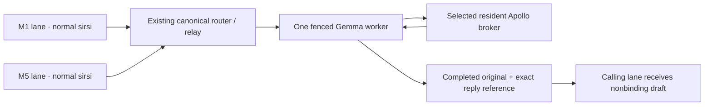
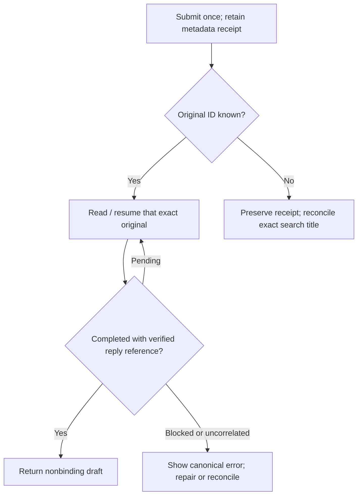

# Use Gemma from a registered lane

The normal `sirsi` command provides shared Gemma drafting to registered lanes on
M5 and M1. Each caller uses its own current actor and thread; the canonical
worker executes the request on its selected resident Apollo broker.

```sh
sirsi gemma shared --wait 15m "Draft a Go function that adds two integers"
sirsi gemma shared --resume ORIGINAL_ITEM_ID --wait 2m
```

The current registered session must supply its own `SIRSI_THREAD_ID` and actor
through `SIRSI_AGENT_ID` or its session marker, with the existing canonical
router configuration. The client checks machine identity, process ancestry or
the supported Codex Desktop resolver, and kernel process start time. It refuses
another lane's identity. Run from your registered session and repair its normal
registration if the check fails.



Prompts must be nonempty UTF-8 and at most 8192 bytes; the client refuses
oversized input rather than shortening it. A wait is bounded to 0–15 minutes.
`--wait 0` submits once and prints the original ID immediately.

Keep the original ID after a timeout or interruption and resume that exact
item. If submission outcome is uncertain, preserve the printed request key,
receipt and search title. Reusing a key never resubmits. Do not create another
key merely to retry an uncertain request. A legacy completion without an exact
reply reference requires manual reconciliation.



The local attempt receipt contains metadata and a prompt digest, not prompt
text. The router proposal contains the full prompt and follows router retention;
the configured relay may stage the payload locally before forwarding. An M1
request can execute on M5. This command does not promise on-device-only data
handling.

Operational recovery, profile selection and worker lifecycle are described in
[Gemma worker recovery](gemma-worker-recovery.md). Normal-command qualification
requires a real request under every registered builder lane's own identity;
installation on a host alone is insufficient proof.

On macOS the router reads process-start identity directly from the kernel before
falling back to `ps`. A restricted caller therefore does not need permission to
launch `ps` merely to prove its own registered runtime. Existing start signatures
retain their local-time, second-resolution format; actor, host, ancestry and PID
generation checks remain mandatory. If neither probe can verify identity, the
request is still refused before submission. This does not grant relay access or
broaden sandbox permissions: the configured relay directory must independently
be writable by the caller's approved execution context.
